<p align="center">
  <picture>
    <source media="(prefers-color-scheme: dark)" srcset="assets/logo-v2-dark.svg">
    
  </picture>
</p>

# Maker Connect

One place for all of a maker's machines: 3D printers, lasers, label printers, and later CNC
machines and cutting plotters, each managed its own way today. Watch them live, control them,
send them files, and see how their jobs go, from a website you host yourself (a Pi, Docker, an
old laptop, a NAS): **the hub**. It runs on your own network, not in someone's cloud. Shaped so
that it could one day be hosted for many makerspaces at once.

A proof of concept, in Rust. Licence: [AGPL-3.0](LICENSE).

<p align="center">
  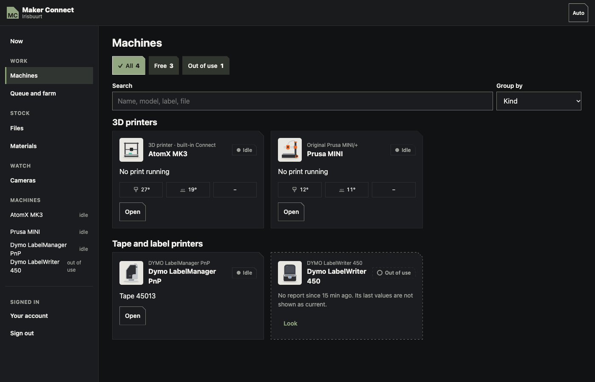
</p>

| | |
|---|---|
| 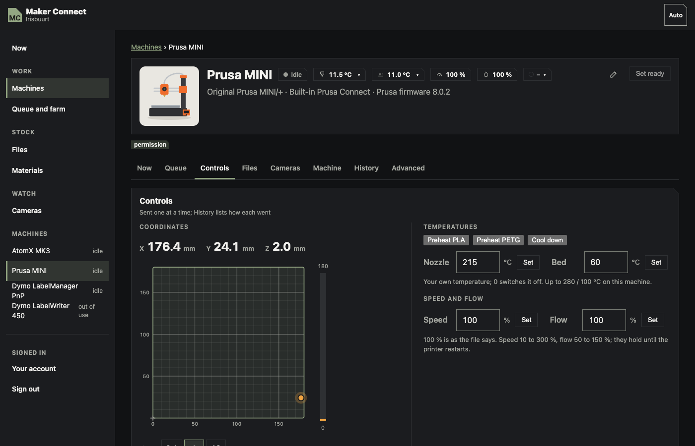 | 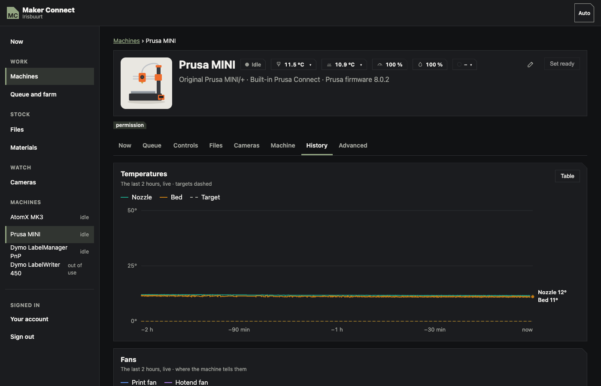 |
| **Control**: the bed with the head where it is, the job, moves, heating, the fan | **Telemetry**: temperatures and fans, live, with a table view |
| 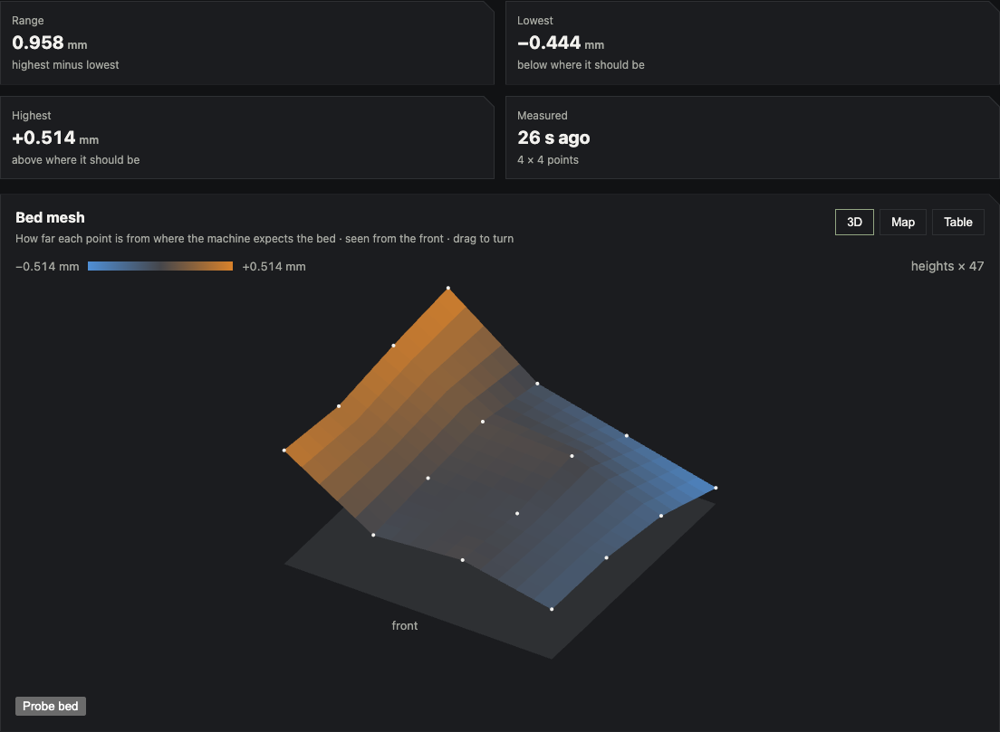 | 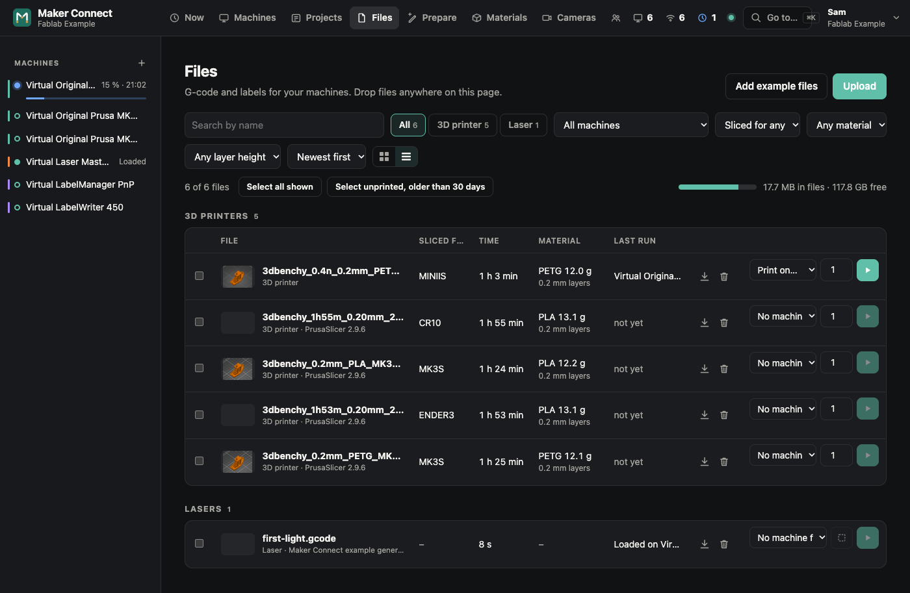 |
| **Bed level**: the mesh as a surface, a map and a table | **Files**: sorted and filtered by type and machine, where each was printed, removed many at once |
| 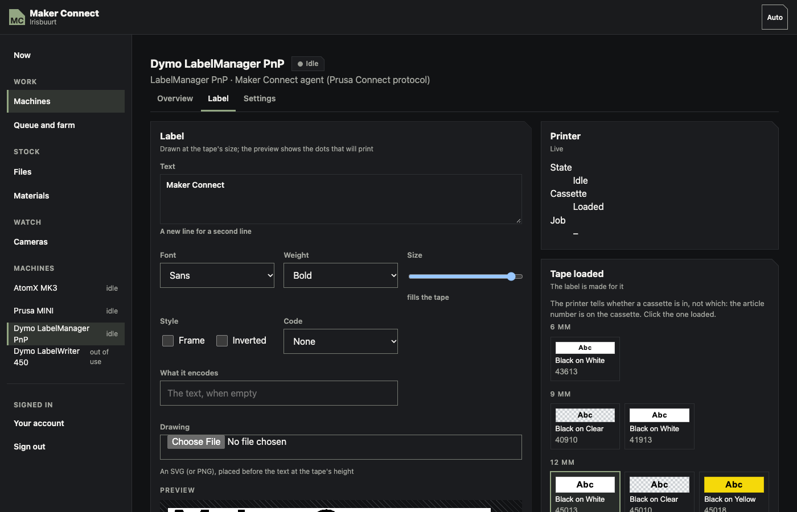 | |
| **Label**: text, a QR code or barcode, a drawing; the preview is the dots that will burn | |
| 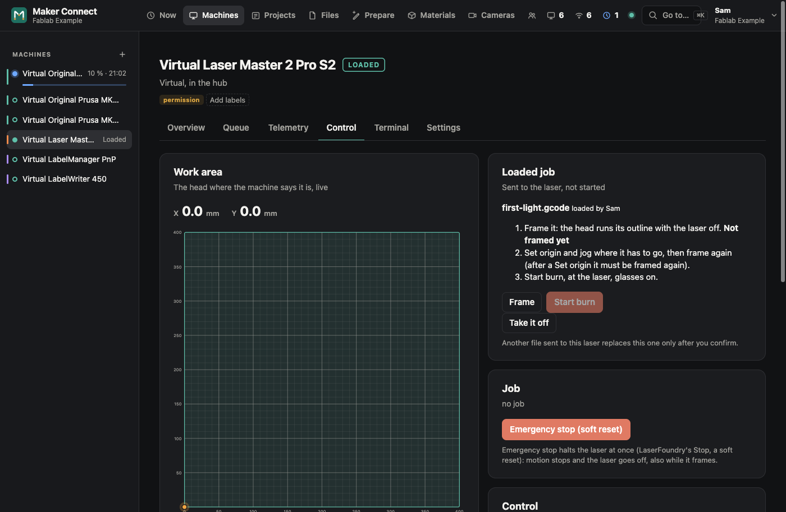 | 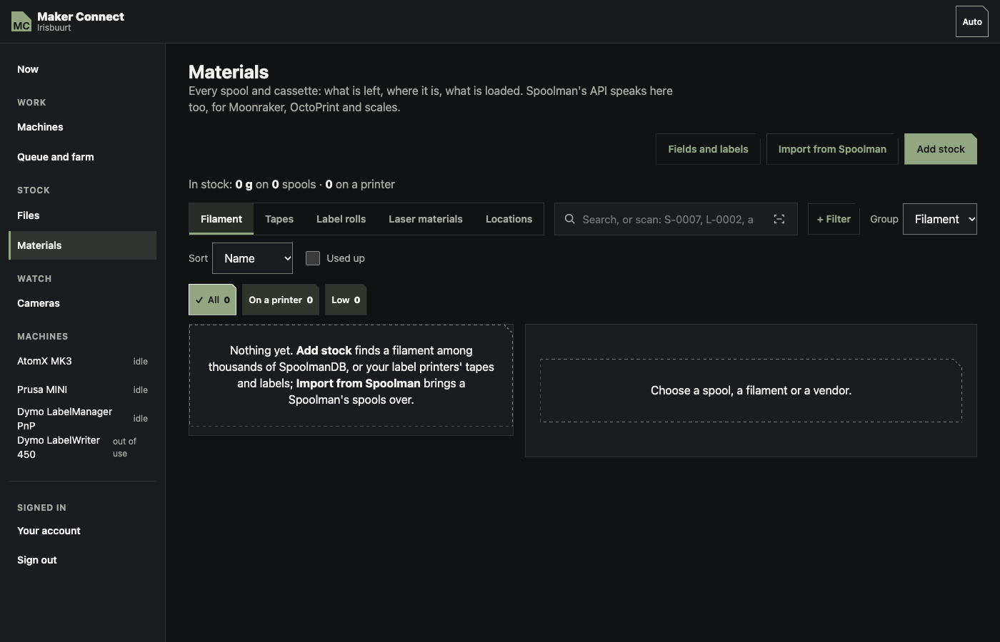 |
| **A laser's Control**: the loaded job is framed, then started by a person at the laser (Start burn); the emergency stop; the jog pad | **Materials**: spools grouped by filament, what is left of each, the chosen one in its inspector; Spoolman's API speaks here too |
| 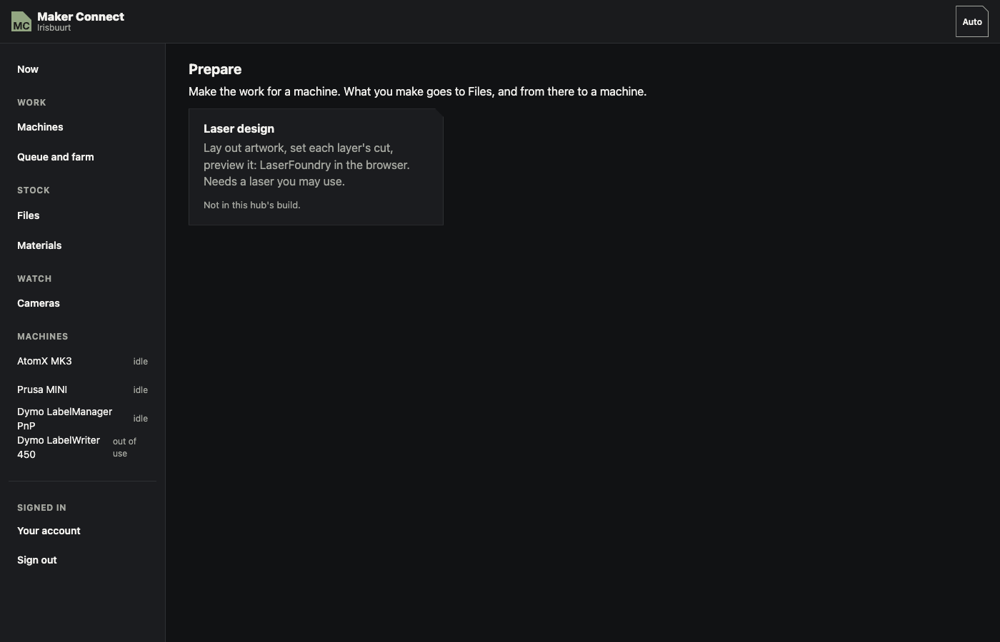 | 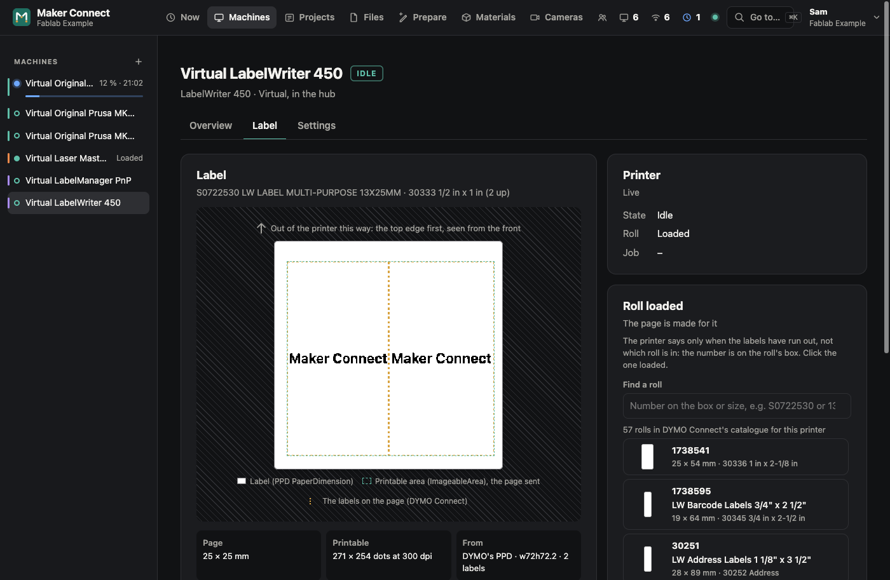 |
| **Prepare**: the tools that make the work; today laser design (LaserFoundry in the browser) | **LabelWriter 450**: the label drawn on the roll loaded, from DYMO Connect's catalogue |
| 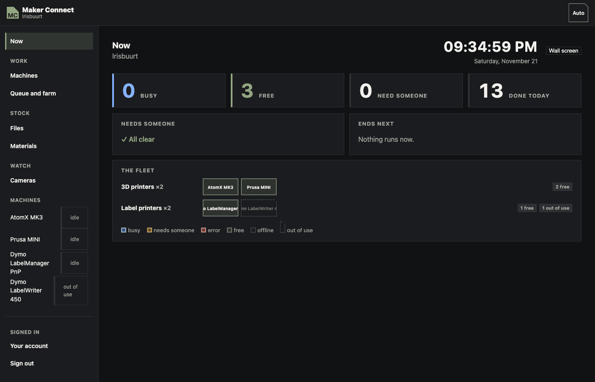 | 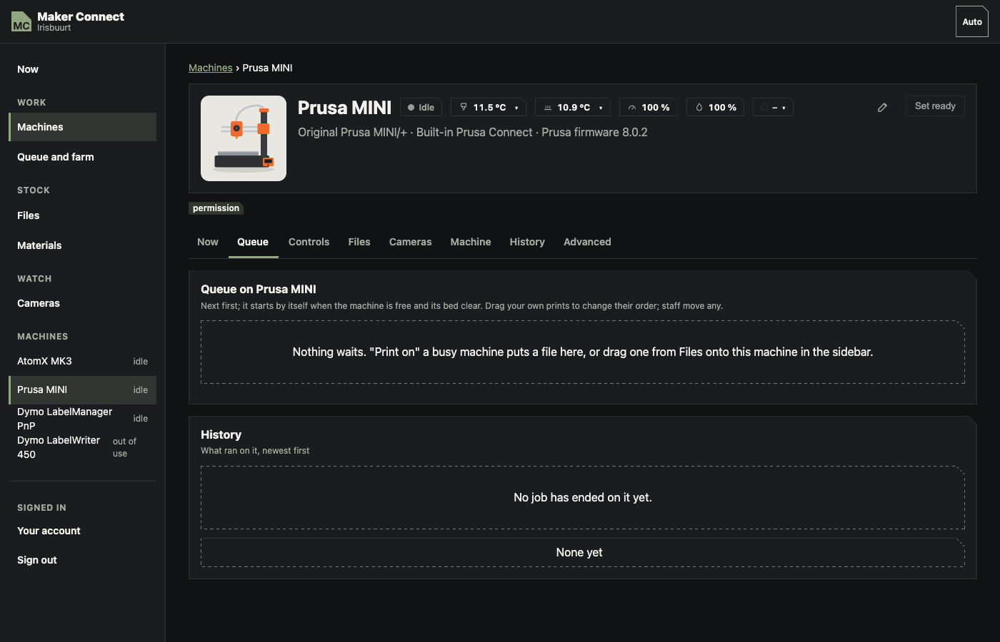 |
| **Now**: what runs, what needs someone, what ends next and who started it, the fleet by kind; also as a wall screen | **Queue**: per machine, next first; it starts by itself once the bed is clear; drag your own prints, staff move any |
| 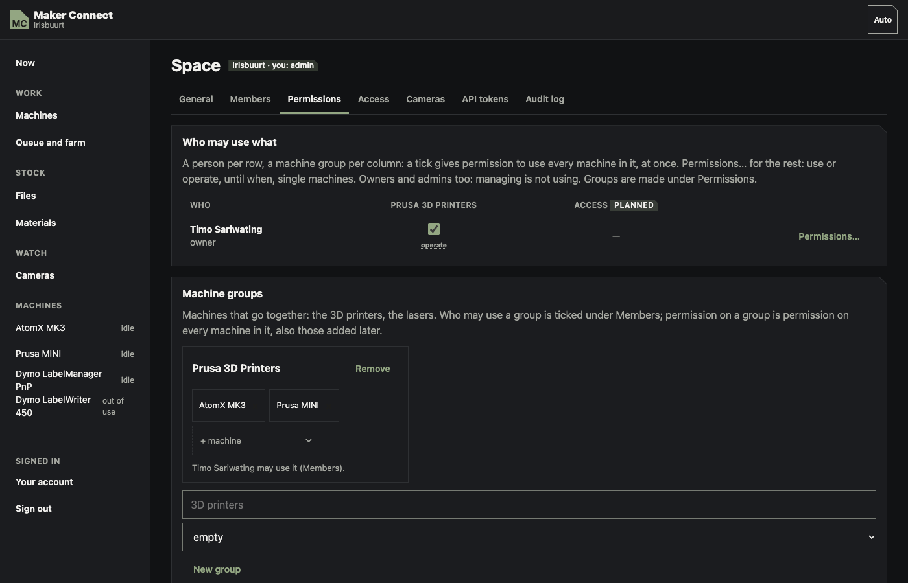 | 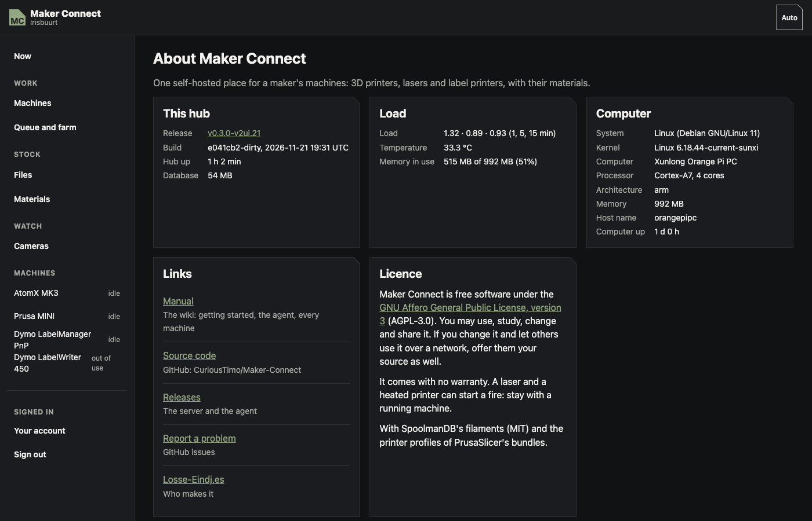 |
| **Members and permissions**: roles, and who may use or operate which machine group, in one matrix | **About**: what runs where, and **Updates** with a way back, from signed releases |

## What works

Every device follows **one working reference to the letter**: the agent's ports are
translations of that reference, file by file, and each is proved against the reference itself
(the audits in [docs/audits](docs/audits/README.md), each with a checker script and a test per
row). What a port does not know, it does not guess.

**One protocol for every device.** Every machine talks to the hub the way a Prusa printer talks
to Prusa Connect: the printer side of the [Prusa Connect SDK](https://github.com/prusa3d/Prusa-Connect-SDK-Printer)
(its `websockets` branch), registration with a code over `/p/register`, then telemetry, events
and commands over the WebSocket `/p/ws`. A Prusa MINI does it with its own firmware; the agent
does it for the machines beside it, a port of the SDK itself. What the SDK has no word for (a
label printer, a laser, a Marlin printer's M115) is an extension written down part by part in
[docs/design/prusa-sdk-extension.md](docs/design/prusa-sdk-extension.md).

- **Machines report themselves.** An agent next to a machine, or the machine's own firmware,
  connects to the hub: no port to open where the machine stands. Add one with the code it
  shows. Every page updates live (server-sent events).
- **A Prusa MINI needs no agent.** Its firmware (Buddy 8.0.2, the current release) connects to the hub over
  Prusa Connect's WebSocket; the hub is the server side of that, after Prusa's own self-hosted
  Prusa Connect. Tried on a real MINI (Buddy 8.0.2): registering, the machine page, moves,
  heating, printing.
- **Printers on Marlin** through the agent: a port of **OctoPrint 1.11.8**'s serial layer,
  proved against OctoPrint itself on its own virtual printer (the same bytes in 22 of 24
  scenarios; the other two differ between OctoPrint's own runs). Files print as jobs from the
  agent's storage, with pause, resume and stop; the terminal shows what the printer answers.
  The printer names itself with M115, so a stock printer gets its profile by itself. **Probe
  bed** measures the bed and draws the mesh as OctoPrint's Bed Level Visualizer reads it (17 of
  17 cases identical). Tried on a real printer: an AtomX MK3 on Marlin 2.1.2.10.
- **Lasers (GRBL)**: a port of [LaserFoundry](https://github.com/StitchFoundry/laserfoundry)
  (v0.6.0): homing, the jog pad, Set origin and Go to origin, Frame. **A laser never starts by
  itself**: a file sent to a laser is *loaded*, framed at the laser (after every Set origin it
  is framed again), and started only by a person there with **Start burn** (permission to
  operate it, safety glasses confirmed, laser mode on). Its Stop is LaserFoundry's soft reset.
  The port is proved and was tried on a real Ortur Laser Master 2 Pro S2 (homing, jogging,
  origin, framing; no burning yet); on the agent it is still to come (issue #89).
- **Prepare: making the work.** A part of its own for the tools that turn an idea into a job
  file; what they make goes to Files, and from there to a machine. Today **laser design** in the
  browser: the hub serves our fork of LaserFoundry's web version (built without Web Serial);
  *Send to <laser>* makes the design that laser's loaded job, and links to its page to frame and
  start it. Slicing and the label editor are to follow.
- **Label printers**, each with its own reference: the **DYMO LabelManager PnP** (tape) as
  [labelle](https://github.com/labelle-org/labelle) does it, and the **DYMO LabelWriter 450**
  (die-cut labels) through a port of **DYMO's own CUPS driver** with the rolls and label
  shapes of DYMO Connect's catalogue. A label printer's page draws the label at the size of
  what is loaded, with QR codes and barcodes. Both print through the agent on the real
  printers (the 450 on S0722530, two labels side by side).
- **Cameras**: network cameras (RTSP) straight to the hub, live in the browser (go2rtc's way,
  checked frame by frame), linked to a machine or a room; an `onvif://` address is resolved to
  the camera's RTSP stream as go2rtc does it. USB webcams through the agent are still to come
  (issue #5).
- **Materials, compatible with [Spoolman](https://github.com/Donkie/Spoolman)**: its model
  (vendors, filaments, spools) and its API at `/api/v1`, measured request by request against
  real Spoolman, so Moonraker's `[spoolman]`, OctoPrint's Spoolman plugin, Mainsail, Fluidd and
  scales use this hub as their Spoolman. A library of spools, a board of locations (dry boxes
  with slots), SpoolmanDB's thousands of filaments, label tapes, scanning and labels.
- **Files, jobs and queues.** Drop G-code or a label on Files; the hub reads what the slicer
  wrote and offers only the machines it fits (and says why not, also when you lack
  permission). Printers have a queue that starts by itself once the bed is clear; lasers take
  one loaded job, no queue.
- **Machine pages**, laid out after Prusa Connect: a head with live chips (nozzle, bed, speed,
  flow) and **Set ready**; tabs Now, Queue, Controls, Files, Cameras, Machine, History, and
  Advanced (terminal, bed level); a state that says what it does (printing, loaded, cooling,
  take the print).
- **331 machine profiles of 99 brands** (3D printers mostly from Marlin's and Klipper's configurations, lasers from LaserFoundry's own preset list), listed in the wiki's [Supported Machines](https://github.com/CuriousTimo/Maker-Connect/wiki/Supported-Machines).
- **Updates with a way back**: signed releases, a trial on a copy of the database, and back by
  itself if the new build does not confirm.

## Supported devices

| Devices | How they connect | The one reference | On real hardware |
|---|---|---|---|
| **Prusa MINI** (Buddy 8.0.2) | Its own firmware, Prusa Connect's WebSocket: no agent | Buddy 8.0.2, Prusa's self-hosted Prusa Connect | Yes: a MINI on Buddy 8.0.2 |
| **3D printers on Marlin** | Agent, USB serial (Linux and macOS; Windows later) | OctoPrint 1.11.8; Bed Level Visualizer 1.1.2 for the mesh | Yes: an AtomX MK3 on Marlin 2.1.2.10 |
| **DYMO LabelManager PnP** (tape) | Agent, USB HID: no driver | labelle | Yes |
| **DYMO LabelWriter 450** (labels) | Agent, USB: no driver | DYMO's CUPS driver 1.4.0, DYMO Connect's catalogue | Yes |
| **Network cameras** (RTSP, ONVIF) | Straight to the hub | retina, go2rtc | Yes: an LSC Smart Connect camera |

Ported and proved, not yet on the agent: **lasers on GRBL** (LaserFoundry v0.6.0, issue #89),
**DYMO M-series scales** (usbscale, #129), **USB webcams** (nokhwa, #5). Still to port: the
**Prusa MK3S and MK2.5S** (PrusaLink, #78). **Klipper** through Moonraker connects by itself,
not yet checked against Moonraker nor tried on a real printer (#9).

| The agent runs on | Build | On real hardware |
|---|---|---|
| Linux ARM64: Raspberry Pi 4 and 5, Orange Pi Zero3 | `linux-aarch64` | Yes: a Raspberry Pi |
| macOS, Apple silicon | `macos-aarch64` | Builds; Windows and macOS are tried again before the first v2 release (#141) |
| Windows 10/11, x64 | `windows-x86_64.exe` | Not yet for v2 (#141) |

Every machine with a profile, by brand: the wiki's
[Supported Machines](https://github.com/CuriousTimo/Maker-Connect/wiki/Supported-Machines).

## Try it

From a [hub release](https://github.com/CuriousTimo/Maker-Connect/releases) (`hub-v…`):
download the hub for the computer it will run on (macOS, Windows, Linux on a PC, a NAS or a Raspberry Pi),
unpack it and start it in its folder:

```sh
./maker-connect-hub                            # http://localhost:8460
```

The agent has releases of its own (`agent-v…`).
The archive brings SpoolmanDB; printer
profiles and filaments are inside the hub. The data is a PostgreSQL 17 database (TimescaleDB's image
`timescale/timescaledb:2.32.0-pg17`), given as `DATABASE_URL` (in the environment: never on the command line, where anyone on the computer can read it) with the hub's own login `maker_connect_hub` (the roles and the restore template come from [scripts/db-roles.sql](scripts/db-roles.sql), run once per server by its superuser; the database is owned by `maker_connect_owner`; the hub refuses a login that is a superuser or owns tables), and the folders
`maker-connect-files/` and `-dumps/` beside `--db /somewhere/maker-connect.db` (the
folder it starts in unless said). The hub dumps the database (`pg_dump`) every night and before an
update into `maker-connect-dumps/` (only for its own user), keeping the last 7 of each
(`--keep-dumps`, our choice); `pg_dump`, `pg_restore` and `psql` must be of the server's version, found on `PATH` (where the
computer has none, as a Raspberry Pi on Debian 11: built from PostgreSQL's source, see
[docs/pi-hub.md](docs/pi-hub.md); `--pg-command` can name a prefix that runs them elsewhere, such as
`docker exec -i -e PGPASSWORD <container>`, which gives the hub the rights of Docker). To upgrade, stop it, unpack the new
release over the old one, start it: the archive holds no data. Or update from **About → Updates**
(Linux and macOS): it dumps the database, tries the new build on a copy restored from that dump, and
goes back by itself, database and build together, if the new build does not work. A Pi set up this
way (the database's container, the hub as a `systemd --user` service): [docs/pi-hub.md](docs/pi-hub.md).
On macOS, the first time: `xattr -d com.apple.quarantine
maker-connect-hub` (the builds are not signed by Apple; the releases are signed with Maker
Connect's own key, which the updates check).

From the source:

```sh
cargo run -p maker-connect-hub                 # http://localhost:8460
```

Then **Add machine** (the ＋ next to "Machines" in the sidebar). A Prusa with built-in Connect
gets a settings file for its USB stick with this hub's address, then you enter the code it shows.
A machine on USB gets the agent:

```sh
./maker-connect-agent                          # its page: http://<this computer>:8470
```

On the agent's page, give the hub's address and switch on the device that is plugged in (a DYMO
LabelManager PnP, a LabelWriter 450, a Marlin printer with its serial port): it shows a code,
which you enter on the hub's Add machine page. [Getting Started](https://github.com/CuriousTimo/Maker-Connect/wiki/Getting-Started)
in the wiki goes through it, [The Agent](https://github.com/CuriousTimo/Maker-Connect/wiki/The-Agent)
has the rest.

## Wiki

Guides and designs live in the [wiki](https://github.com/CuriousTimo/Maker-Connect/wiki):
getting started, the agent, lasers, label printers, materials, machine profiles; the designs
for devices behind smart plugs, a multi-tenant hub, and consumables and stock; and the
roadmap.

## How it is built

| Part | What |
|---|---|
| **hub** (`crates/hub`) | The website and the API: one binary over a Postgres database, uploaded files on disk. Every record belongs to a space |
| **agent** (`crates/agent`) | Next to machines: one program for several devices, each linked to the hub as its own Prusa Connect printer, each running one of the engine's ports; a small page of its own (`:8470`) |
| **connect-sdk** (`crates/connect-sdk`) | A port of Prusa-Connect-SDK-Printer (`websockets` branch, `c0d7d233`): registration, the WebSocket, telemetry, events, commands, downloads |
| **gcode-metadata**, **inotify-simple** | Ports of what the SDK uses: prusa3d/gcode-metadata (`7d8f25d`), inotify_simple 1.3.5 |
| **engine** (`crates/engine`) | The ports, one per device, each a translation of its one reference (OctoPrint, labelle, DYMO's CUPS driver, LaserFoundry, usbscale) |
| **device** (`crates/device`) | The device contract: identity, capabilities, states, commands and results |
| **system** (`crates/system`) | What the computer a hub or an agent runs on is, for the About pages |
| **grbl** (`crates/grbl`) | GRBL machines (lasers), on LaserFoundry's `laserfoundry-device` and `laserfoundry-gcode`; used by the agent |
| **label** (`crates/label`) | Labels as rasters (PNG in, dots out), and the DYMO LabelManager's protocol over USB HID |
| **protocol** (`crates/protocol`) | What agents and the hub say to each other |
| **update** (`crates/update`) | Updating itself, for the hub and the agent: releases checked against the release key, a trial, and the way back; `examples/release-key.rs` makes the key and signs a release |
| **import** (`crates/import`) | Makes machine profiles and the filament catalogue (`filaments/`) from other projects' data (Marlin's example configurations, Klipper's printer configurations, PrusaSlicer's profiles) and the wiki's list of machines: `scripts/import-profiles.sh` |

The tools that make the jobs stay the makers' own: PrusaSlicer and Cura for printers,
LaserFoundry for lasers (also in the browser, served by the hub). Maker Connect takes it from
the file on. Before a commit, `scripts/check.sh` runs the CI checks and every audit's checker. See
[docs/api/integrations.md](docs/api/integrations.md), also for label printers.

## Signing in

Every page and API needs someone signed in; machines prove who they are with their own tokens
(agents, Prusa printers, Moonraker). On a fresh install the hub prints a **setup code** at
start: open it in a browser, and the first account (with that code) runs the server and owns
the first space, which it names. Passwords are kept as Argon2id hashes, sessions as hashes of a
random token in an HttpOnly cookie; a change must come from the site's own pages, and guessing
is slowed down and then refused for a while. Locked out:

```sh
maker-connect-hub reset-password <name> --db maker-connect.db
```

prints a new password and signs that account out everywhere. Behind a proxy with TLS, pass
`X-Forwarded-Proto: https` so the cookie is marked `Secure`.

**Organisations, spaces and roles.** An organisation (a makerspace, a club, a maker at home)
has one or more spaces (its locations, its workshops); every space and organisation has its
own id under the hood, apart from its name. Someone in the organisation is in all its
spaces; someone can also be in one space only. Roles: *owner*, *admin* (machines, members,
tokens), *member* (files, materials, machines), *guest* (looks only). A new machine needs
**permission** (a machine can also be open to every member). An admin gives it per machine
or per **machine group** ("3D printers": every printer in it, also those added later); the
most a member has counts. A member may only *use* it (jobs, labels) or *operate* it (also move, heat,
G-code) as far as an admin gave them, until a date if one is set. New people come in by an
**invite link** (a week, once; no email needed). Everything on the **Space** page, with the
space's **audit log** (who changed what).

**API tokens** (Space page) act in a space with a role: `Authorization: Bearer mct_…`, or in the
address for clients that send no headers, such as Moonraker's Spoolman:

```ini
[spoolman]
server: http://maker-connect.local:8460/t/mct_…
```

Programs that make the work (a laser program such as LaserFoundry, a slicer, a script) send
finished files to a space with such a token: [docs/api/apps-api.md](docs/api/apps-api.md). The file
waits in Files with its machine chosen; nothing starts by itself.

## 💡 Idea, work in progress: a Stream Deck for quick management and overview

> **Idea / WIP — not part of Maker Connect yet.** The pictures below are a demo with made-up data that
> talks to no hub. Nothing here is released; plans and open questions are in
> [#190](https://github.com/CuriousTimo/Maker-Connect/issues/190) and the wiki's
> [Stream Deck](https://github.com/CuriousTimo/Maker-Connect/wiki/Design:-Stream-Deck) page.

An Elgato Stream Deck for quick management and overview, through our fork
[deckhand](https://github.com/CuriousTimo/deckhand): keys that show at a glance what the machines do and
let you act on them in one press; the lockers; and a weigh station
at the desk that scans a spool, weighs it into Materials and books the filament used on the member's
badge.

Printers on the deck (idea) | The weigh station (idea)
---|---
 | 

## Not yet

Lasers, scales and USB webcams on the agent; burning on a real laser; the MK3 port of
PrusaLink; Klipper on real hardware; the agent on Windows and macOS for v2; the Buddy telemetry
fields (the audit's open rows). The open work, in order: the
[roadmap](https://github.com/CuriousTimo/Maker-Connect/issues/144). Values marked `# check` in the
profiles are not yet confirmed on the machines.

**Safety:** a laser and a heated printer can start a fire. Frame a laser job, wear the
glasses, and stay with a running machine. The jog pad keeps the laser off, but it moves a real
head: home first, and keep hands out of the work area.

## References and credits

- [LaserFoundry](https://github.com/StitchFoundry/laserfoundry) (MIT OR Apache-2.0): its
  `laserfoundry-device` and `laserfoundry-gcode` crates drive GRBL lasers here, as a dependency;
  the laser design page is our fork of its web version
  ([CuriousTimo/laserfoundry](https://github.com/CuriousTimo/laserfoundry), branch `maker-connect`).
- DYMO's CUPS driver 1.4.0 (GPL-2.0 or later) and CUPS 2.4.20 (Apache-2.0): ported for the
  LabelWriter 450; DYMO Connect's label catalogue read for its rolls.
- [usbscale](https://github.com/erjiang/usbscale) (GPL-3.0): the DYMO scale's reports.
- [retina](https://github.com/scottlamb/retina) (MIT OR Apache-2.0) for RTSP, and
  [go2rtc](https://github.com/AlexxIT/go2rtc) (MIT) for live video in the browser.
- [nokhwa](https://github.com/l1npengtul/nokhwa) (Apache-2.0) for USB webcams, and FFmpeg's
  `mjpeg2jpeg` (LGPL-2.1 or later) for their missing Huffman tables.
- [OctoPrint](https://github.com/OctoPrint/OctoPrint) (AGPL-3.0): its serial layer is ported
  for Marlin printers.
- The [Prusa Connect SDK](https://github.com/prusa3d/Prusa-Connect-SDK-Printer) (printer side,
  "Freeware" in its `setup.py`) and [PrusaLink](https://github.com/prusa3d/Prusa-Link): the
  agent's link to the hub is a port of the SDK, with PrusaLink as the example of using it.
  Prusa-Firmware-Buddy (GPL-3.0 code) and Prusa's self-hosted Prusa Connect: read for the
  protocol's both sides (the Connect server is read, not ported).
- [gcode-metadata](https://github.com/prusa3d/gcode-metadata) (LGPL-2.0 or later) and
  [inotify_simple](https://github.com/chrisjbillington/inotify_simple) (BSD-2-Clause): ported,
  as the SDK uses them.
- [OctoPrint-BedLevelVisualizer](https://github.com/jneilliii/OctoPrint-BedLevelVisualizer)
  1.1.2: its reading of a printer's mesh, ported for Probe bed.
- [thermal-label](https://thermal-label.github.io/) (MIT): the DYMO LabelManager's protocol and
  its media list; [labelle](https://github.com/labelle-org/labelle) (Apache-2.0) for the same
  protocol in practice. Notes: [docs/api/integrations.md](docs/api/integrations.md).
- [Marlin's example configurations](https://github.com/MarlinFirmware/Configurations)
  (GPL-3.0): the facts (sizes, temperatures, names) the 3D printer profiles are made from.
- [Klipper's printer configurations](https://github.com/Klipper3d/klipper/tree/master/config)
  (GPL-3.0): the same facts for the printers Marlin's examples do not have.
- [PrusaSlicer's vendor profiles](https://github.com/prusa3d/PrusaSlicer-settings-prusa-fff)
  (shipped with [PrusaSlicer](https://github.com/prusa3d/PrusaSlicer), AGPL-3.0): the facts
  (type, density, empty spool, temperatures, price) the filament catalogue is made from.
- [qrcode](https://crates.io/crates/qrcode) and [barcoders](https://crates.io/crates/barcoders)
  (both MIT OR Apache-2.0): QR codes and barcodes on labels.

`reference/` holds read-only clones of these projects for study; it is not part of this
repository. Maker Connect is independent of the makers of the machines and software it names.
