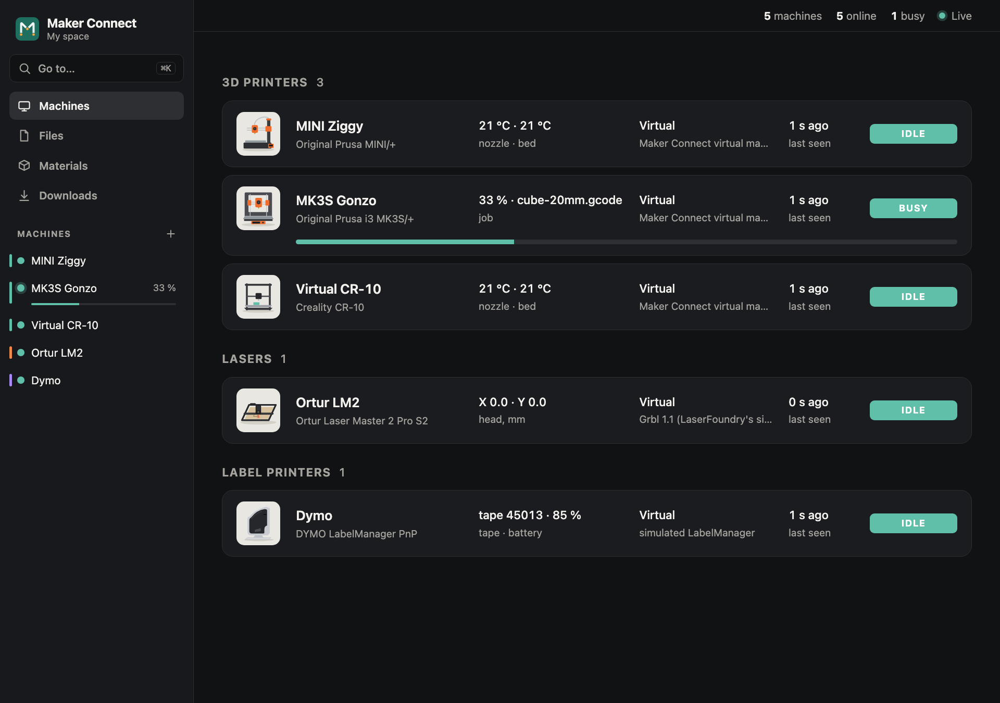
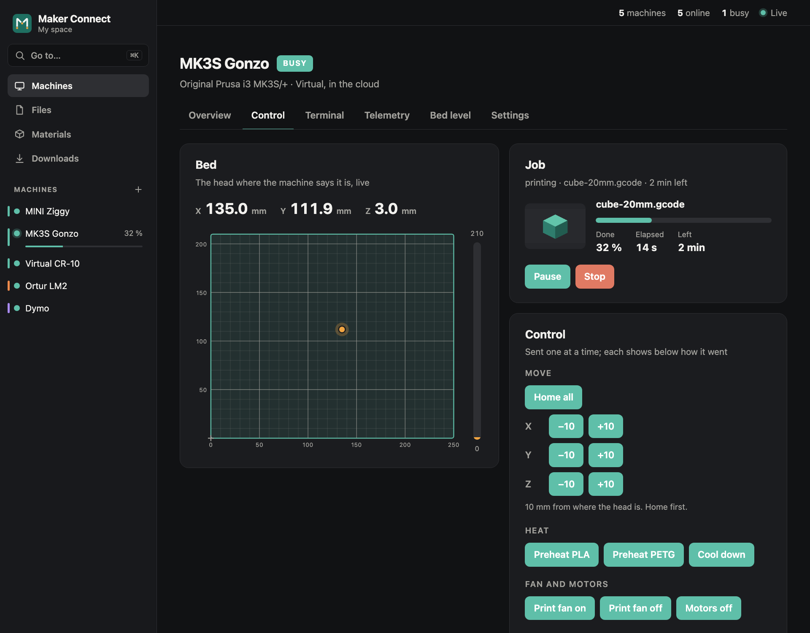
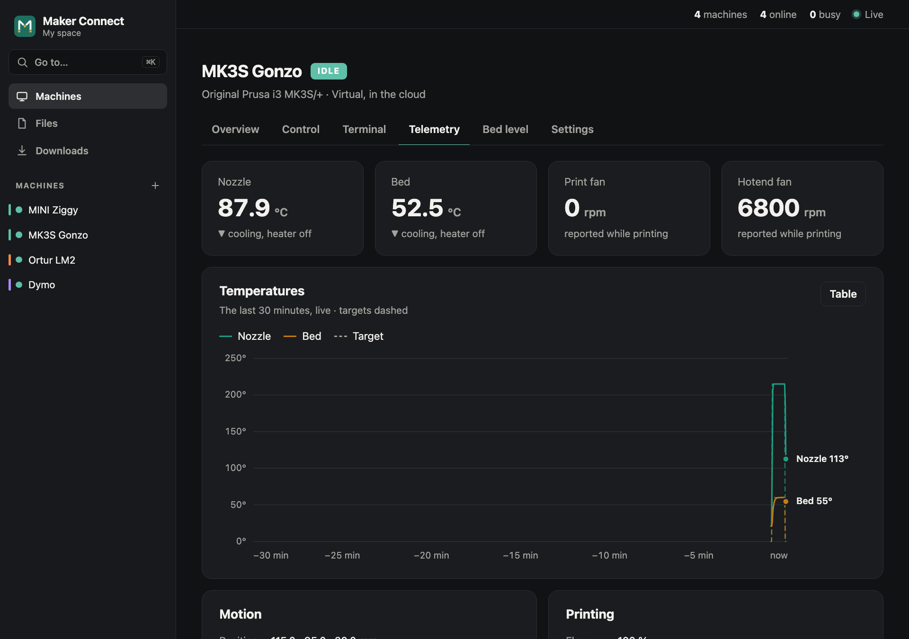
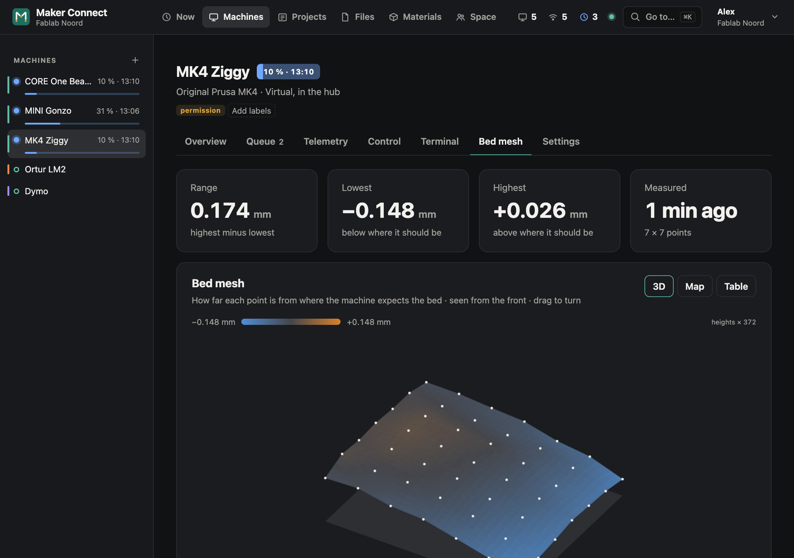
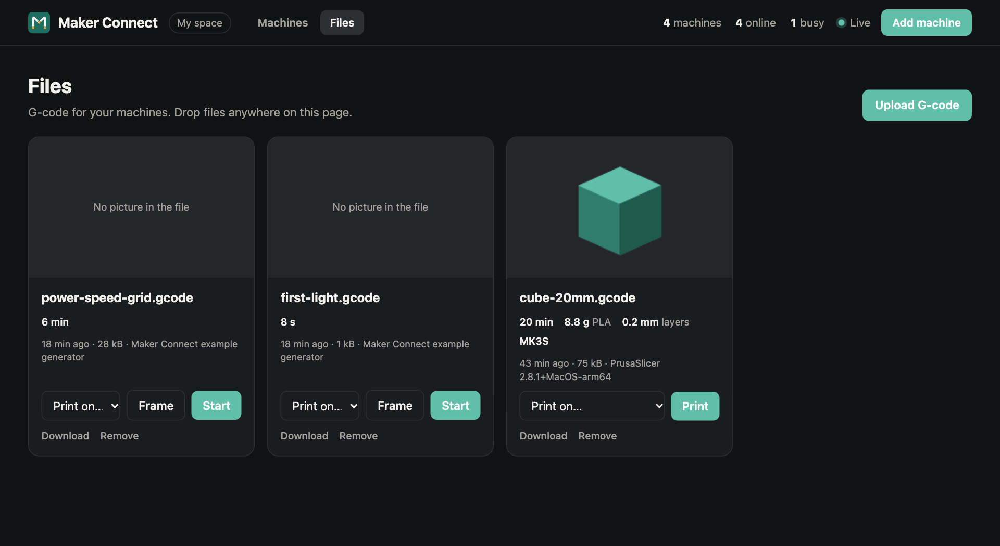
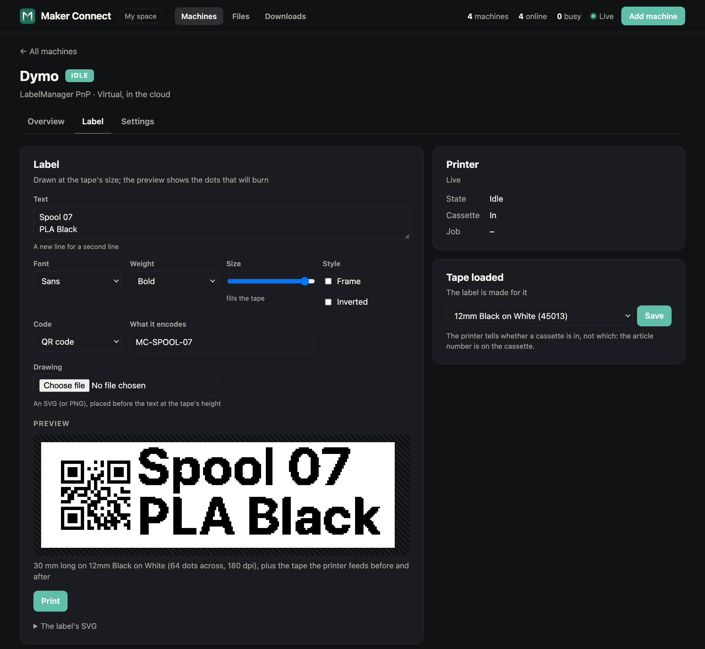
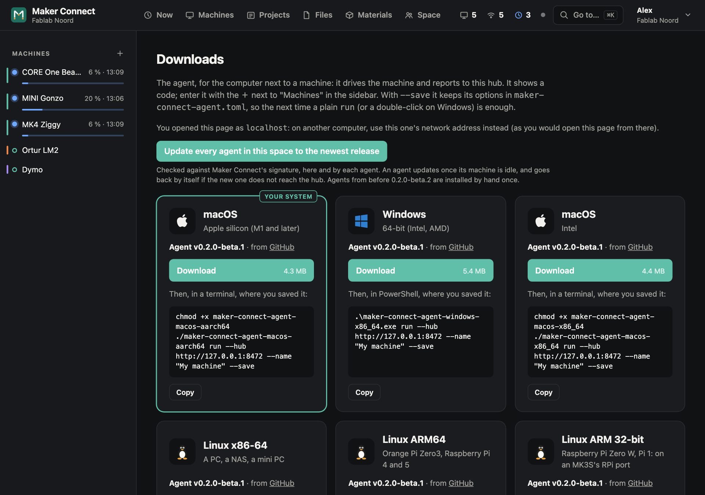
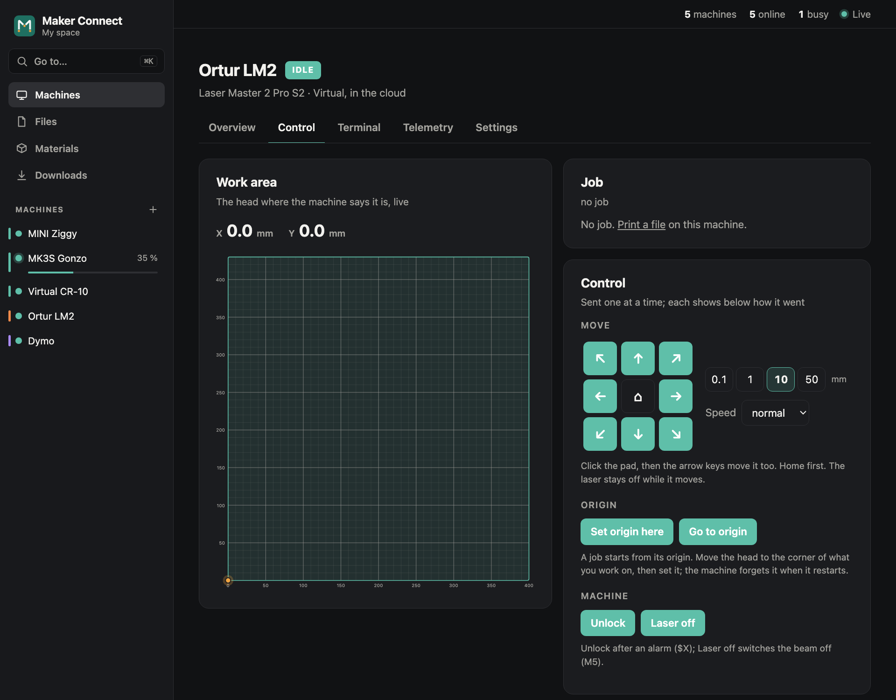
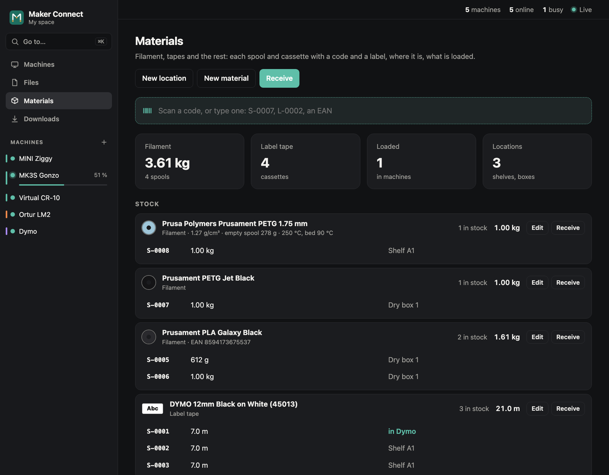

<p align="center">
  <picture>
    <source media="(prefers-color-scheme: dark)" srcset="assets/logo-dark.svg">
    
  </picture>
</p>

# Maker Connect

One place for all of a maker's machines: 3D printers, lasers, label printers, and later CNC
machines and cutting plotters, each managed its own way today. Watch them live, control them,
send them files, and see how their jobs go, from a website you host yourself (a Pi, Docker, an
old laptop, a NAS). Shaped so that it could one day be hosted for many makerspaces at once.

A proof of concept, in Rust. Licence: [AGPL-3.0](LICENSE).

<p align="center">
  
</p>

| | |
|---|---|
|  |  |
| **Control**: the bed with the head where it is, the job, moves, heating, the fan | **Telemetry**: temperatures and fans, live, with a table view |
|  |  |
| **Bed level**: the mesh as a surface, a map and a table | **Files**: sorted and filtered by type and machine, where each was printed, removed many at once |
|  |  |
| **Label**: text, a QR code or barcode, a drawing; the preview is the dots that will burn | **Downloads**: the agent for each platform, with the command for this cloud |
|  |  |
| **A laser's Control**: a jog pad (eight directions, a step from 0.1 to 50 mm, the arrow keys), the job's origin set where the head is | **Materials**: each spool and cassette with a code and a label, where it is, what is loaded |

## What works

- **Machines report themselves.** An agent next to a machine, or the machine's own firmware,
  connects to the cloud: no port to open where the machine stands. Add one with the code it
  shows. Every page updates live (server-sent events).
- **A Prusa MINI needs no agent.** Its firmware speaks Prusa Connect; the cloud speaks the
  printer side of that protocol. Point the MINI's Connect settings at your cloud and it
  registers, reports, and takes commands. Tried on a real MINI (firmware 6.3.0).
- **Printers on USB** through the agent: Marlin and Prusa's 8-bit firmware (line numbers,
  checksums, resends), recognised by what they say (`M115`, `M862.2 Q`). Files print on
  them as jobs: streamed by the agent with progress, time left and the temperatures as it
  goes (`M155`), paused between two lines, stopped with heaters and motors off. Tested
  against a simulated printer; the first real print is still to come.
- **Lasers (GRBL)** through the agent, with [LaserFoundry](https://github.com/Stitchwright/laserfoundry)'s
  device crate: homing; a jog pad (eight directions, a step of 0.1, 1, 10 or 50 mm, a speed,
  the arrow keys) moving by GRBL's own jogs with the laser off; the job's origin set where the
  head is (`G92 X0 Y0`) and gone back to; the controller's settings checked before a job
  (laser mode, full power, travel), Frame (the outline with the laser off), streaming by GRBL's
  character counting, pause, resume, stop (laser off), and starting an interrupted job again a
  little before where it stopped. Not yet tried on a real laser.
- **Label printers (DYMO LabelManager PnP)** through the agent, over USB HID: no DYMO
  software, no driver, no mode switch. A label printer's page draws the label as SVG (text,
  frame, a drawing you add) at the tape's size and shows the dots that will burn; Print sends
  them, with a QR code or a barcode (Code 128, EAN-13) on whole dots if you like. Tried on a
  real PnP from a Mac and from a Windows laptop (12 mm tape); you say which tape is loaded, since the
  printer only tells whether a cassette is in.
- **Materials** (the stock): filament and label tapes (drawn as they look); each spool and cassette
  an item with a code (`S-0007`) and a QR label printed on the label printer, locations
  (`L-0003`), loading into a machine (a tape tells the label printer which it has), weighing,
  used up; every change kept as a movement. A barcode scanner works anywhere on the page.
  **271 filaments** (Prusament, Devil Design, Fiberlogy, colorFabb…) from PrusaSlicer's
  profiles, found by typing (typos forgiven), with density, empty spool weight and
  temperatures: weigh a spool and the spool is taken off. A material has a colour and a
  colour name (*Galaxy Black*), and can be changed later.
- **Files and jobs.** Drop G-code on the Files page; the cloud reads what the slicer wrote
  (time, filament, layer height, the printer it was sliced for, the thumbnail) and offers only
  the machines it fits. Jobs show progress, time left, pause and stop.
- **The machine list**: every machine in the same columns, grouped by kind: name and model,
  what it does now (its job, temperatures, the head, the tape and battery), how it connects
  and its firmware, when it was last seen, its state.
- **Machine pages**: Overview, Control, Terminal (G-code and the machine's answers),
  Telemetry, Bed level (Prusa `G80`/`G81`, Marlin `G29`/`M420 V`, read the way the OctoPrint
  Bed Level Visualizer does), Settings.
- **250 machine profiles of 85 brands** (`profiles/`, one TOML file per model): most 3D
  printers made from [Marlin's example configurations](https://github.com/MarlinFirmware/Configurations)
  (`scripts/import-profiles.sh`), recognised from what they say to `M115`; by hand the Prusas,
  the Ortur laser and the DYMO with its tapes. Chosen with a searchable picker; listed in the
  wiki's [Supported Machines](https://github.com/CuriousTimo/Maker-Connect/wiki/Supported-Machines).
- **Virtual machines** for every profile, to try everything without a machine: printers home,
  heat, move, measure their bed and play files (ten times faster than real); virtual lasers
  run on LaserFoundry's simulated GRBL, through the same code as a real one; a virtual label
  printer takes labels and "prints" them at a real one's pace.

## Supported devices

| Devices | How they connect | What works | On real hardware |
|---|---|---|---|
| **Prusa MINI** (Buddy firmware) | Its own firmware speaks Prusa Connect to the cloud: no agent | Registers with a code, reports, takes commands | Yes: a MINI on firmware 6.3.0 |
| **3D printers on Marlin**: 245 models (Creality, Anycubic, Artillery, …) | Agent, on USB | Recognised from `M115`; live temperatures, moves, heating, bed mesh, terminal; **prints files** (pause, resume, stop) | Not yet: tested against simulated printers |
| **Prusa on 8-bit firmware**: MK3S, MK2.5S | Agent, on USB or an MK3S's RPi port (a Pi Zero W) | As Marlin, recognised from `M862.2 Q` | Not yet: an MK3S with its Pi Zero W is the first to try |
| **Lasers on GRBL**: Ortur Laser Master 2 Pro S2, other GRBL 1.1 | Agent, on USB, with LaserFoundry's device crate | Homing, the jog pad, the job's origin, settings checked, Frame, jobs streamed, pause, resume, stop, restart where it stopped | Not yet: tested against LaserFoundry's simulated GRBL |
| **Label printers**: DYMO LabelManager PnP | Agent, on USB HID: no driver, no DYMO software | Labels from the editor (text, QR codes, barcodes, drawings), tapes, cassette and battery | Yes: from a Mac and a Windows laptop, 12 mm tape |
| **A virtual one of every profile** | Simulated in the cloud | Printers home, heat, measure and print; lasers on simulated GRBL; label printers print | – |

| The agent runs on | Build | On real hardware |
|---|---|---|
| macOS, Apple silicon | `macos-aarch64` | Yes |
| Windows 10/11, x64 | `windows-x86_64.exe` | Yes |
| Linux ARM64: Orange Pi Zero3, Raspberry Pi 4 and 5 | `linux-aarch64` | Not yet |
| Linux ARM 32-bit: Raspberry Pi Zero W (an MK3S's RPi port), Pi 1 | `linux-armv6` | Not yet |
| Linux x86-64: a PC, a NAS | `linux-x86_64` | Not yet |

Every machine with a profile, by brand: the wiki's
[Supported Machines](https://github.com/CuriousTimo/Maker-Connect/wiki/Supported-Machines).

## Try it

```sh
cargo run -p maker-connect-cloud                 # http://localhost:8460
```

Then the ＋ next to "Machines" in the sidebar (or ⌘K, *Add a machine*), "A virtual one", and pick a printer, a laser or a label printer. For a real
machine, the cloud's **Downloads** page has the agent for each platform, with the command to
start it: [Getting Started](https://github.com/CuriousTimo/Maker-Connect/wiki/Getting-Started)
in the wiki goes through it, [The Agent](https://github.com/CuriousTimo/Maker-Connect/wiki/The-Agent)
has its options and its config file.

## Wiki

Guides and designs live in the [wiki](https://github.com/CuriousTimo/Maker-Connect/wiki):
getting started, the agent, lasers, label printers, materials, machine profiles; the designs
for devices behind smart plugs, a multi-tenant cloud, and consumables and stock; and the
roadmap.

## How it is built

| Part | What |
|---|---|
| **cloud** (`crates/cloud`) | The website and the API: one binary, one SQLite file, uploaded files beside it. Every record belongs to a space |
| **agent** (`crates/agent`) | Next to a machine: drives it over USB, reports to the cloud, carries out its commands and jobs |
| **grbl** (`crates/grbl`) | GRBL machines (lasers), on LaserFoundry's `laserfoundry-device` and `laserfoundry-gcode`; used by the agent and by the cloud's virtual lasers |
| **label** (`crates/label`) | Labels as rasters (PNG in, dots out), and the DYMO LabelManager's protocol over USB HID |
| **protocol** (`crates/protocol`) | What agents and the cloud say to each other |
| **import** (`crates/import`) | Makes machine profiles and the filament catalogue (`filaments/`) from other projects' data (Marlin's example configurations, PrusaSlicer's profiles) and the wiki's list of machines: `scripts/import-profiles.sh` |

The tools that make the jobs stay the makers' own: PrusaSlicer and Cura for printers,
LaserFoundry for lasers. Maker Connect takes it from the file on. See
[docs/integrations.md](docs/integrations.md), also for label printers.

## Not yet

No login: run it where only you can reach it, since anyone who reaches it can move your
machines (and download the agent). Label printers other than the DYMO LabelManager PnP, and
codes scanned off real labels, are still to try. Files for the MINI over Prusa Connect, binary G-code (`.bgcode`), queues and a G-code viewer are still to come. Values
marked `# check` in the profiles are not yet confirmed on the machines.

**Safety:** a laser and a heated printer can start a fire. Frame a laser job and start at low
power; stay with a running machine. The jog pad keeps the laser off, but it moves a real head:
home first, and keep hands out of the work area.

## References and credits

- [LaserFoundry](https://github.com/Stitchwright/laserfoundry) (MIT OR Apache-2.0): its
  `laserfoundry-device` and `laserfoundry-gcode` crates drive GRBL lasers here, as a dependency.
- [OctoPrint](https://github.com/OctoPrint/OctoPrint) (AGPL-3.0): the reference for talking to
  printers; its Bed Level Visualizer plugin (MIT) for the mesh formats.
- Prusa-Firmware-Buddy (GPL-3.0 code) and Prusa-Firmware: read to learn the Prusa Connect
  protocol and the printers' replies. Prusa Link and the Prusa Connect SDK ("Freeware") were
  read to understand, never copied. Notes: [docs/printer-protocols.md](docs/printer-protocols.md).
- [thermal-label](https://thermal-label.github.io/) (MIT): the DYMO LabelManager's protocol and
  its media list; [labelle](https://github.com/labelle-org/labelle) (Apache-2.0) for the same
  protocol in practice. Notes: [docs/integrations.md](docs/integrations.md).
- [Marlin's example configurations](https://github.com/MarlinFirmware/Configurations)
  (GPL-3.0): the facts (sizes, temperatures, names) the 3D printer profiles are made from.
- [PrusaSlicer's vendor profiles](https://github.com/prusa3d/PrusaSlicer-settings-prusa-fff)
  (shipped with [PrusaSlicer](https://github.com/prusa3d/PrusaSlicer), AGPL-3.0): the facts
  (type, density, empty spool, temperatures, price) the filament catalogue is made from.
- [qrcode](https://crates.io/crates/qrcode) and [barcoders](https://crates.io/crates/barcoders)
  (both MIT OR Apache-2.0): QR codes and barcodes on labels.

`reference/` holds read-only clones of these projects for study; it is not part of this
repository. Maker Connect is independent of the makers of the machines and software it names.
