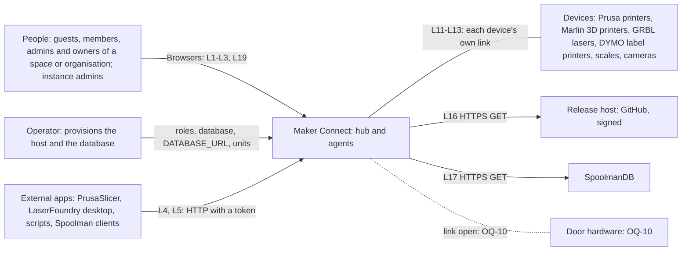
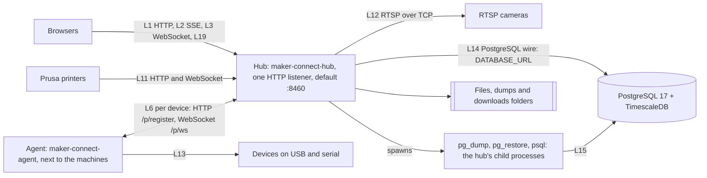
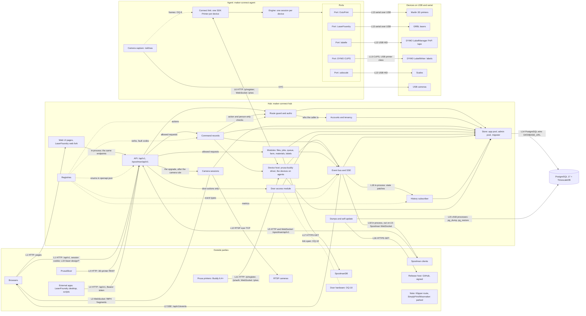
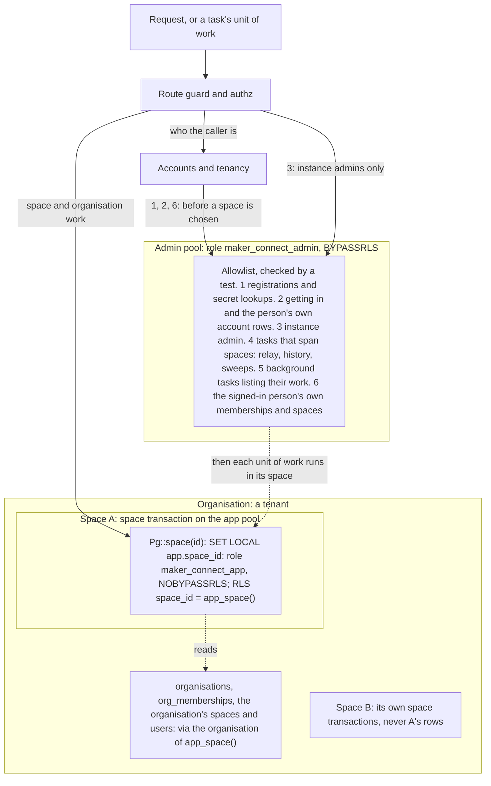
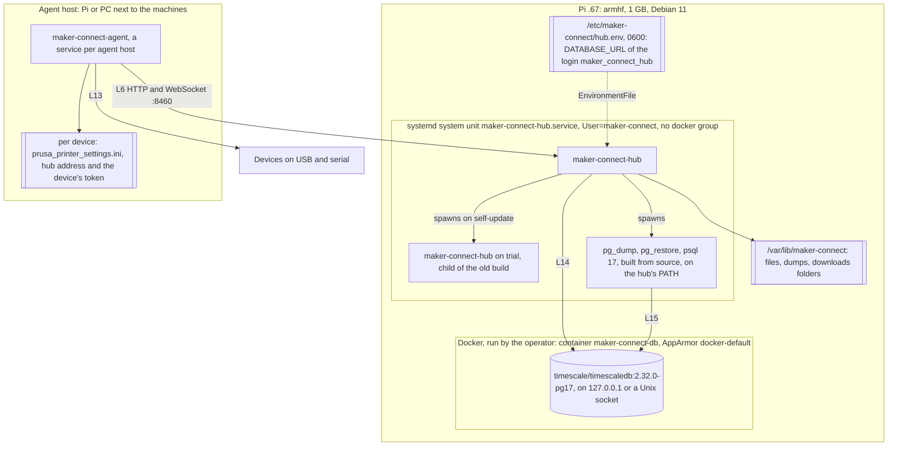

# System architecture

The building blocks of Maker Connect v2 and how they talk to each other: the foundation the other
chapters fit into. Each block below has the same name in every chapter; the chapters go one level
deeper ([processes.md](processes.md) for tasks and processes, [links.md](links.md) for every link
L1-L19, [flows.md](flows.md) for sequences). An arrow points from the side that opens the
connection or sends; its label names the link (L-number) and the transport. An arrow between two
blocks of the same process is a call inside that process and carries no L-number, except the event
bus (L18).

The views, from far to near (C4-style levels): [context](#level-1-context) (Maker Connect among people,
devices and outside services), [containers](#level-2-containers) (hub, agent, database, browser),
[components](#level-3-components) (the blocks inside the hub and the agent, with their tables below),
then [accounts and tenancy](#accounts-and-tenancy-the-organisation-and-space-boundary),
[the rules on who may depend on whom](#may-depend-on), the [deployment](#deployment) and
[the agent](#the-agent-update-credentials-settings-page).

## Level 1: context

Roles are those of [authz.md](authz.md#presets-roles-and-grants); the operator is the one who
provisions ([storage-ops.md](storage-ops.md#provisioning-the-database)).

## Level 2: containers

One hub per installation, any number of agents ([processes.md](processes.md#processes)). The database is
reached only by the hub and its dump tools.

## Level 3: components

The Klipper note has no arrow: the SimplyPrint/Moonraker route is parked (plan §3, [links.md](links.md#the-links)).

## Accounts and tenancy: the organisation and space boundary

Every request and every unit of work is in one space. Its rows are reached in a **space transaction**
on the app pool (`Pg::space(id)`); the one exception is an organisation role change, which walks the
organisation's spaces in one transaction with `Pg::org_spaces(space_id)`; the admin pool is for the allowlist of [database.md](database.md#roles-and-pools)
only. Organisation rows are seen from a space of that organisation.

- An organisation admin's work (rename, org membership, removing a member, open spaces, listing its
  spaces) is a space transaction of a space of that organisation; the guard checks the org role. It is
  not allowlist #3 ([database.md](database.md#roles-and-pools)).
- Moving a device to another space is #3; its history stays behind
  ([decision](decisions/20261119-device-move.md)).
- An **agent is a host, not a tenant row**, and it has no identity on the link: each device on it
  registers as a Prusa Connect printer of its own, with its own token, belongs to its own space, has
  what it sends applied in that space's transaction, and gets only its own commands on its own socket
  ([decision](decisions/20261120-agent-link-is-prusa-connect-protocol.md)). What is done to the agent
  itself, its update, is the instance admin's: no space may break a host other spaces share
  ([decision](decisions/20261119-agent-update-by-instance-admin.md)); how it reaches the agent is
  [OQ-46](risks-and-open.md#oq-46-how-the-agents-own-update-reaches-it).
- `organisation.manage` comes from an organisation role only; a space admin without one does not
  reach the organisation ([decision](decisions/20261119-organisation-actions-by-organisation-role.md)).
- The rule on the request path is [authz.md](authz.md#tenancy).

## May depend on

An in-process arrow of the [component diagram](#level-3-components) is the only dependency a block may
have on another block; anything else is a defect or a design change first
([README](README.md)). The arrow points from the block that calls to the block it may depend on.

| Block | May depend on |
|---|---|
| Web UI pages | API |
| API | Route guard and authz; Command records; Modules; Door access module (door actions only); Camera sessions (the upgrade, after the guard's camera rule: `device.view` on the watched device, or `room_view_role` for a room camera); Registries |
| Route guard and authz | Accounts and tenancy; Registries; Store. It decides and never dispatches ([decision](decisions/20261119-architecture-approved.md)) |
| Accounts and tenancy | Store |
| Command records | Route guard and authz (the action and person-only checks of every command, whoever asks: a person, a token, the queue); Device host; Event bus and SSE; Registries; Store |
| Modules | Event bus and SSE; Store; Command records (a job start is a command) |
| Door access module | Event bus and SSE; Store |
| Event bus and SSE | Store; Registries |
| History subscriber | Event bus and SSE (as a subscriber); Registries; Store |
| Device host | Event bus and SSE; Store |
| Camera sessions | Store |
| Registries | nothing |
| Store | nothing in-process; the database (L14) |
| Dumps and self-update | nothing in-process; the dump tools (L15), the Release host (L16) |
| Agent: Connect link | Engine |
| Agent: Engine | Ports |
| Agent: Ports | nothing; no port depends on another (no shared code between the LabelManager and LabelWriter stacks) |
| Agent: Camera capture | Connect link ([OQ-9](risks-and-open.md#oq-9-how-usb-camera-video-reaches-the-hub)) |

Only Store reaches the database, and only Registries are read by many without depending on anything.
The route guard is a decision: who the caller is, which action is needed, whether it is held. It
calls no module, command record or device; the API hands an allowed request on.

**Planned test, not built:** `architecture_dependencies_hold` (in `crates/hub/tests/architecture.rs`,
one of the same name for the agent crate). It reads every `crate::` path of each source module, maps
the module to its block through a checked-in map file (`crates/hub/tests/blocks.map`: one line per
module path and its block; a module missing from the map fails the test) and fails on a dependency
the table does not have, both ways listed in the failure. The modules are moved to one module per
block inside the device, authz and history steps, not as a step of their own
([decision](decisions/20261119-block-map-file.md)).

## The blocks

### Hub

| Block | Responsible for | Owns | Talks to, over | Must never |
|---|---|---|---|---|
| Web UI pages | The pages people use, server-rendered ([decision](decisions/20261118-ui-server-rendered.md)); the LaserFoundry web fork under `/laser-design/*` (L19) | page templates, static assets in the binary | API (in-process, the same endpoints); browsers (L1 HTTP) | change data on a GET page route; do anything the API cannot (plan §2.9) |
| API | `/api/v1` (ours, the 3D-printer REST after Prusa Connect, owner ruling R3) and `/spoolman/api/v1` (Spoolman to the letter) | the generated `docs/api/openapi.json` | browsers (L1, L19), PrusaSlicer and external apps (L4), Spoolman clients (L5); Route guard and authz for the decision, then Command records, Modules, Door access module or Camera sessions with the allowed request (in-process); Registries (enums in the spec) | serve a route that names no action (plan §2.6, hub-core-v2.md:151); grant an action outside the Space API (plan §1, hub-core-v2.md:27) |
| Accounts and tenancy | Sign-in, sessions, API tokens, invites; organisations, spaces and memberships; the audit log; opens the space transaction a request runs in | `organisations`, `spaces`, `users`, `identities`, `memberships`, `org_memberships`, `sessions`, `invites`, `api_tokens`, `audit_log` ([database.md](database.md#tenancy-and-accounts)) | called by Route guard and authz (in-process); Store | read or write a space's rows outside its space transaction; use the admin pool outside allowlist #1, #2, #3 and #6 ([database.md](database.md#roles-and-pools)) |
| Route guard and authz | Who the caller is (cookie, API token, through Accounts and tenancy), which action a route needs, whether the caller holds it on the device; person-only verbs | `device_access`, grants, roles, `authz_epoch` (through Store) | Accounts and tenancy; Registries (actions); Store; all in-process. It answers allowed or refused with a fault code; the API dispatches | call a module, a command record or a device: it only decides; let an unknown route through; accept a person-only verb from a token, the queue or an agent; grant permissions anywhere but Space, where an admin or owner sets them, their own included (plan §1, hub-core-v2.md:27; owner 2026-11-06, no "give myself permission" shortcut); let a door action grant a machine action or a machine grant open a door (plan §2.6, hub-core-v2.md:158-159; owner 2026-11-06) |
| Command records | Every verb on every device as a durable record from request to outcome; host-side checks (set, arguments, state) | `commands`, `transfers` | Route guard and authz (action and person-only checks); Device host; Event bus and SSE; Store; Registries (verbs, fault codes); all in-process | re-send an open record after a hub restart (it becomes `outcome unknown`, plan §2.5); start a laser from the queue (plan §1, hub-core-v2.md:29) |
| Modules | Files, jobs, queue and farm dispatchers, materials and stock, labels; each with its own migrations, routes and registry entries (hub-modules.md A5) | their own tables | Store; Event bus and SSE; Command records (a job start is a command), all in-process; SpoolmanDB (L17 HTTPS) | start a laser job, the queue skips lasers (plan §1, hub-core-v2.md:29); create anything of its own when the module is off (hub-modules.md A5) |
| Door access module | Doors and badges: who may open which door when, with its own tables and actions (plan §2.6, hub-core-v2.md:158) | its own tables, not designed ([OQ-10](risks-and-open.md#oq-10-door-access-link)) | called by the API with an allowed door action, after the guard's decision; Event bus and SSE; Store; all in-process. Door hardware: open ([OQ-10](risks-and-open.md#oq-10-door-access-link)) | grant a machine action; open a door for a machine grant (plan §2.6, hub-core-v2.md:158-159) |
| Event bus and SSE | Stored facts with a `seq` in commit order, published by one relay after commit; state patches live with a `rev`; one SSE stream per subscriber, filtered by `device_access`; resume by `Last-Event-ID` ([decision](decisions/20261119-event-order.md)) | the `event` hypertable | browsers (L2 SSE); Spoolman WebSocket (L18 in-process, out to the client on L5); History subscriber (L18); Store | send an event the subscriber's `device_access` hides; store state patches |
| History subscriber | An event subscriber, not part of the core (plan §1): takes state patches off the bus, writes `sample` and `gap` rows (plan §2.7) | `sample`, `metric`, `gap` | Event bus and SSE (L18); Registries (metrics); Store (the history writer is cross-space, plan §2.6, hub-core-v2.md:156) | store a text value as a sample; text values are events (plan §2.7, hub-core-v2.md:197) |
| Device host | Every live device session through one `Host` boundary: in-process drivers (Prusa `prusa-buddy`, websocket dialect only) and every device on an agent, each a Prusa Connect printer over `/p/ws` | `agents`, `devices`, `device_registrations`, `device_credentials`, `device_capabilities` | Prusa printers (L11 WebSocket); the devices on agents (L6: `/p/register`, `/p/ws`); Command records; Event bus and SSE | send a device anything its driver's one reference does not send; make G-code for an agent device (the port does) |
| Camera sessions | RTSP cameras: retina session, frames to viewers, GOP since the last key frame | `cameras` | RTSP cameras (L12 RTSP over TCP); browsers (L3 WebSocket MSE); the API hands it the upgrade after the guard's camera rule (in-process); Store | show a camera to a person the camera rule refuses: `device.view` on the watched device, or the role `room_view_role` names for a room camera (checked before the upgrade, [authz.md](authz.md#actions)) |
| Registries | The generated lists: capability verbs, state sets, actions, fault codes, event types, metrics (plan §2.10) | `docs/registries/*`, generated from the code | read by Route guard and authz, Command records, Event bus and SSE, History subscriber, and the API spec (`openapi.json` enums); in-process and at build time | be edited by hand |
| Store | The only way to the database: the app pool (`SET LOCAL app.space_id`, RLS), the admin pool (allowlist), the migrator | the roles of [database.md](database.md#roles-and-pools), the migrations | PostgreSQL (L14 PostgreSQL wire) | connect as a superuser or as the owner of the tables; use the admin pool outside the allowlist |
| Dumps and self-update | Nightly and before-update dumps; signed releases, the trial and the way back | the dumps folder, the update state | Release host (L16 HTTPS); `pg_dump`, `pg_restore` (L15 child processes) | take a build whose signature or sum does not hold; restore over the database in use |

### Agent

| Block | Responsible for | Owns | Talks to, over | Must never |
|---|---|---|---|---|
| Connect link | Per device one port of the SDK's `Printer`: registration over `/p/register`, the token, one `/p/ws` with telemetry and events up, `J`/`G`/`F` frames down, ping and pong, the command lifecycle ([wire.md](wire.md), [decision](decisions/20261120-agent-link-is-prusa-connect-protocol.md)) | per device a `prusa_printer_settings.ini` with the hub address and the token | Hub's Device host (L6); Engine (in-process) | send anything the SDK at `c0d7d233` does not send; report for a device it does not host |
| Engine | One session per device, commands in order (agent-engine.md O1, O2) | the sessions | Connect link; Ports (in-process) | reorder a device's commands |
| Ports | Each device kind's protocol, a port of one reference to the letter, one port per stack: OctoPrint (Marlin), LaserFoundry (GRBL), labelle (DYMO LabelManager PnP, tape), DYMO CUPS (DYMO LabelWriter, labels), usbscale (scales) | nothing persistent | devices (L13: serial over USB, USB HID, CUPS and USB printer class) | fuse references, or add timing, retries, limits or bytes the reference does not have; share code between the LabelManager and the LabelWriter stack (owner 2026-11-12, 2026-11-15) |
| Camera capture | USB cameras through nokhwa; MJPEG passed on with the Huffman tables inserted as FFmpeg's mjpeg2jpeg does ([decision](decisions/20261119-usb-camera-dht-ffmpeg.md)) | nothing persistent | USB cameras (UVC, no L-number); Connect link (how frames reach the hub is [OQ-9](risks-and-open.md#oq-9-how-usb-camera-video-reaches-the-hub)) | decode or re-encode the camera's image data; only the missing DHT is inserted (archive/plans/cameras.md:15, :31) |

### Database and outside parties

| Block | Responsible for | Talks to, over | Notes |
|---|---|---|---|
| PostgreSQL 17 + TimescaleDB | Every table, events and history hypertables | the Store only (L14), the dump tools (L15) | provisioned by its operator ([storage-ops.md](storage-ops.md#provisioning-the-database)) |
| Browsers | People using the pages | HTTP, SSE, camera WebSocket (L1-L3), the LaserFoundry web fork (L19) | |
| PrusaSlicer, external apps | Uploads and scripts | HTTP `/api/v1` with a token (L4) | the 3D-printer REST surface is [OQ-2](risks-and-open.md#oq-2-the-3d-printer-rest-surface) |
| Spoolman clients | Moonraker, OctoPrint's Spoolman plugin, Mainsail, Fluidd, KlipperScreen | HTTP and WebSocket `/spoolman/api/v1` (L5), fed by the event bus (L18) | authentication is [OQ-7](risks-and-open.md#oq-7-how-spoolman-clients-authenticate) |
| Prusa printers | Buddy 6.4+ over `/p/ws` | L11 | [decision](decisions/20261119-buddy-websocket-dialect-only.md) |
| RTSP cameras | Network cameras | pulled by the hub over RTSP (L12) | |
| Release host, SpoolmanDB | Signed releases; the public filament catalogue | HTTPS GET (L16, L17) | |
| Door hardware | Door locks, badge readers | open ([OQ-10](risks-and-open.md#oq-10-door-access-link)) | not machine permissions |
| Klipper route (SimplyPrint/Moonraker) | Klipper printers | none in v2 | parked (plan §3, issue #9) |
| Devices on USB and serial | Marlin printers, GRBL lasers, DYMO LabelManager PnP (tape), DYMO LabelWriter (labels), scales, USB cameras | reached only by their port (L13); USB cameras by Camera capture (UVC) | a laser fires only after a person's Start burn ([device-contract.md](device-contract.md#host-side-rules)) |

## Deployment

The test hub, the Pi at .67 ([decision](decisions/20261118-hub-host-pi-and-apt-hosts.md); how-to
[pi-hub.md](../pi-hub.md)). The hub runs as its own system user `maker-connect`, not in the `docker`
group (owner, [decision](decisions/20261119-pg-client-no-docker-rights.md)): user `pi` is in `docker`,
so the hub no longer runs as `pi` (journal:V2-STORE-6:0003).

| Part | Where | Notes |
|---|---|---|
| Hub | system unit `maker-connect-hub.service`, `User=maker-connect` (system user, home `/var/lib/maker-connect`, shell `nologin`) | not in `docker`; `id maker-connect` shows no `docker` group |
| Hub settings | `EnvironmentFile=/etc/maker-connect/hub.env`, 0600 | `DATABASE_URL` with the login `maker_connect_hub` ([database.md](database.md#roles-and-pools)) |
| Database | Docker container `maker-connect-db`, limits of [storage-ops.md](storage-ops.md#deployment-the-pi-67-armhf-1-gb) | made and run by the operator; the hub has no Docker rights |
| Client tools | PostgreSQL 17 client, from source, on the hub's `PATH` | [decision](decisions/20261119-pg-client-no-docker-rights.md) |
| Agent | its own host, a service per agent host ([processes.md](processes.md#processes)) | below |

The system unit, the user and the paths are the V2-STORE-6 builder's design for this owner decision
(handoff:V2-STORE-6:001 steps 8-9); [pi-hub.md](../pi-hub.md) holds the commands. A preferred
makerspace host (arm64/amd64) uses TimescaleDB's apt packages instead of Docker.

## The agent: update, credentials, settings page

- **Update path.** The `update` message and the agent's update route are gone with our own link; how a
  signed release reaches the agent is [OQ-46](risks-and-open.md#oq-46-how-the-agents-own-update-reaches-it).
  Taking a file only when the signature over tag and `SHA256SUMS` holds and its sum is listed, the
  `--version` trial and the way back stay as [storage-ops.md](storage-ops.md#self-update) has them.
- **Credentials.** Each device registers on its own (L6, a person enters its code in Space) and the agent
  keeps, per device, PrusaLink's `prusa_printer_settings.ini` with the hub address and the device's token
  in the clear (`[service::connect]`, PrusaLink `prusa/link/config.py:298-307`, written at
  `prusa/link/printer_adapter/prusa_link.py:918-928`); serial and fingerprint are read from the device at
  every start, not kept ([wire.md](wire.md#what-the-agent-keeps)). Where the files lie is **ours**; their
  mode is [OQ-36](risks-and-open.md#oq-36-the-mode-of-the-agents-credentials-file). The hub never keeps a
  token's plaintext ([decision](decisions/20261119-prusa-token-never-stored.md)).
- **One agent, several devices, and its settings page (#12).** One agent hosts several devices, each a
  Prusa Connect printer of its own with its own registration and code, as PrusaLink runs one instance per
  printer ([decision](decisions/20261120-agent-link-is-prusa-connect-protocol.md)). It has a settings page
  of its own, LAN only, behind a password made at install, in the house style
  ([decision](decisions/20261119-agent-settings-page.md)); it shows the hub address and, per device, the
  registration status, the code and the link's condition ([wire.md](wire.md#how-the-code-reaches-the-person));
  its open points are [OQ-44](risks-and-open.md#oq-44-the-agent-settings-page-open-points). The first
  devices on agent v2: the DYMO LabelManager PnP (labelle stack) and the DYMO LabelWriter 450 (DYMO CUPS
  stack), two separate stacks (plan §3, V2-DEVICES).
- **USB camera video** to the hub: [OQ-9](risks-and-open.md#oq-9-how-usb-camera-video-reaches-the-hub).
