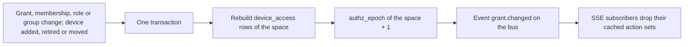
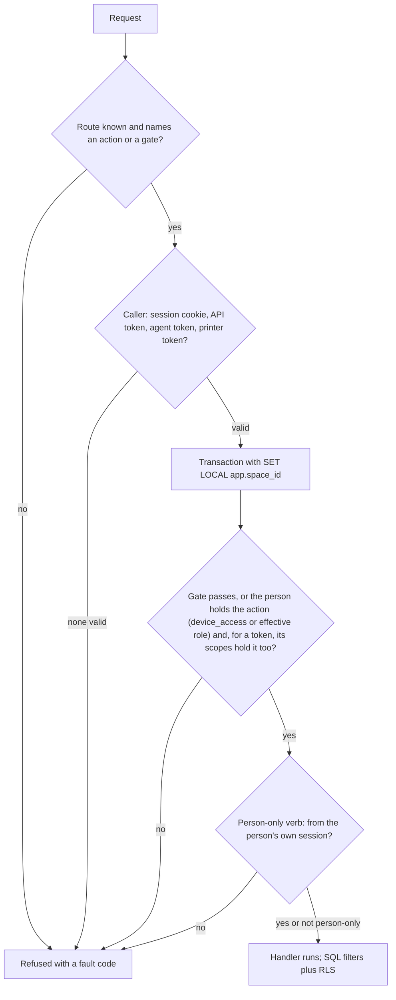

# Authorization: actions within a Space

Who may do what (plan §2.6). Machine **permissions** are actions granted within a Space; door
**access** is a separate module and never mixes with them.

## Actions

An action is a named right in the [actions registry](../registries/actions.md). Every capability verb
names the action it needs; every route names the action it needs. Each action has a fixed bit in a
`bigint`, so an action set is one number. How many actions fit is [OQ-27](risks-and-open.md#oq-27-the-number-of-actions).
The names below are decided ([decision](decisions/20261119-actions-and-presets.md)); the registry
follows them when the code is built.

**Device actions**, held per person per device (`device_access`):

| Action | Damaging | What it allows | Source |
|---|---|---|---|
| `device.view` | no | See a device and read from it; view the camera that watches it. A room camera (watching no device) is seen by the role its `room_view_role` names, admin by default: today's rule (`cameras/page.rs:200`), kept | registry |
| `device.move` | no | Move axes, home, motors off; laser jog, origin, frame at power 0 | registry |
| `device.heat` | no | Set heaters and fans | registry |
| `device.gcode` | yes | Send raw G-code; 3D printers only ([decision](decisions/20261119-no-raw-gcode-on-a-laser.md)) | registry; [decision](decisions/20261118-damaging-actions-by-grant.md) |
| `device.manage` | no | Rename, settings, retire, farm on or off, PPE list, upkeep of this device. Not the agent's update: an agent hosts devices of several spaces, so its update is the instance admin's ([decision](decisions/20261119-agent-update-by-instance-admin.md)) | today's Manage level (`access.rs:78`) |
| `device.firmware` | yes | Update a device's firmware | plan §5 Q4 |
| `job.start` | no | Start a job | registry |
| `job.control` | no | Pause, resume, stop; speed, flow; delete a file on the device; confirm a plate | registry |
| `mc.laser.start` | yes | Start a laser job, person-only | registry; [decision](decisions/20261118-damaging-actions-by-grant.md) |

**Area actions**, held by role in the space or organisation (never granted per device): one area per
module, `.view` for looking, `.use` for a member's day-to-day work where today's routes distinguish it,
`.manage` for what today needs an admin. The organisation area is the exception: `organisation.manage`
comes only from an organisation role, never from a space role, however high
([decision](decisions/20261119-organisation-actions-by-organisation-role.md)).

| Area | Actions | Covers | Today (`access.rs` RULES) |
|---|---|---|---|
| organisation | `organisation.manage` (organisation admin or owner only) | rename the organisation, make a space in it, open spaces, org membership | `/organisation/name` Admin |
| space | `space.manage` | the space's name, PPE checks, safety | `/space/name`, `/space/safety` Admin |
| members | `space.members.view`, `space.members.manage` | the member list; invite, remove, change roles | plan §2.6; `/space/invites`, `/space/members/*` Admin |
| tokens | `tokens.manage` | API tokens of the space | `/space/tokens` Admin |
| audit | `audit.view` | the audit log | `/api/space/audit` Admin |
| grants | `grants.view`, `grants.manage` | grants, device groups, access requests; `grants.manage` only through the Space API | `/permissions/*` Admin |
| devices | `devices.manage` | pair or add a device (no device yet) | `/pair`, `/virtual` Admin |
| files | `files.view`, `files.manage` | list and read; upload, remove | `/api/files` Member |
| queue | `queue.view`, `queue.manage` | the queue; add, reorder, remove (own items for their person) | `/machines/{id}/queue/*` |
| farm | `farm.view`, `farm.use`, `farm.manage` | projects and parts; `farm.manage` for a count correction | `/api/projects`, `/api/parts` Member; `/api/parts/{id}/count` Admin |
| stock | `stock.view`, `stock.use`, `stock.manage` | materials, spools, locations; `stock.manage` for import, export, field definitions, Spoolman backup | `/api/stock/*`, `/api/v1/*` Member; import, export, `field`, `backup` Admin |
| cameras | `cameras.manage` | add, change, remove a camera; viewing follows the camera rule under `device.view` above | `/cameras` POST Admin |
| labels, door access | not named | [OQ-14](risks-and-open.md#oq-14-tables-of-materials-items-and-labels), [OQ-10](risks-and-open.md#oq-10-door-access-link) | |

**Gates.** A route that needs no action still names what lets a caller through, from the same registry,
so the route walk below has one rule: every route names an action or a gate, and a route with neither
fails the test (plan §2.6).

| Gate | Lets through |
|---|---|
| `public` | anyone: sign-in, `/setup` with the setup code, accepting an invite with its token; the handler checks the code or token |
| `session` | any signed-in person, in no space yet: `/me`, their own password, tokens and spaces |
| `space.member` | a signed-in person with a membership in the space, or an organisation membership in its organisation (an organisation role counts in every space of the organisation) |
| `instance.admin` | a signed-in person with `users.instance_admin`: the instance routes, the agents' update |

The instance admin (`users.instance_admin`) is a flag, not an action: the `instance.admin` gate reads it.

## Presets, roles and grants

- **Roles** in a space or organisation: owner, admin, member, guest. The higher of the organisation
  role and the space role counts (the person's **effective role**) for the space's area actions and
  device presets: an organisation admin is admin in every space of the organisation. The other way
  round does not hold: `organisation.manage` is held by the organisation role alone
  ([decision](decisions/20261119-organisation-actions-by-organisation-role.md)).
- **No role above one's own** ([decision](decisions/20261119-no-self-elevation.md)): a role given by
  invite or by `PATCH` is at most the giver's effective role (`authz/ROLE_ABOVE_OWN`); an invite for
  the whole organisation needs an organisation role and gives at most that role
  (`authz/ORG_ROLE_NEEDED`). Changing or removing a member above oneself, lowering one's own role and
  the last owner are [OQ-39](risks-and-open.md#oq-39-roles-above-ones-own-and-the-last-owner).
- **Presets** are named action sets shown in the Space UI: the device levels View, Use, Operate and
  Manage, and the role defaults, today's levels and roles one to one (`access.rs:70-78`, `:1210`;
  [decision](decisions/20261119-actions-and-presets.md)):

  | Preset | Device actions |
  |---|---|
  | View | `device.view` |
  | Use | View + `job.start`, `job.control` |
  | Operate | Use + `device.move`, `device.heat` (today also raw G-code and Start burn: those are damaging and leave the preset) |
  | Manage | Operate + `device.manage` |

  | Role | Device preset on every device of the space | Area actions |
  |---|---|---|
  | guest | View | `files.view`, `queue.view`, `farm.view`, `stock.view` |
  | member | Operate on a device without induction; on a device with induction, View until a grant says more | guest's + `space.members.view`, `files.manage`, `queue.manage`, `farm.use`, `stock.use` |
  | admin | Manage | every area action but `organisation.manage`; `grants.manage` in Space only |
  | owner | Manage | as admin; the owner role is given only by an owner ([decision](decisions/20261119-no-self-elevation.md)) |
  | organisation admin, organisation owner | as admin in every space of the organisation | the admin's, plus `organisation.manage` |

  The per-role route snapshot (plan §4, risk R-5) checks this translation against today's `RULES`;
  every difference it shows is a decision, not a drift. Known differences: `device.gcode` and
  `mc.laser.start` leave Operate; reordering the queue needs `queue.manage` (today View).
- **Damaging actions** (`device.gcode`, `mc.laser.start`, firmware update) are never in a preset:
  granted by name to a person on a device, shown as separate switches; being owner is not having had
  the laser course ([decision](decisions/20261118-damaging-actions-by-grant.md)).
- **Induction** stays a rule of the preset: a device can need permission or training before its
  preset applies.
- A **grant** gives a set of device actions to a person, on a device or a device group, with an
  optional expiry, and records who granted it (`action_grants`). Subjects are persons; a group of
  people as subject waits until it is asked for ([decision](decisions/20261119-actions-and-presets.md)).
  Area actions are never granted: they follow the role.
- Grants are made **only in Space**, the owner's own included; no route outside the Space API grants an
  action. A request for permission (#11) grants nothing: it reaches the space's staff, who grant in
  Space (`access_requests`).

## The materialised table

`device_access(space_id, user_id, device_id, actions bigint)` holds each person's effective action
set per device. It is rebuilt **in the same transaction** as any grant, membership, role or device
group change, a device added, retired or moved, and that transaction bumps the space's `authz_epoch`.
Lists, counts and the SSE filter join `device_access`; nothing filters after fetching. Four changes
reach more than one space and each names its rebuilds:

- An **organisation role** change (org membership added, changed or removed) rebuilds every space of
  the organisation in **one** transaction: the handler issues `SET LOCAL app.space_id` for each space
  in turn inside the same transaction, rebuilds, bumps that space's epoch, and moves on; a failure
  rolls all of it back, so a demoted organisation admin never keeps rights in some spaces. This is
  `Pg::org_spaces(id)`, the one exception to one space per transaction
  ([roles and pools](database.md#roles-and-pools)).
- **Accepting an invite** (admin pool #2) is followed, in the same handler, by a space transaction per
  space joined (one, or every space of the organisation for a whole-organisation invite) that
  rebuilds the newcomer's rows.
- **Moving a device** (admin pool #3, [decision](decisions/20261119-device-move.md)) deletes the
  device's rows in the old space, rebuilds the device's rows in the new space from its roles, and
  bumps both spaces' `authz_epoch`, all in the move's transaction.
- A **grant's expiry** is honoured by the rebuild (an expired grant counts as absent) and by the
  expiry sweep (admin pool #4), which lists the spaces with a grant just expired and rebuilds each in
  its own space transaction; an expired right is gone at the sweep's next run (its interval is
  [OQ-32](risks-and-open.md#oq-32-how-retention-runs)).

## The decision on a request

- **Route guard:** every route names its action or its [gate](#actions), generated from its OpenAPI
  operation; an unknown route is refused (plan §2.6). A route walk test fails when a route names
  neither.
- **API tokens:** stored hashed, with scopes (an action set), expiry, last use, and the person's
  **generation**: one bump ends every token the person minted. A token's effective rights are its
  scopes intersected with its person's `device_access` and role at the time of the request: a token
  never outgrows its person ([decision](decisions/20261119-token-effective-rights.md)). A token
  reaches only routes that name an **action**, in the token's own space (`api_tokens.space_id`);
  every gate but `public` is a person's session (`session`, `space.member`, `instance.admin`: a
  token is refused with `authz/SESSION_ONLY`), except the event stream (`/api/v1/events`, plan §2.8),
  which a token reads in its own space with the same filter narrowed by its scopes; and so are the routes that make or change a grant
  (`grants.manage`), whoever holds the action: a grant is made by a person in Space, never by a
  token. Minting a token (`POST /api/v1/tokens`) is a session's act too; its scopes may name any
  action, because the intersection with the person's rights at each request already keeps the token
  within its person.
- **Agent tokens** may only report and fetch for their own devices; they never carry a person's
  actions. **Printer tokens** (Prusa) likewise.
- **Person-only verbs** (`mc.laser.start`, a frame with power above 0) are accepted only from a
  person's own session: never from the queue, a token or an agent.

## Tenancy

- `space_id` on every tenant row.
- **Row-level security** on every tenant table, policy `space_id = app_space()`, where `app_space()`
  reads `app.space_id`, set with `SET LOCAL` inside each request's transaction. A connection back in
  the pool keeps no setting; a fresh transaction sees no space and no rows.
- RLS is the **second wall**: the SQL filters stay the first.
- Cross-space work runs on a separate pool whose role has `BYPASSRLS`, for an allowlist of uses only
  ([database.md](database.md#roles-and-pools)).

## Door access

Doors and badges are their own module with their own tables and actions. A door action never grants a
machine action and a machine grant never opens a door (plan §2.6). Its tables and its link to the
door hardware are [OQ-10](risks-and-open.md#oq-10-door-access-link).
