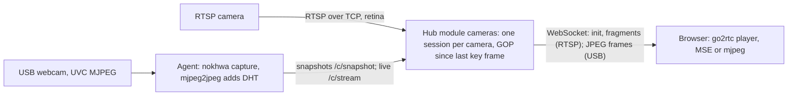

# Cameras

Cameras in general, nothing model-specific in code (owner, 2026-11-16; [archive/plans/cameras.md](../archive/plans/cameras.md)).
A camera is a device of kind `camera`, linked to a machine or a room; it is never a machine in the
machine list (#5). The hub on a Pi decodes and transcodes nothing.

## Two sources, one module

| Source | Path | References | Where |
|---|---|---|---|
| Network camera (`rtsp`) | camera → hub over RTSP/TCP → browser over WebSocket (fMP4, MSE) | retina 0.4.22 `2b6b7fe` (RTSP side); go2rtc v1.9.15 `7c05066` (muxer, `internal/mp4/ws.go`, `www/video-rtc.js`) | hub's LAN only |
| USB webcam (`agent`) | camera → agent (nokhwa capture, MJPEG passed through) → hub → browser | nokhwa 0.10.11 (owner's exception, "nokhwa overal"); missing Huffman tables added by FFmpeg's bitstream filter `libavcodec/bsf/mjpeg2jpeg.c` with the tables of `libavcodec/jpegtabs.h` (= T.81 annex K.3), FFmpeg master `f1d4dd2b`, LGPL-2.1-or-later | any agent host (Linux, Windows, macOS) |

### Why FFmpeg's filter, not PrusaLink

A UVC camera's MJPEG frame has no Huffman tables (DHT), so Safari and macOS ImageIO show nothing (seen
on the Logitech C270). The agent adds them as FFmpeg's `mjpeg2jpeg` bitstream filter does
(`crates/agent/src/camera.rs:1-9`, `89a8c4e`). PrusaLink meets the same problem and its fix is an
unmerged pull request (prusa3d/Prusa-Link#1062); an unmerged PR is not a reference, and PrusaLink is
not used for cameras at all (owner, 2026-11-16)
([decision](decisions/20261119-usb-camera-dht-ffmpeg.md)).

## Viewing and rights

- The browser side is go2rtc's: the viewer's first text message names its codecs, the answer
  `{"type":"mse","value":"video/mp4; codecs=…"}`, then binary init and fragments; errors as
  `{"type":"error","value":"mse: …"}`; 5 s write deadline; no pings; a viewer that falls behind loses
  frames.
- Ours (owner, 2026-11-16): a new viewer first gets the frames since the last key frame, so the
  picture comes at once. Memory: one GOP per camera, not bounded for a camera that never sends another
  key frame ([risks](risks-and-open.md#risks)).
- **Who may view:** a machine camera, whoever may view the machine (`device.view`, guests too); a room
  camera, a minimum role per camera, default admin. How the room role fits the action model is
  [OQ-17](risks-and-open.md#oq-17-room-camera-rights-in-the-action-model).
- Adding, changing and removing cameras: admins, on the Cameras tab of Space, in the audit log; the
  password never comes back in a page and is never logged.
- A camera's session starts when it is added or saved and stops when it is removed.

## USB cameras: snapshots, then live view

Owner, 2026-11-20: "eerst wat prusa heeft. daarna de live stream . alleen als iemand kijkt"; "in de
camera settings een keuze tussen prusa mode / live" ([OQ-9](risks-and-open.md#oq-9-how-usb-camera-video-reaches-the-hub)).

1. **Snapshots** go by the SDK's own camera protocol, unchanged: `POST /p/camera`, then `PUT /c/snapshot`
   with `Fingerprint` and `Token`, at the SDK's trigger schemes
   ([prusa-sdk-extension.md](prusa-sdk-extension.md#part-5-a-usb-camera)).
2. **Live view** is the extension's part 5. The agent uploads `POST /c/stream` in go2rtc's pushed-MJPEG
   format only between `START_CAMERA_STREAM` and `STOP_CAMERA_STREAM`, which the hub sends for the first
   viewer and after the last one. The hub hands the frames to the browser in go2rtc's WebSocket
   `mjpeg` mode (go2rtc v1.9.15 `internal/mjpeg/mjpeg.go:193-216`, `www/video-rtc.js:384-392`,
   `:632-638`), on the same player and `/api/v1/cameras/{id}/ws` as a network camera. Nothing is decoded or
   re-encoded.
3. **Per camera, a setting:** Prusa mode (snapshots only) or live (snapshots plus live view).

## Not in this design yet

A USB camera's identity across replugs ([OQ-15](risks-and-open.md#oq-15-device-identity-across-replugs-and-agents)),
ONVIF discovery and `GetStreamUri`, sub streams, reconnecting, network-camera sessions only while someone watches,
HTTPS, per-layer snapshots, privacy (who may watch, logging, notices; the microphone is never opened),
WebRTC on a fat hub, cameras outside the hub's LAN.
