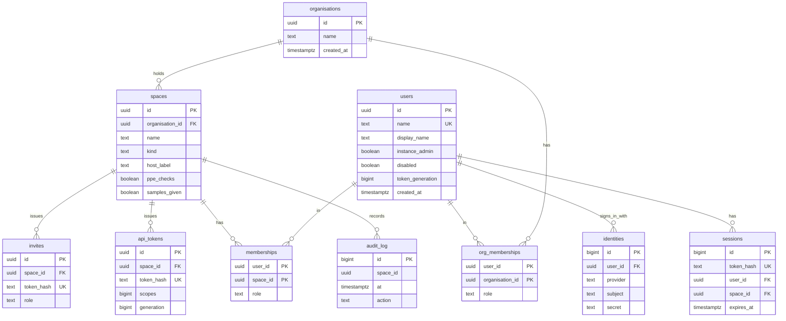
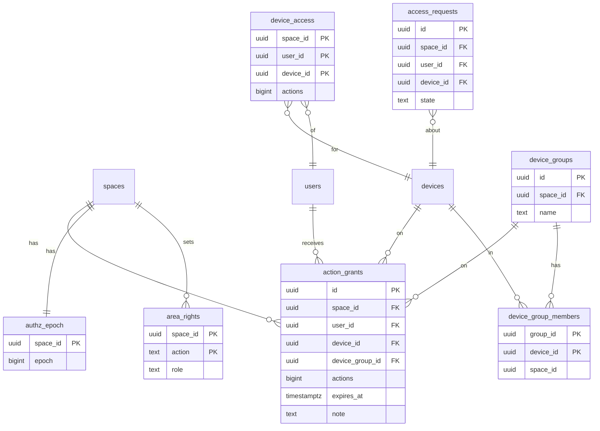
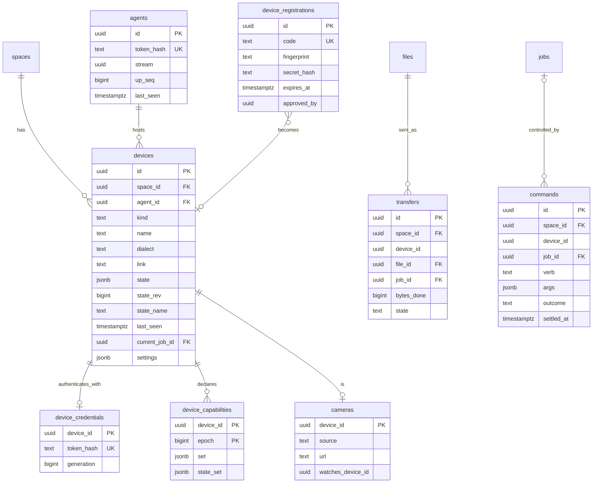
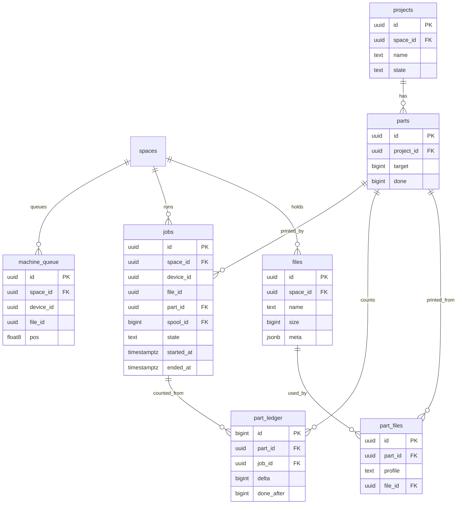
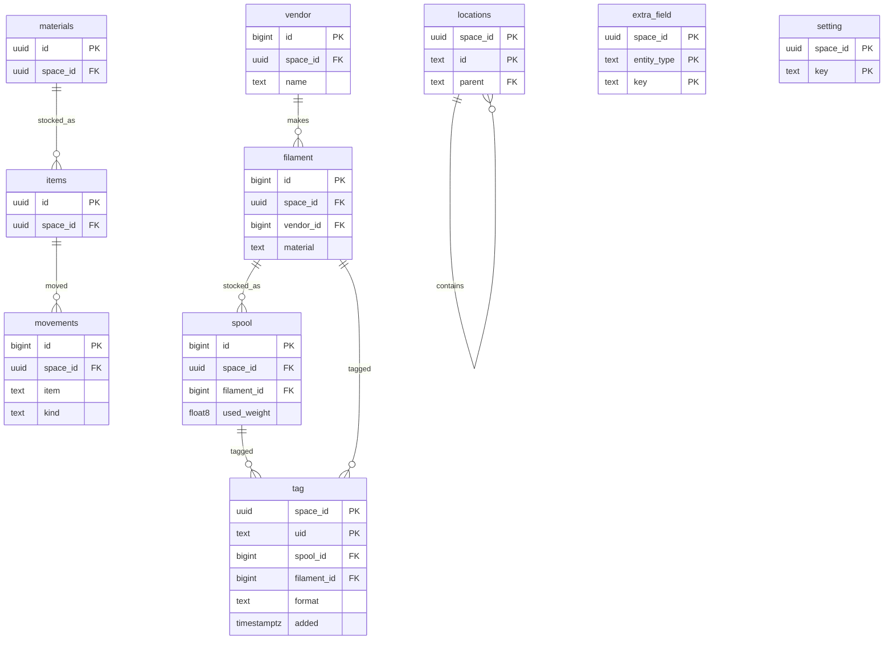
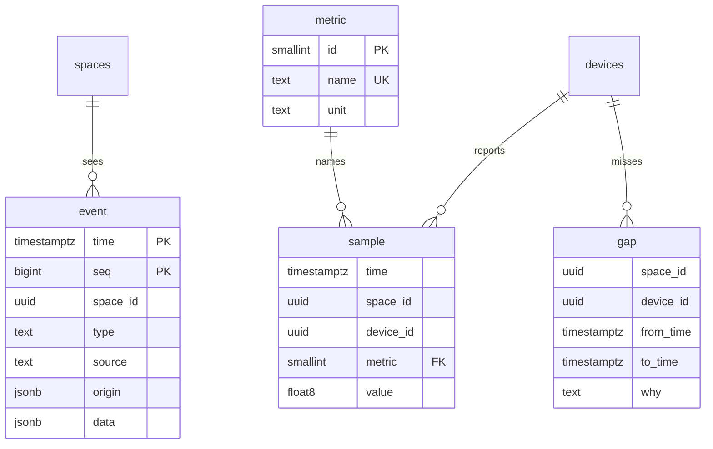

# Database

One PostgreSQL 17 database with TimescaleDB 2.32 (plan §2.7). sqlx 0.9 (Postgres only, rustls) with
compile-time checked queries and an offline cache (`.sqlx/`). Each module owns a `migrations/` folder
with timestamped files unique across modules; the hub assembles one migrator from the enabled
modules. A module that is off has no tables (hub-modules.md A5).

Conventions:

- `uuid` (v7) ids for rows people see; `bigint` identity for logs; `timestamptz` for every time.
- Spoolman's tables keep Spoolman's integer ids, because Spoolman's API exposes them
  ([OQ-6](risks-and-open.md#oq-6-ids-people-see-and-spoolmans-integer-ids)).
- `space_id` on every tenant row, with row-level security `USING (space_id = app_space())`;
  `app_space()` reads `current_setting('app.space_id', true)` as set by `SET LOCAL` in the request's
  transaction ([authz.md](authz.md#tenancy)).
- "RLS" below: **space** = the policy on `space_id`; **via** = the policy through a parent row;
  **admin only** = the app role has no privilege on the table at all.
- **Composite foreign keys.** A reference from a tenant row to another tenant row is a foreign key on
  `(space_id, parent_id)` to the parent's `UNIQUE (space_id, id)`, so a row can never point into
  another space, whatever a query or a policy does ([decision](decisions/20261119-composite-foreign-keys.md)).
  Every tenant table that is referenced carries that unique constraint. `jobs` and `machine_queue`
  keep no foreign key to `devices` or `files` (a job outlives both) and look the ids up in the space
  transaction before writing; `jobs` is itself referenced (by `commands`, `transfers`, `part_ledger`
  and `devices.current_job_id`) and carries the unique constraint. References to `users` (not a
  tenant table) are checked through a membership in the same transaction. A table whose rows people
  name by a text id (`locations`) keys them per space, `(space_id, id)`, so one space's names never
  block or reveal another's. A composite key that may be cleared uses PostgreSQL 15's
  `ON DELETE SET NULL (child_column)`, naming only the reference column, so `space_id` stays.

## Roles and pools

The hub reaches the database only through `DATABASE_URL`
([decision](decisions/20261119-database-url-only.md)). The roles are created once when the database is
provisioned, by its operator, not by a migration. This section resolves the architect's risks R1 and
R2 ([decision](decisions/20261119-database-roles.md)).

| Role | Login | Attributes | Owns | Privileges | Used by |
|---|---|---|---|---|---|
| `maker_connect_hub` | yes, the user in `DATABASE_URL` | `NOSUPERUSER NOCREATEDB NOCREATEROLE NOBYPASSRLS NOREPLICATION`, `NOINHERIT` | nothing | none of its own; member of the three roles below with `INHERIT FALSE, SET TRUE` | every connection; it always `SET ROLE`s first |
| `maker_connect_owner` | no (see note 1) | `CREATEDB` | the database, the schema, every table, function and sequence | all, as owner | the migrator; dumps and restores |
| `maker_connect_app` | no | `NOBYPASSRLS` | nothing | `SELECT, INSERT, UPDATE, DELETE` on tenant tables; `SELECT` only on `users` (note 2); none on admin-only tables | the **app pool** |
| `maker_connect_admin` | no | `BYPASSRLS` | nothing | `SELECT, INSERT, UPDATE, DELETE` on every table | the **admin pool**, allowlist only |
| operator (`postgres`) | yes | superuser | — | — | provisioning only: roles, the database, `CREATE EXTENSION timescaledb`, the restore template; never the hub |

| Pool | Role after connect | Size | For |
|---|---|---|---|
| app | `SET ROLE maker_connect_app` | most of `max_connections` | every request and every unit of work in one space, always inside `Pg::space(id)`: a transaction with `SET LOCAL app.space_id`. One exception: `Pg::org_spaces(space_id)`, for an organisation role change only, is one transaction that lists the organisation's spaces under RLS from the request's space (`space_id`), then sets `SET LOCAL app.space_id` to each in ascending id order (the order a device move locks its two spaces in, so the two never deadlock) |
| admin | `SET ROLE maker_connect_admin` | small | the allowlist below |
| migrator | `SET ROLE maker_connect_owner` | one connection, at start, closed after | migrations |
| dump tools | `pg_dump --role=maker_connect_owner` and `pg_restore --role=maker_connect_owner` | child processes | [storage-ops.md](storage-ops.md) |

Notes on the roles (V2-STORE-6 Q1, Q2; coordinator's answers, journal:DESIGN-DOC:0031):

1. `maker_connect_owner` is `NOLOGIN` on every server. Only dev and CI give it a login
   (`scripts/db-roles.sql -v owner_password=`), because `sqlx::test` makes a database per test and
   needs a login with `CREATEDB`. The hub refuses to start when its `DATABASE_URL` login owns tables
   (or is superuser, `BYPASSRLS`, or may read a table itself).
2. `maker_connect_app` has `SELECT` on `users`, and nothing else on it, under its RLS policy: a row is
   visible when the user has a membership in `app_space()` or an org membership in the organisation of
   `app_space()`. No space transaction can write a `users` row: `display_name` and `token_generation`
   change only for the signed-in person's own row (allowlist #2), `instance_admin` and `disabled` only
   by an instance admin (#3). `identities`, `sessions` and `meta` are admin only: `REVOKE ALL` from
   `maker_connect_app`; the app role has no privilege on them. Code that grants the app role more is a
   defect.

A `RESET ROLE` on a pooled connection returns to `maker_connect_hub`, which has no privileges: it
reads no tenant row (a test shows it). The login is neither superuser nor owner of anything.

**The admin-pool allowlist** (plan §2.6: instance admin, agent token lookup, the history writer;
completed here). Each use is one of:

1. Before the space is known: a device's or agent's registration is inserted (code, secret hash), a
   device an agent registers gets its own row while it is in no space yet (`register_linked`), and a
   presented secret is looked up: session token hash, API token hash, agent token hash, Prusa printer
   token, registration code or secret, invite token hash, the `iv` of `/f/{iv}/raw`. The answer is the
   ids needed to open a space transaction, and for an agent the update asked of it
   (`agent_update_asked`), nothing more; the only writes are on the row the secret
   found: `last_seen` or `last_used`, an agent's `stream` and `info` on its hello or new stream,
   `spent_at` on a registration at its token's first use, and the device's own report about itself
   (its "info"): what the device tells about itself (`set_details`), the profile recognised at
   registration (`recognise`), where its reports come from (`set_peer`), a Moonraker printer's name
   (`moonraker_name`), and its registration code spent (`code_spent`); and an agent's update asked
   no more once it is done (`agent_update_done`).
2. Getting in, and the signed-in person's own account rows: a user by name and their identity's
   secret at sign-in; the first account on a fresh database; creating an organisation with its first
   space and its maker as owner, by an instance admin or by anyone where spaces are open (account
   level, before any space: `create_organisation`); accepting an invite (the user, identity,
   membership and the invite's use in one transaction, [decision](decisions/20261119-invite-accept.md));
   then, always `WHERE user_id` is the session's user: `sessions` (insert at sign-in, delete at
   sign-out, `space_id` on `PUT /api/v1/session/space`), `identities` (`PUT /api/v1/me/password`), and
   the person's own `users.display_name` and `users.token_generation` (`POST /api/v1/me/tokens/end`).
3. Instance admin: organisations and spaces across tenants, `users.instance_admin`
   and `users.disabled`, agents and their update ([decision](decisions/20261119-agent-update-by-instance-admin.md)),
   moving a device to another space ([decision](decisions/20261119-device-move.md)); only for a user
   with `instance_admin`. An organisation admin is not #3: org-wide work runs on the app pool (below).
4. Tasks that span spaces: the event relay (reads every committed fact in `seq` order to publish it;
   the per-subscriber filter is applied on the bus, [decision](decisions/20261119-event-order.md)), the
   history subscriber (`sample`, `gap`), the command sweep at start, the agent's upstream cursor
   (`agents.up_seq`, advanced after the items' space transactions committed), the retention task for
   tables that are not hypertables and the expiry sweep of `sessions`, `invites`, `device_registrations`
   and `action_grants` (an expired grant: the sweep lists the space and rebuilds its `device_access`
   in a space transaction, [authz.md](authz.md#the-materialised-table))
   ([OQ-32](risks-and-open.md#oq-32-how-retention-runs)).
5. Background tasks listing their work: the queue and farm dispatchers and the dumps task read which
   spaces and devices have work; each unit of work then runs on the app pool in its space.
6. The signed-in person's own memberships and organisation memberships, and the spaces they name or
   that belong to those organisations (`GET /api/v1/me`, `GET /api/v1/spaces`, `PUT /api/v1/session/space`):
   always `WHERE user_id` is the session's user, before a space is chosen.

**Pairing in a space transaction.** `device_registrations` is admin only, but a person pairs in Space.
Two functions, `SECURITY DEFINER`, owned by `maker_connect_owner`, with `search_path` pinned to
`pg_catalog, public`, are the only way a space transaction reaches the table
([decision](decisions/20261119-pairing-in-one-space-transaction.md)): `claim_registration(code)` marks
an open registration approved into `app_space()` by the session's user and returns its id, kind,
identity and agent; `collect_registration(id, token_hash)` checks it was approved into `app_space()`
and not yet spent, inserts the `agents` row for an agent's first registration or the
`device_credentials` row for a hub-hosted device, sets `devices.agent_id`, and marks it collected.
Both lock the registration row (`SELECT … FOR UPDATE`), so two claims of one code, or two collects of
one registration, end with one winner and one `410`. Neither takes a space as an argument: both read
`app_space()`. The registration is **spent** at the token's first use (a Prusa printer's first
report, an agent's first `up`), on the admin pool (#1). An agent's token is shown once: a second
collect of an agent's registration gets `410`. Whether a Prusa printer may collect again until its
code is spent, and how the hub then answers, is [OQ-12](risks-and-open.md#oq-12-the-prusa-token-until-the-code-is-spent).
A first agent registration has no `agents` row when the device is claimed: the device is inserted
with `agent_id` null and `collect_registration` fills it. The code's strength, the registration's
life and a limit on claims of unknown codes are [OQ-40](risks-and-open.md#oq-40-the-pairing-codes-strength-expiry-and-attempt-limit).

**Org-wide work on the app pool** (V2-STORE-6 Q3). No allowlist reason covers it.
`organisations`, `org_memberships` and `spaces` are visible via the organisation of `app_space()`, so
an organisation admin's work runs in a space transaction of a space of that organisation, and the
guard checks the org role: renaming the organisation, org membership, removing a member, open spaces,
listing the organisation's spaces. Creating an organisation is allowlist #2, by an instance admin or,
where spaces are open, by anyone signed in.

A test extracts every admin-pool call from the source and fails when one is not on a checked-in list
with its number above. Whether to use three logins instead of one is
[OQ-8](risks-and-open.md#oq-8-one-login-role-or-one-per-pool).

## Modules and their tables

| Module | Tables |
|---|---|
| core: instance | `meta` |
| tenancy and accounts | `organisations`, `spaces`, `users`, `identities`, `memberships`, `org_memberships`, `sessions`, `invites`, `api_tokens`, `audit_log` |
| authz | `action_grants`, `device_groups`, `device_group_members`, `device_access`, `authz_epoch`, `access_requests`, `area_rights` |
| devices | `agents`, `devices`, `device_credentials`, `device_registrations`, `device_capabilities` |
| commands | `commands`, `transfers` |
| files, jobs, queue | `files`, `jobs`, `machine_queue` |
| farm | `projects`, `parts`, `part_files`, `part_ledger` |
| materials and stock | Spoolman's `vendor`, `filament`, `spool`, `extra_field`, `setting`, `tag`; ours `materials`, `items`, `locations`, `movements` |
| cameras | `cameras` (a camera is a device; this table holds its source) |
| labels | own tables, not designed ([OQ-14](risks-and-open.md#oq-14-tables-of-materials-items-and-labels)) |
| door access | own tables, not designed ([OQ-10](risks-and-open.md#oq-10-door-access-link)) |
| events (hypertable) | `event` |
| history (hypertables) | `sample`, `metric`, `gap`, aggregates `sample_1m`, `sample_1h` |

### Tenancy and accounts

| Table | Columns (type) | Keys and FKs | RLS |
|---|---|---|---|
| `meta` | `key text`, `value text` | PK `key` | admin only |
| `organisations` | `id uuid`, `name text`, `created_at timestamptz` | PK `id` | via: the organisation of `app_space()` |
| `spaces` | `id uuid`, `organisation_id uuid`, `name text`, `kind text` (`makerspace`, `office`, `private`: chosen when the space is made, it gives the space's first `area_rights`; changed later with `space.manage`, which changes no right), `host_label text` null (the space's word for the host role, free text; empty: "host"), `ppe_checks boolean`, `samples_given boolean` | PK `id`; FK `organisation_id` → `organisations`; `CHECK (kind IN ('makerspace', 'office', 'private'))` | via: `SELECT` where `organisation_id` = the organisation of `app_space()`; `INSERT WITH CHECK (organisation_id` = the organisation of `app_space()`); `UPDATE`, `DELETE` where `id = app_space()` |
| `users` | `id uuid`, `name text`, `display_name text`, `instance_admin boolean`, `disabled boolean`, `token_generation bigint`, `created_at timestamptz` | PK `id`; unique `lower(name)` | via, `SELECT` only: a membership in `app_space()` or an org membership in its organisation; every write is admin pool #2 (own row) or #3 (note 2) |
| `identities` | `id bigint identity`, `user_id uuid`, `provider text`, `subject text`, `secret text` (Argon2id), `created_at timestamptz` | PK `id`; FK `user_id` → `users`; unique `(provider, subject)` | admin only |
| `memberships` | `user_id uuid`, `space_id uuid`, `role text`, `created_at timestamptz` | PK `(user_id, space_id)`; FKs to `users`, `spaces`; `CHECK (role IN ('guest', 'member', 'host', 'admin', 'owner'))` | space |
| `org_memberships` | `user_id uuid`, `organisation_id uuid`, `role text`, `created_at timestamptz` | PK `(user_id, organisation_id)`; FKs; `CHECK (role IN ('member', 'admin', 'owner'))`: no organisation host ([OQ-41](risks-and-open.md#oq-41-the-host-role-open-points)) | via: the organisation of `app_space()` |
| `sessions` | `id bigint identity`, `token_hash text`, `user_id uuid`, `space_id uuid` null, `created_at`, `last_seen`, `expires_at timestamptz`, `user_agent text`, `address text` | PK `id`; unique `token_hash`; FKs | admin only |
| `invites` | `id uuid`, `space_id uuid`, `token_hash text`, `role text`, `whole_organisation boolean`, `created_by uuid`, `created_at`, `expires_at timestamptz`, `used_by uuid` null, `used_at` null, `revoked_at` null | PK `id`; unique `token_hash`; FKs; `CHECK` on `role` as `memberships` has it | space |
| `api_tokens` | `id uuid`, `space_id uuid`, `token_hash text`, `name text`, `created_by uuid`, `scopes bigint`, `generation bigint`, `expires_at` null, `last_used` null, `revoked_at` null, `created_at timestamptz` | PK `id`; unique `token_hash`; FKs | space |
| `audit_log` | `id bigint identity`, `space_id uuid`, `at timestamptz`, `user_id uuid` null, `token_id uuid` null, `actor text`, `action text`, `target text`, `detail text` | PK `id`; index `(space_id, at)` | space |

### Authz

| Table | Columns (type) | Keys and FKs | RLS |
|---|---|---|---|
| `action_grants` | `id uuid`, `space_id uuid`, `user_id uuid`, `device_id uuid` null, `device_group_id uuid` null, `actions bigint`, `expires_at timestamptz` null, `note text` null (free text, for example an induction given: an induction is a grant with a note), `granted_by uuid`, `granted_at timestamptz` | PK `id`; FK `(space_id, device_id)` → `devices`, FK `(space_id, device_group_id)` → `device_groups`, both on delete cascade; `CHECK` exactly one of `device_id`, `device_group_id` | space |
| `device_groups` | `id uuid`, `space_id uuid`, `name text`, `created_at timestamptz` | PK `id`; unique `(space_id, id)` | space |
| `device_group_members` | `space_id uuid`, `group_id uuid`, `device_id uuid` | PK `(group_id, device_id)`; FK `(space_id, group_id)` → `device_groups`, FK `(space_id, device_id)` → `devices`, both on delete cascade | space |
| `device_access` | `space_id uuid`, `user_id uuid`, `device_id uuid`, `actions bigint` | PK `(space_id, user_id, device_id)`; FK `(space_id, device_id)` → `devices` on delete cascade | space |
| `authz_epoch` | `space_id uuid`, `epoch bigint` | PK `space_id`; FK `space_id` → `spaces` | space |
| `access_requests` | `id uuid`, `space_id uuid`, `user_id uuid`, `device_id uuid`, `asked_at timestamptz`, `state text` (`open`, `granted`, `refused`, `withdrawn` by its person), `handled_by uuid` null, `handled_at` null | PK `id`; FK `(space_id, device_id)` → `devices` on delete cascade; index `(space_id, state)`; index `(space_id, user_id)` | space |
| `area_rights` | `space_id uuid`, `action text` (an area action named `.view` or `.use`, by its registry name), `role text` (the lowest role that holds it), `changed_by uuid` null, `changed_at timestamptz` | PK `(space_id, action)`; FK `space_id` → `spaces` on delete cascade; `CHECK (role IN ('guest', 'member', 'host', 'admin'))`; `CHECK (action IN ('files.view', 'queue.view', 'farm.view', 'farm.use', 'stock.view', 'stock.use'))`; `CHECK (action NOT LIKE '%.use' OR role <> 'guest')`; a `.use` never below its area's `.view` (checked by the handler) | space |

A grant's subject is a person; a group of people as subject waits until it is asked for
([decision](decisions/20261119-actions-and-presets.md)). `area_rights` holds a row per movable area
action of the space, written from the space kind's defaults when the space is made (a later change
of `spaces.kind` rewrites none) and changed only with `space.manage`, each change in the audit log and with the space's `authz_epoch` bumped
([authz.md](authz.md#area-rights-per-space), [decision](decisions/20261119-host-role-and-area-rights.md)).

**Migration** (host role and area rights): a new migration of the accounts module adds the `role`
checks and the `spaces` columns `kind` (existing spaces: `makerspace`) and `host_label`; one of the
authz module adds `area_rights` and fills each existing space with the `makerspace` defaults, which
are today's role table, so no right changes. No data is carried beyond that, and nothing of v1: v2
has no users yet (a clean break, [overview.md](overview.md#rules-every-part-obeys)).

### Devices and commands

| Table | Columns (type) | Keys and FKs | RLS |
|---|---|---|---|
| `agents` | `id uuid`, `token_hash text`, `generation bigint`, `fingerprint text`, `info jsonb` (AgentInfo), `stream uuid` null (the stream the agent is on), `up_seq bigint` (the highest `seq` applied on that stream), `created_at`, `last_seen timestamptz` null | PK `id`; unique `token_hash` | admin only: looked up by hash (allowlist #1), cursor advanced by #4. An agent is a host, not a tenant row: it has no space; each device under it belongs to its own space and every item is applied in that device's space transaction; the agent is sent only its own devices' commands ([decision](decisions/20261119-agent-link-identity-and-delivery.md)) |
| `devices` | `id uuid`, `space_id uuid`, `agent_id uuid` null (`link = agent`; null between the claim and the collect of an agent's first registration), `state_rev bigint` (one up per applied patch batch; carried by snapshot and patch events), `kind text`, `name text`, identity `vendor text`, `model text`, `firmware_label text`, `serial text`, `unit_uid text`; `dialect text` null, `link text` (`hub` or `agent`), `state jsonb` with `CHECK (jsonb_typeof(state) = 'object')`, `state_name text`, `last_seen timestamptz` null, `current_job_id uuid` null, `retired_at timestamptz` null, `retired_reason text` null, `settings jsonb` | PK `id`; unique `(space_id, id)`; FK `space_id` → `spaces`; FK `agent_id` → `agents`; FK `(space_id, current_job_id)` → `jobs` `ON DELETE SET NULL (current_job_id)` (a device with a job not ended is not moved, [decision](decisions/20261119-device-move.md)); index `(space_id, name)` | space |
| `device_credentials` | `device_id uuid`, `space_id uuid`, `token_hash text`, `generation bigint`, `created_at`, `last_used timestamptz` | PK `device_id`; unique `token_hash`; FK `(space_id, device_id)` → `devices` on delete cascade, `ON UPDATE CASCADE` (the row moves with its device) | space (looked up by hash on the admin pool). Hub-hosted devices only (Prusa printers); an agent's devices authenticate through their agent ([decision](decisions/20261119-agent-link-identity-and-delivery.md)) |
| `device_registrations` | `id uuid`, `code text`, `fingerprint text`, `secret_hash text`, `agent_id uuid` null (a further device of a known agent), `kind text`, `dialect text` null, `identity jsonb`, `created_at`, `expires_at timestamptz`, `space_id uuid` null, `device_id uuid` null, `approved_by uuid` null, `approved_at` null, `collected_at` null, `spent_at` null | PK `id`; unique `code` while open | admin only (no space before approval); a space transaction reaches it only through `claim_registration` and `collect_registration` ([roles and pools](#roles-and-pools)) |
| `device_capabilities` | `device_id uuid`, `space_id uuid`, `epoch bigint`, `set jsonb`, `state_set jsonb`, `at timestamptz` | PK `(device_id, epoch)`; FK `(space_id, device_id)` → `devices` on delete cascade, `ON UPDATE CASCADE` (moves with its device) | space |
| `commands` | `id uuid`, `space_id uuid`, `device_id uuid`, `verb text`, `args jsonb`, `idempotency_key text`, `origin text` (person, token, agent, queue, device), `requested_by uuid` null, `token_id uuid` null, `job_id uuid` null, `requested_at`, `authorized_at`, `sent_at`, `settled_at timestamptz` null, `grant_id uuid` null, `outcome text` null (ok, refused, failed, unknown), `fault_code text` null, `reason text` null, `late_outcome text` null, `late_reason text` null, `late_at timestamptz` null (a result that arrives after `unknown`: shown, never acted on) | PK `id`; unique `(space_id, id)`; no FK to `devices` (a record outlives a retired or moved device, like a job; the device is looked up in the space transaction before writing); FK `(space_id, job_id)` → `jobs`; unique `(space_id, device_id, idempotency_key)`; partial index `(device_id) WHERE settled_at IS NULL` | space |
| `transfers` | `id uuid`, `space_id uuid`, `device_id uuid`, `file_id uuid`, `path text`, `iv text`, `key text`, `size bigint`, `bytes_done bigint`, `state text`, `reason text` null, `command_id uuid` null, `job_id uuid` null, `print_after boolean`, `created_at`, `settled_at timestamptz` null | PK `id`; no FK to `devices` (as `commands`); FK `(space_id, file_id)` → `files`; FK `(space_id, command_id)` → `commands`; FK `(space_id, job_id)` → `jobs`; unique `iv`; partial index `WHERE settled_at IS NULL` | space (`/f/{iv}/raw` looks up by `iv` on the admin pool) |
| `cameras` | `device_id uuid`, `space_id uuid`, `source text` (`rtsp` or `agent`), `url text` null, `username text` null, `password text` null, `watches_device_id uuid` null (empty: a room camera, seen by the role `room_view_role` names, default `admin`; a watching camera is seen with `device.view` on the watched device) | PK `device_id`; FK `(space_id, device_id)` → `devices` on delete cascade, `ON UPDATE CASCADE` (a camera device moves with its own row); FK `(space_id, watches_device_id)` → `devices` `ON DELETE SET NULL (watches_device_id)`, cleared by a move of either device | space |

`devices.settings` holds the device's own settings: its machine profile, PPE list, induction rule,
labels, farm on/off with `farm_on_by` (set in the same write that switches the farm on, cleared when it is switched off; the person on whose behalf the farm dispatcher starts jobs,
[flows.md](flows.md#4-a-job-with-the-laser-rule)), sheet, service interval and last service,
out-of-use note, and per laser the origin, G-code dialect, rotary and M4 (#24). Each key is defined
by the module that owns it.

**Moving a device** ([decision](decisions/20261119-device-move.md)) is one transaction on the admin
pool (#3) that changes `devices.space_id` and, for every table that points at the device: `device_credentials`,
`device_capabilities` and the camera's own `cameras` row follow by `ON UPDATE CASCADE`; `action_grants`,
`device_group_members`, `device_access`, `access_requests` and `machine_queue` rows of the device are
deleted (the new space grants afresh); `spool.device_id` and `cameras.watches_device_id` that point at
it are set null (the spool stays in its space, unloaded); `commands`, `transfers`, `jobs`, `sample` and
`gap` have no key to the device and stay where they happened. The same transaction, after the `devices`
update (the `device_access` FK has no `ON UPDATE CASCADE`), rebuilds the device's `device_access` rows
in the new space from its roles, naming that space's id explicitly (the admin pool has no `app.space_id`), and bumps both spaces' `authz_epoch`, the lower space id first, as `Pg::org_spaces` does
([authz.md](authz.md#the-materialised-table)). A device with a job not ended is not moved.

### Files, jobs, queue and farm

| Table | Columns (type) | Keys and FKs | RLS |
|---|---|---|---|
| `files` | `id uuid`, `space_id uuid`, `name text`, `size bigint`, `uploaded_at timestamptz`, `uploaded_by uuid` null, `meta jsonb` (what the file says about itself) | PK `id`; unique `(space_id, id)`; index `(space_id, uploaded_at desc)`; the bytes in the files folder under the id | space |
| `jobs` | `id uuid`, `space_id uuid`, `device_id uuid`, `file_id uuid`, `file_name text`, `state text` (`queued`, `loaded`, `running`, `paused`, `ended`; derived from the command records and the device's job end, [decision](decisions/20261119-job-states.md)), `outcome text` null (`done`, `stopped`, `failed`), `created_at`, `started_at`, `ended_at timestamptz` null, `reason text` null, `from_line bigint` null, `used float8` null, `spool_id bigint` null, `by_user uuid` null, `part_id uuid` null, `per_plate bigint` null, `confirmed_at` null, `confirmed_good bigint` null, `confirmed_by uuid` null | PK `id`; unique `(space_id, id)` (referenced by `commands`, `transfers`, `part_ledger`, `devices.current_job_id`); no FK to `devices` or `files` (a job outlives both); FK `(space_id, part_id)` → `parts` `ON DELETE SET NULL (part_id)`; FK `(space_id, spool_id)` → `spool` `ON DELETE SET NULL (spool_id)`; partial index on jobs not ended | space |
| `machine_queue` | `id uuid`, `space_id uuid`, `device_id uuid`, `file_id uuid`, `file_name text`, `pos float8`, `added_at timestamptz`, `by_user uuid`, `problem text` null | PK `id`; index `(space_id, device_id, pos)` | space |
| `projects` | `id uuid`, `space_id uuid`, `name text`, `description text`, `state text`, `priority bigint`, `created_at timestamptz` | PK `id`; unique `(space_id, id)` | space |
| `parts` | `id uuid`, `project_id uuid`, `space_id uuid`, `name text`, `target bigint`, `done bigint`, `sort_order bigint`, `created_at` | PK `id`; unique `(space_id, id)`; FK `(space_id, project_id)` → `projects` on delete cascade | space |
| `part_files` | `id uuid`, `part_id uuid`, `space_id uuid`, `profile text`, `file_id uuid`, `per_plate bigint`, `material text` null, `color text` null, `sheet text` null, `created_at` | PK `id`; unique `(part_id, profile)`; FK `(space_id, part_id)` → `parts` on delete cascade; FK `(space_id, file_id)` → `files` | space |
| `part_ledger` | `id bigint identity`, `space_id uuid`, `part_id uuid`, `at timestamptz`, `delta bigint`, `done_after bigint`, `source text`, `job_id uuid` null, `actor text`, `note text` | PK `id`; FK `(space_id, part_id)` → `parts` on delete cascade; FK `(space_id, job_id)` → `jobs`; index `(space_id, part_id, at desc)` | space |

A job's state is never set by a page: `queued` by the queue, `loaded` when the file is at the device
(a laser waits here), `running`, `paused` and back from the settled command records (`job.start`,
pause, resume), `ended` with its `outcome` from the device's job end ([decision](decisions/20261119-job-states.md)).
Where a printer's own storage listing lives is [OQ-21](risks-and-open.md#oq-21-a-printers-storage-listing).

### Materials and stock

Spoolman's tables follow Spoolman `eccb05e` (its columns and integer ids), with `space_id` added; ours
sit beside them. Spoolman's data model is Vendor → Filament → Spool, with extra fields per entity,
tags (NFC) and settings.

| Table | Columns (type) | Keys and FKs | RLS |
|---|---|---|---|
| `vendor` | Spoolman's: `id bigint`, `registered timestamptz`, `name text`, `empty_spool_weight float8`, `comment text`, `external_id text`, `extra jsonb`; plus `space_id uuid` | PK `id`; unique `(space_id, id)` | space |
| `filament` | Spoolman's: `id`, `registered`, `name`, `vendor_id`, `material`, `price`, `density`, `diameter`, `weight`, `spool_weight`, `article_number`, `comment`, `settings_extruder_temp`, `settings_bed_temp`, `color_hex`, `multi_color_hexes`, `multi_color_direction`, `external_id`, `extra`; plus `space_id` | PK `id`; unique `(space_id, id)`; FK `(space_id, vendor_id)` → `vendor` | space |
| `spool` | Spoolman's: `id`, `registered`, `first_used`, `last_used`, `price`, `filament_id`, `initial_weight`, `spool_weight`, `used_weight`, `location`, `lot_nr`, `comment`, `archived`, `extra`; plus `space_id`, `device_id uuid` null and `slot bigint` null (loaded in a device) | PK `id`; unique `(space_id, id)`; FK `(space_id, filament_id)` → `filament`; FK `(space_id, device_id)` → `devices` `ON DELETE SET NULL (device_id)` | space |
| `tag` | Spoolman 0.27's NFC tag: `uid`, its target (`spool_id` or `filament_id`), `format`, `added`; plus `space_id` | PK `(space_id, uid)`; FK `(space_id, spool_id)` → `spool`, FK `(space_id, filament_id)` → `filament`, both on delete cascade; `CHECK` exactly one target | space |
| `extra_field` | `space_id uuid`, `entity_type text`, `key text`, `definition jsonb` | PK `(space_id, entity_type, key)` | space |
| `setting` | `space_id uuid`, `key text`, `value text`, `last_updated timestamptz` | PK `(space_id, key)` | space |
| `locations` | `id text` (ours, named by people), `space_id uuid`, `name text`, `parent text` null, `slots bigint` null, `model text` null, `description text` null | PK `(space_id, id)`; FK `(space_id, parent)` → `locations`; `spool.location` is Spoolman's free text and keeps no FK | space |
| `movements` | `id bigint identity`, `space_id uuid`, `item text`, `kind text`, `amount float8` null, `place text` null, `note text` null, `at timestamptz` | PK `id`; index `(space_id, item, id desc)` | space |
| `materials`, `items` | not designed: tapes, label rolls, laser materials (#10) | — | space |

Which of these Spoolman columns are exactly Spoolman's is proven by the Spoolman audit (#7,
`docs/audits/spoolman.md`), not by this table.

### Events and history

| Table | Columns (type) | Keys | RLS | Timescale |
|---|---|---|---|---|
| `event` | `time timestamptz`, `seq bigint` (global, from one sequence, taken under `pg_advisory_xact_lock` of one fixed key so that seq order is commit order, [decision](decisions/20261119-event-order.md)), `space_id uuid`, `type text` (registry), `source text` (device or resource id), `origin jsonb` (person, token, agent, queue or device, with its id), `data jsonb` | unique `(seq, time)` | space | hypertable on `time`; retention 1 year |
| `sample` | `time timestamptz`, `space_id uuid`, `device_id uuid`, `metric smallint`, `value float8` | index `(device_id, metric, time desc)` | space ([decision](decisions/20261119-history-tenancy.md)); written by the history subscriber on the admin pool (allowlist #4) | hypertable on `time`; compression `segmentby device_id, metric` after 7 days (`space_id` compresses with the segment); raw retention 30 days |
| `sample_1m`, `sample_1h` | continuous aggregates of `sample` per space, device, metric and bucket | — | space, through the `space_id` the aggregate groups by | retention 1 year and forever |
| `metric` | `id smallint`, `name text`, `unit text` | PK `id`; unique `name` | none (registry, same for every space) | plain |
| `gap` | `space_id uuid`, `device_id uuid`, `from_time`, `to_time timestamptz`, `why text` (hub restart, agent offline) | index `(device_id, from_time)` | space | plain |

Retention defaults ([decision](decisions/20261118-retention-defaults.md)): raw samples 30 days, 1-minute
aggregates 1 year, 1-hour aggregates forever, events 1 year, command records and the audit log
forever. Text values (state names, dialog texts) are events, not samples. Narrow, not wide: the core
does not know which values a device has (plan §2.7).
