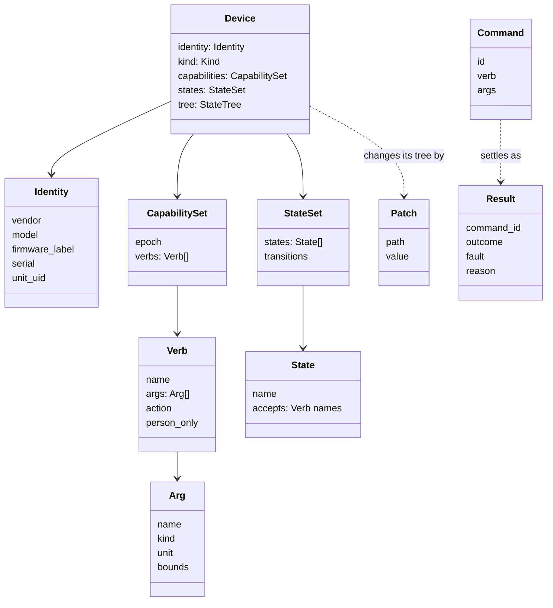
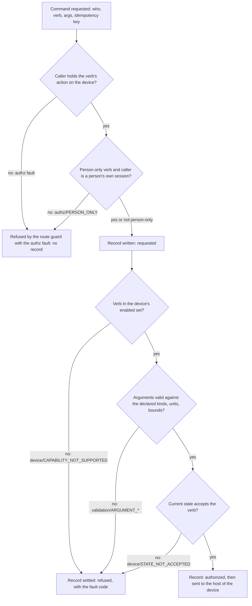
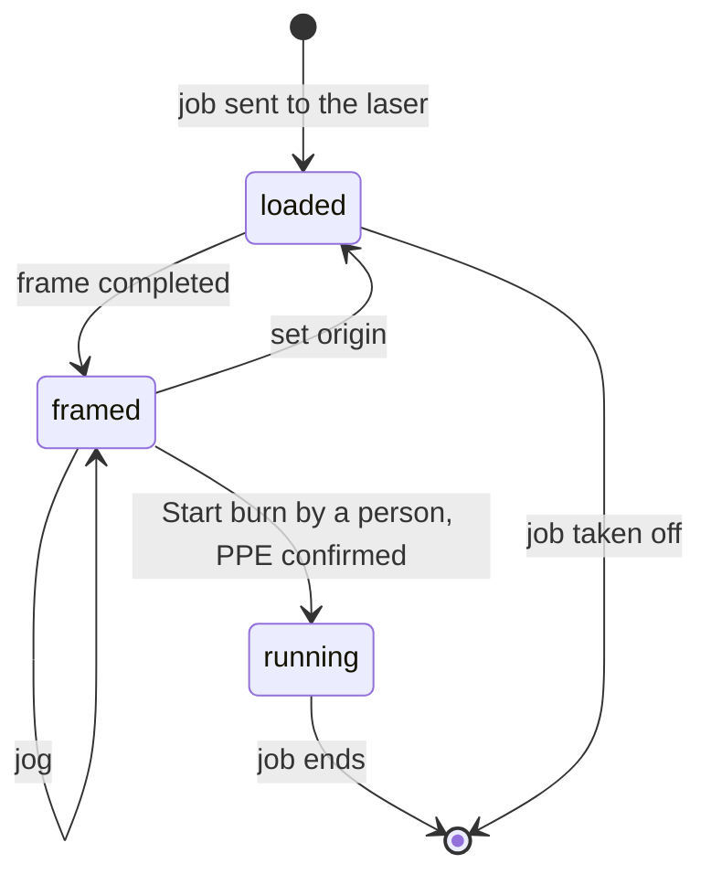
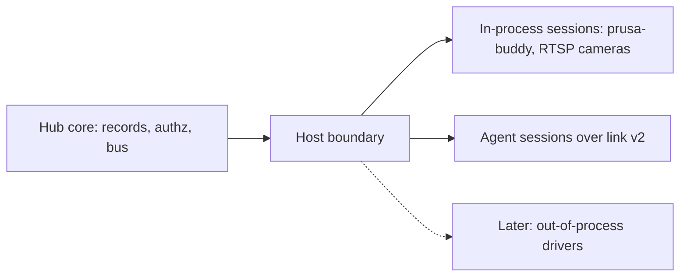

# The device contract

One contract for every kind of device (plan §2.1), in `crates/device`, written by us after the meaning
of Prusa Connect's driver contract (read to understand, nothing copied). The contract is internal:
what reaches a machine is still made by a port or driver that follows its one reference to the letter.

## Parts

| Part | Holds | Rule |
|---|---|---|
| Identity | `vendor`, `model`, `firmware_label`, `serial`, `unit_uid` | The firmware is a label: never compared. `unit_uid` is what the port's reference reads to tell one unit from another, never guessed; a port whose reference reads nothing leaves it empty ([decision](decisions/20261119-device-identity-per-port.md)). |
| Capability | a verb with typed arguments (kind, unit, bounds) and the action it needs | A verb maps to the reference's own call; a verb the reference has no call for is not declared. |
| Enabled set | driver baseline ∩ model profile ∩ device probe | Changes bump the **epoch** (plan §2.1). A command carries no epoch: the host checks the verb against the current set ([decision](decisions/20261119-no-epoch-on-commands.md)). |
| State set | per kind: states, which verbs each state accepts, transitions | The host refuses a verb the current state does not accept (`device/STATE_NOT_ACCEPTED`). |
| State tree | a JSON object | Changed only by patches `{path, value}`; `null` removes the path. Stored as `devices.state` with a `CHECK` that it is an object. |
| Command | verb, arguments, the hub's record id | `do(command) → result`. |
| Result | ok, refused, failed, or outcome unknown; a fault code and the device's own reason | Never "ok" for something not observed. A refusal by the device is a result, not an error. |

Registries, one Rust table each and generated docs that fail a test on drift (plan §2.10):
[capability verbs](../registries/capability-verbs.md), [state sets](../registries/state-sets.md),
[event types](../registries/event-types.md), [actions](../registries/actions.md),
[fault codes](../registries/fault-codes.md), [metrics](../registries/metrics.md).

## Host-side rules

Ours, outside every port and driver. The plan lists these rules (plan §2.1) but not their order; the
order is decided: authorization first, so a caller without the right learns nothing about the device
([decision](decisions/20261119-host-checks-order.md), OQ-34), as [flows.md](flows.md#2-a-command-click-to-settled)
draws it:

The laser rule: `mc.laser.start` (and `mc.laser.frame` with `power` above 0) is person-only: accepted
only from a person's own session, never from the queue or a token. A laser offers no raw G-code
(`mc.laser.gcode` is not declared, [decision](decisions/20261119-no-raw-gcode-on-a-laser.md)): nothing
but Start burn can switch the laser on. Start burn also needs a completed
frame of the loaded job after the last Set origin (a jog does not reset it); one loaded job per laser,
no laser queue (owner, HS7b, 2026-11-17). The queue never starts a laser; a laser job waits for a person's Start.

The states above are the hub's job flow for a laser, not device states: the device's states are
GRBL's ten (`IDLE` … `UNKNOWN`).

## Kinds

| Kind | Verbs | States | Host and port | Reference |
|---|---|---|---|---|
| `marlin` (3D printer) | Prusa Connect's `core.command.*` names where the meaning is the same, else `mc.printer.*` | OctoPrint's 16 comm states, as they are; mapped to Prusa Connect names only in the API layer | agent, OctoPrint port | OctoPrint 1.11.8 `42be740` |
| `prusa` (3D printer) | the 3D-printer verbs of the `buddy-ws` dialect's baseline | Buddy's | hub, driver `prusa-buddy`, dialect `buddy-ws` | Buddy 6.4+ |
| `grbl` (laser) | `mc.laser.*` (11: no raw G-code, [decision](decisions/20261119-no-raw-gcode-on-a-laser.md)) | GRBL's 10 machine states | agent, LaserFoundry port | gnea/grbl wiki `86e8ecd` + `stream.py` (gnea/grbl `bfb67f0`); LaserFoundry is the library (CLAUDE.md, *Lasers (GRBL)*) |
| `labelmanager` (tape) | `mc.label.print` | `DISCONNECTED`, `IDLE`, `BUSY` (ours, approved) | agent, labelle port | labelle `5e8f1e5` |
| `labelwriter` (labels) | `mc.label.print` | `IDLE`, `PRINTING`, `OUT_OF_PAPER`, `ERROR` | agent, DYMO CUPS port | DYMO CUPS driver 1.4.0 |
| `scale` | none (state only: weight, stable) | usbscale's 8 + unknown | agent, usbscale port | usbscale `9ed1cb5` |
| `camera` | `mc.camera.snapshot`, `mc.camera.stream` | online, offline | hub (RTSP, retina), agent (USB, nokhwa) | retina 0.4.22, go2rtc v1.9.15, nokhwa 0.10.11 |

The full verb and state tables are the generated registries (the laser's 11 verbs, without
`mc.laser.gcode`, as the decision above says). The per-port mapping with every
citation is [plans/hub-core-v2-device-map.md](../archive/plans/hub-core-v2-device-map.md); its owner answers
(fan and motors off declared with OctoPrint's template G-code; Marlin's 16 states as they are; the
laser frame through LaserFoundry's `job.frame`; no scale `zero`; the DYMO Connect roll catalogue as data)
are part of this design.

A camera is its own device linked to a machine or a room; whoever may view the machine may view its
camera. The two DYMO printers are separate kinds with separate ports and no shared code.

## Sessions and hosts

A **session** is one device's live connection, hosted either in the hub (Prusa driver, RTSP cameras) or
in an agent (ports). Both arrive at the hub through one `Host` boundary, so a third kind (an
out-of-process driver over Prusa's plugin wire) fits later without changing the core.

A session reports upstream: identity, capability set and epoch, state set, state patches, command
results, job ends. It takes downstream: commands in contract form with the hub's record id, jobs,
answers (plan §2.3; messages in [wire.md](wire.md)).

## Conformance

`crates/device` carries a conformance kit (fake host, fake device). Every port behind its adapter and
every driver passes it. Step 1's not-covered list (device-map.md "Step 1 as built") applies.
