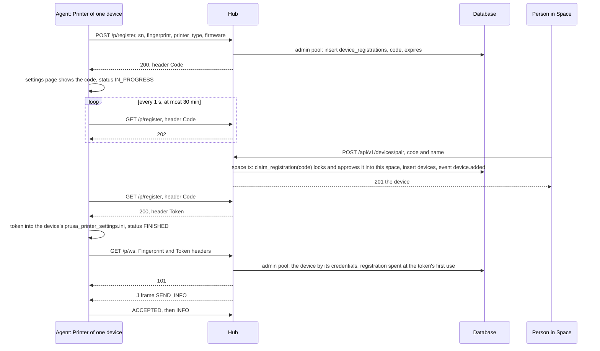
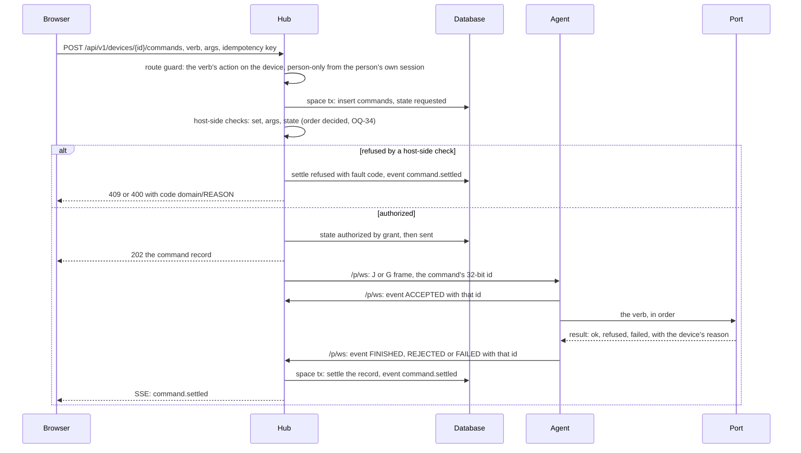
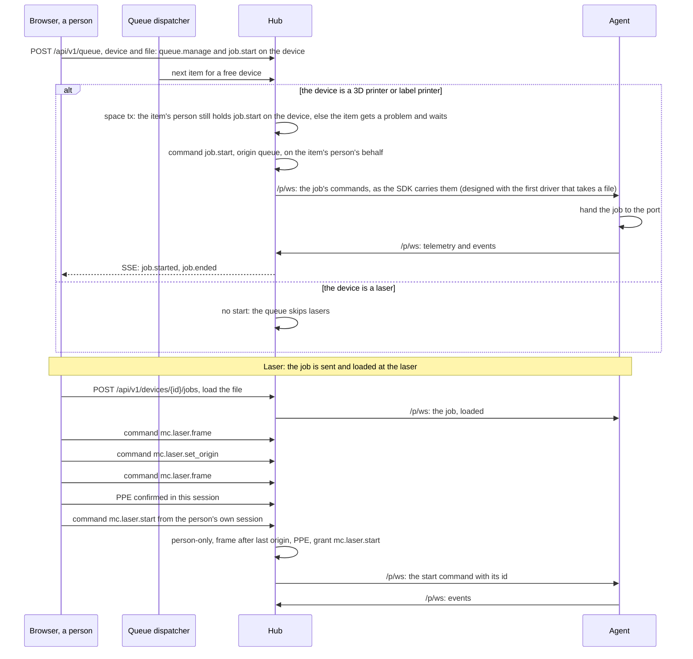
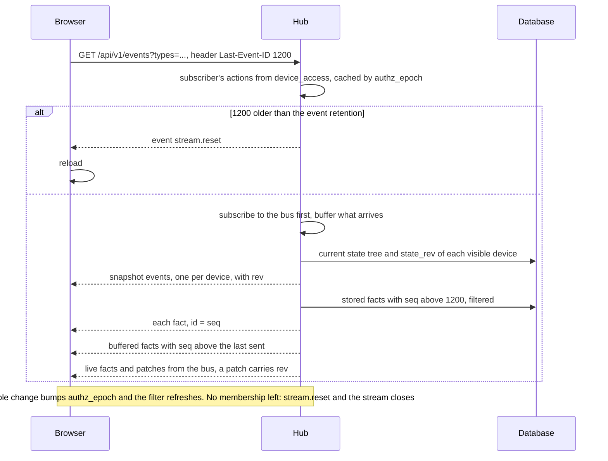
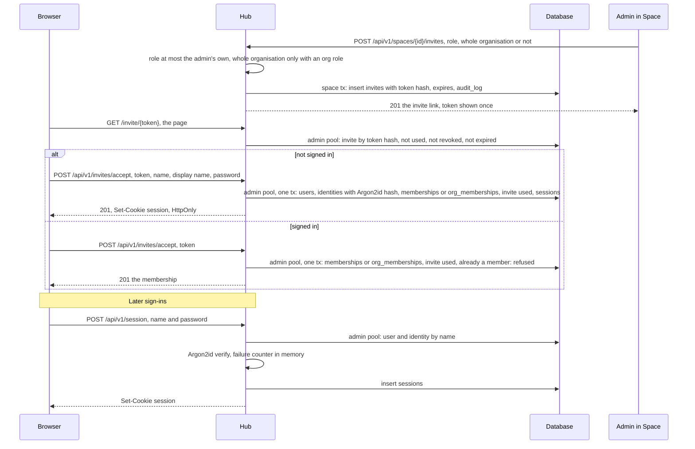
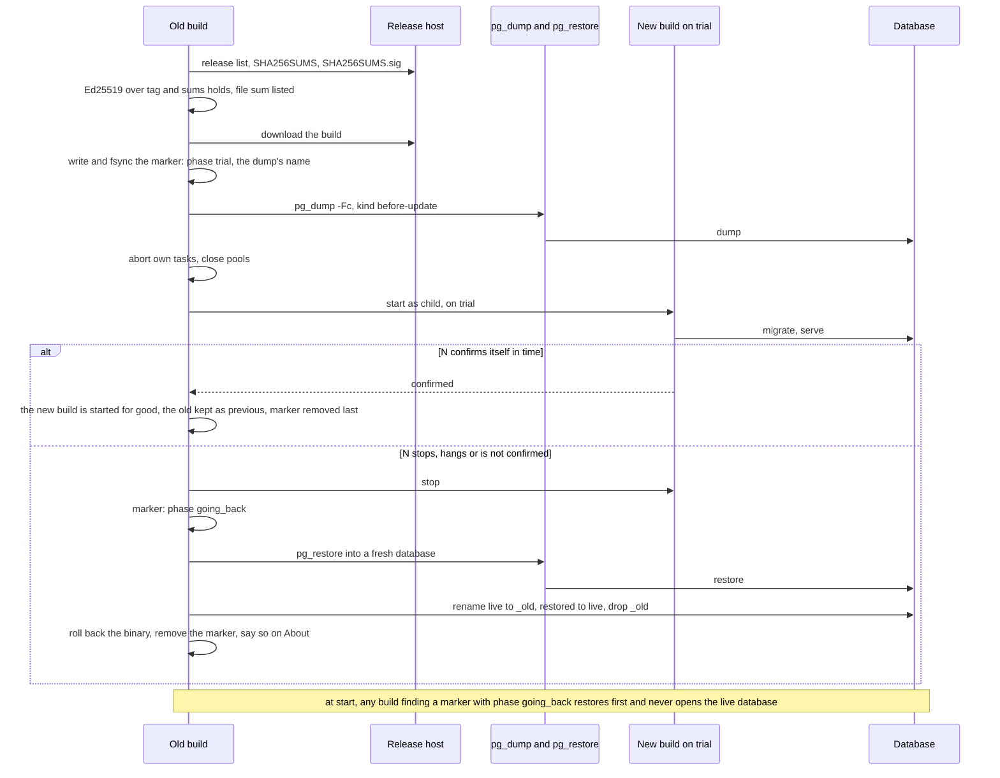
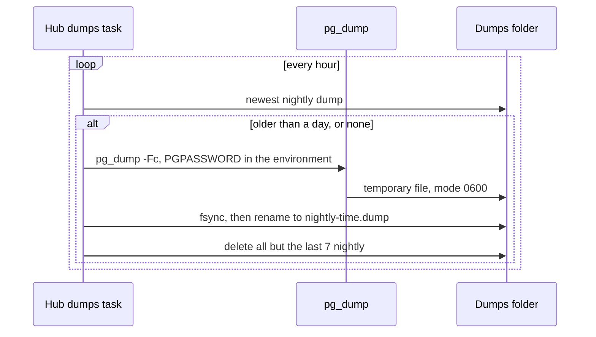

# Flows

The main flows end to end. Links (L1…) are in [links.md](links.md), endpoints in [api.md](api.md),
agent messages in [wire.md](wire.md). Every hub step that touches tenant rows runs in a transaction
with `SET LOCAL app.space_id`; a lookup before the space is known runs on the admin pool
([database.md](database.md#roles-and-pools)).

## 1. Pairing a device on an agent

Each device on an agent registers and pairs on its own, as a Prusa Connect printer does
([wire.md](wire.md#registration-http), [decision](decisions/20261120-agent-link-is-prusa-connect-protocol.md)):
the agent's `Printer` for that device posts `/p/register` and polls it with the code; a person types the
code shown on the agent's settings page into Space; the poll then carries the token, which the agent
writes into the device's settings file. The hub's side is the one built for Prusa printers. A device that
already has a row is paired again by the person, who picks "this is MINI-1 again": the row keeps its
history and grants, never automatically ([decision](decisions/20261119-re-pairing-by-the-person.md)).

A Prusa printer (Buddy 6.4+, `/p/register`, `/p/auth`, `/p/ws`) is paired in Space by the code on its
screen the same way; its flow is drawn with the Buddy driver (V2-DEVICES step 3). The token's plaintext
is never stored by the hub: a device that collects again gets it from the hub process that minted it, and
after a hub restart a freshly minted one, as prusa-connect does (`internal/connector/xbuddy/registration.go:114-118`,
`:624-638`; [decision](decisions/20261119-prusa-token-never-stored.md)).

## 2. A command: click to settled

A hub restart turns every open record into `outcome unknown`; nothing is re-sent (plan §2.5). The
link carries no outbox and no sequence: while a device's socket is down its `Printer` drops telemetry and
events (SDK `__init__.py:806-812`), the hub keeps the device's queue and sends it when the device
reattaches (`xbuddy.go:793-804`), and the same command id sent again is answered with its current or last
state, not run again (SDK `command.py:84-96`) ([wire.md](wire.md#the-websocket)). A result that arrives
after the record was settled `unknown` is kept as a late result and never acted on
([database.md](database.md#devices-and-commands)).

## 3. A job, with the laser rule

A job's start, pause and stop are command records (plan §2.5). The queue may start a job on a 3D
printer or a label printer; it never starts a laser. The job's state follows from those records and
the device's job end ([database.md](database.md#files-jobs-queue-and-farm)). A dispatcher never
starts what its person may not: a queue item is started on behalf of the person who queued it
(`machine_queue.by_user`), and the dispatcher checks that person's `job.start` on the device in the
space transaction before each start; without it the item keeps a `problem` and waits (`by_user` is
not null: every item has the person who queued it). The farm dispatcher starts
on behalf of the person who switched the farm on for that device (`devices.settings.farm_on_by`, set
with `device.manage` in the same write that switches the farm on, and cleared when it is switched off), with the same check and the same wait with a `problem` shown on the Now page.

## 4. SSE resume (browser)

## 5. Sign-in and invite

On a fresh database the hub logs a one-time setup code; `/setup` with that code makes the first
account, its organisation and space.

## 6. Self-update, dump and the way back

Changes made after the update started are lost on the way back
([decision](decisions/20261119-database-dumps.md)).

## 7. The nightly dump

