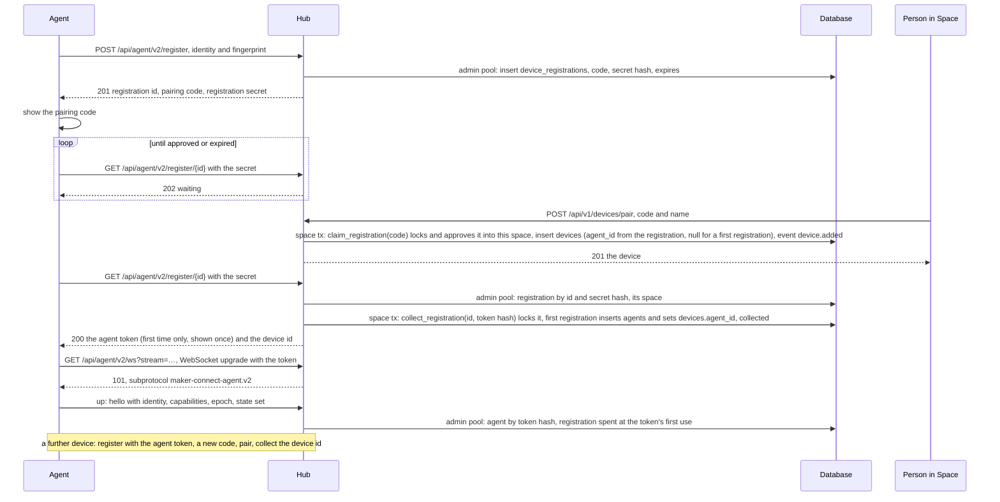
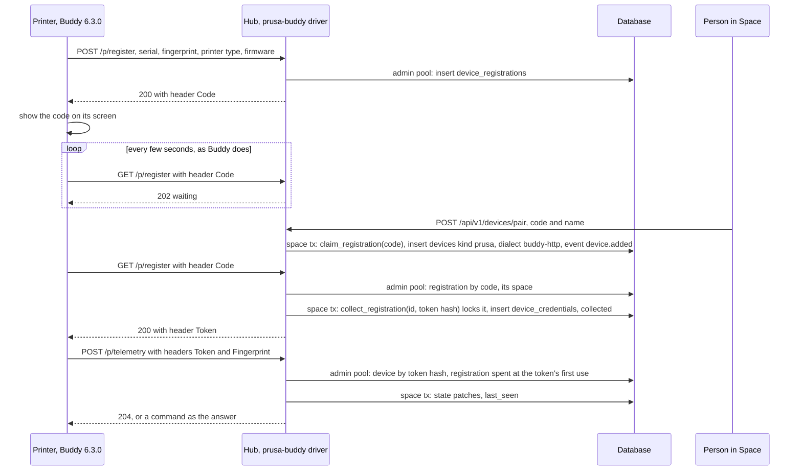
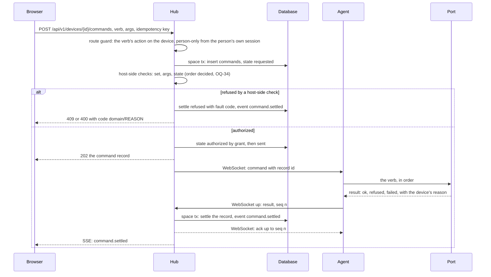
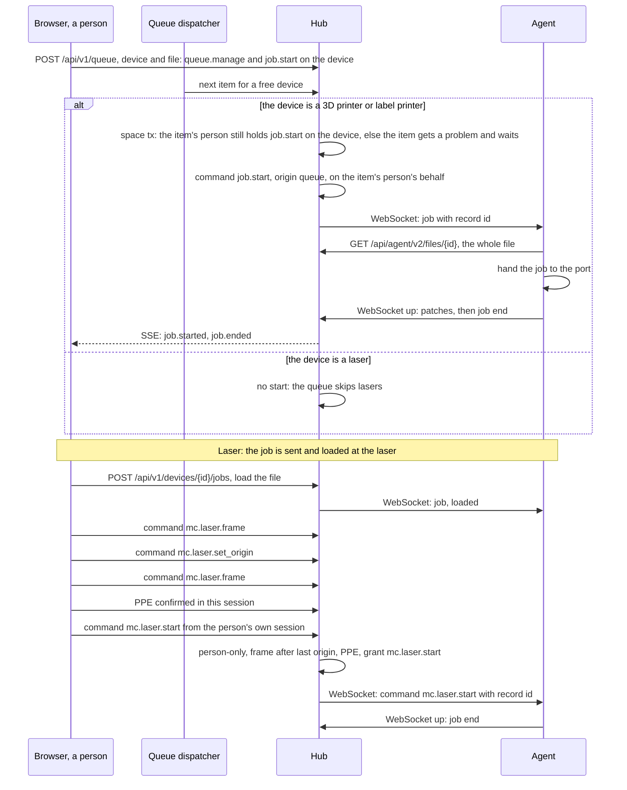
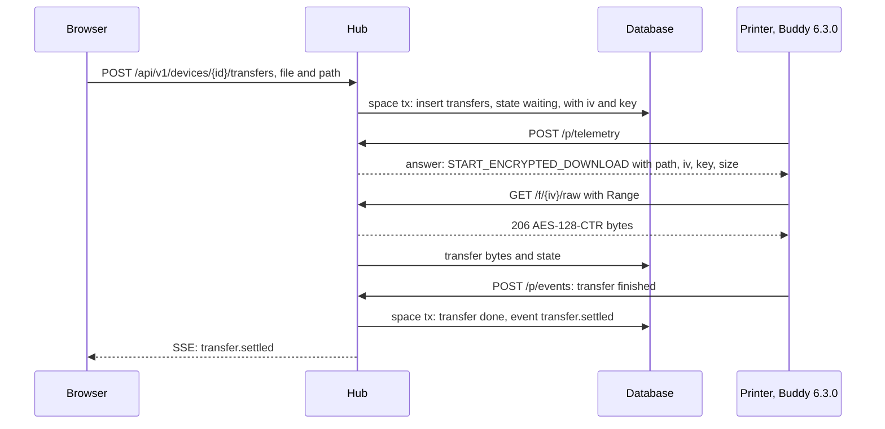
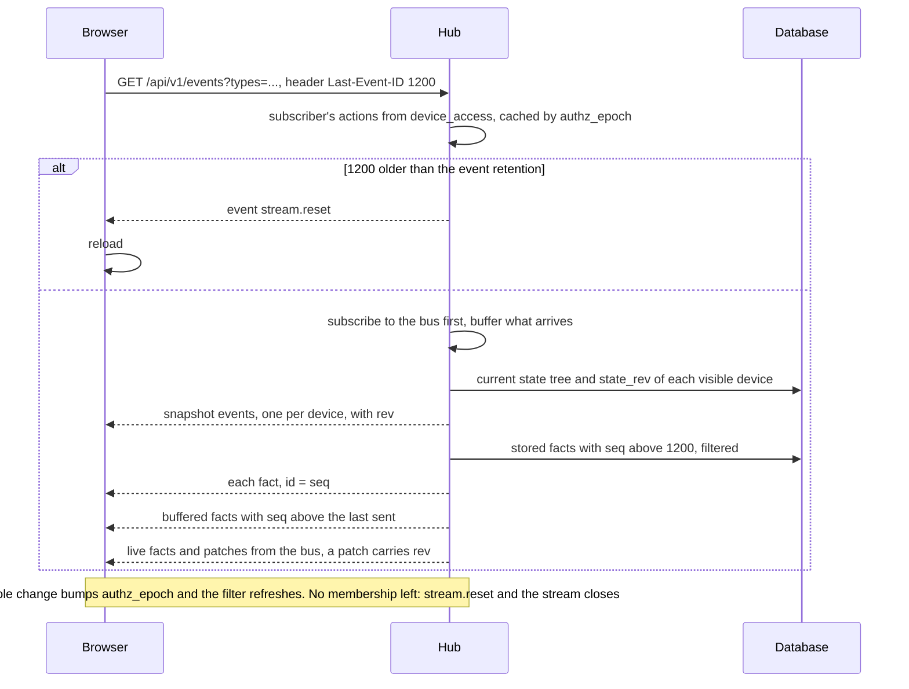
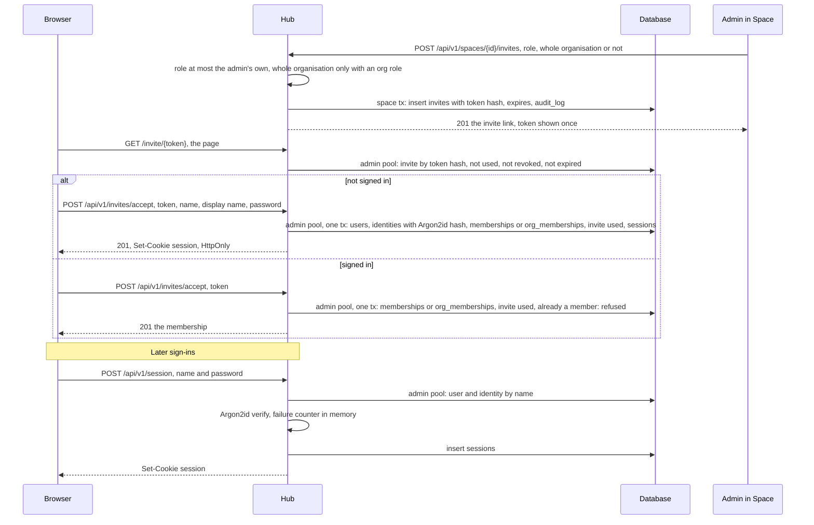
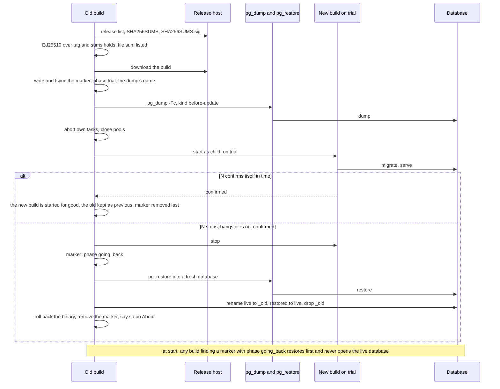
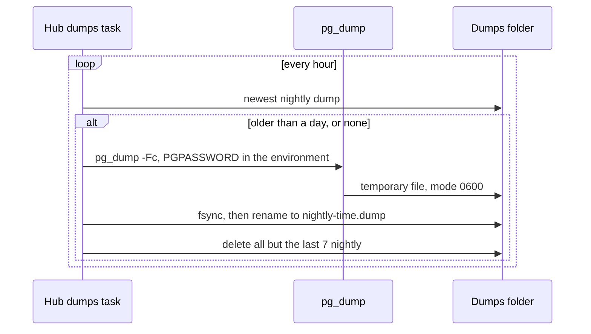

# Flows

The main flows end to end. Links (L1…) are in [links.md](links.md), endpoints in [api.md](api.md),
agent messages in [wire.md](wire.md). Every hub step that touches tenant rows runs in a transaction
with `SET LOCAL app.space_id`; a lookup before the space is known runs on the admin pool
([database.md](database.md#roles-and-pools)).

## 1. Pairing a device on an agent

The agent registers once for its link and then each device it hosts; a person adds each device in
Space with the code the agent shows (registering as today, agent-engine.md O7; tables `agents`,
`device_registrations`, plan §2.7; [decision](decisions/20261119-agent-link-identity-and-delivery.md)).
The first registration carries no token and yields the agent token with the first device; every
further one carries the agent token and yields only the device. A device that already has a row is
paired again by the person, who picks "this is MINI-1 again": the row gets the new `agent_id` and keeps
its history and grants, never automatically ([decision](decisions/20261119-re-pairing-by-the-person.md)).

## 2. A Prusa printer registers (Buddy 6.3.0)

**Shelved:** v2 builds only the websocket dialect (Buddy 6.4+: `/p/register`, `/p/auth`, `/p/ws`;
[decision](decisions/20261119-buddy-websocket-dialect-only.md)); this flow and flow 5 are kept as the
record of the 6.3.0 dialect until the Buddy driver (V2-DEVICES step 3) draws the websocket one.
As Buddy 6.3.0's registrator does it (`reference/buddy-6.3.0` `src/connect`, audit
`docs/audits/buddy.md`). The token is kept in the registration until its first use, so a printer that
asks again gets the same token ([decision](decisions/20261119-prusa-token-until-spent.md)).

## 3. A command: click to settled

A hub restart turns every open record into `outcome unknown`; nothing is re-sent (plan §2.5). An
agent that is offline keeps results in its outbox and sends them when it is back; the hub accepts
each seq once, per agent and stream, and applies each item by its own key, so a repeated batch
changes nothing. The agent keeps the ids of the commands it took, with their results, until the hub
acknowledged them, and never runs one twice; on a reconnect on the same stream the hub re-sends the
open records of that stream on the new WebSocket. A result that arrives after the record was settled `unknown` is kept
as a late result and never acted on ([wire.md](wire.md#shape)).

## 4. A job, with the laser rule

A job's start, pause and stop are command records (plan §2.5). The queue may start a job on a 3D
printer or a label printer; it never starts a laser. The job's state follows from those records and
the device's job end ([database.md](database.md#files-jobs-queue-and-farm)). A dispatcher never
starts what its person may not: a queue item is started on behalf of the person who queued it
(`machine_queue.by_user`), and the dispatcher checks that person's `job.start` on the device in the
space transaction before each start; without it the item keeps a `problem` and waits (`by_user` is
not null: every item has the person who queued it). The farm dispatcher starts
on behalf of the person who switched the farm on for that device (`devices.settings.farm_on_by`, set
with `device.manage` in the same write that switches the farm on, and cleared when it is switched off), with the same check and the same wait with a `problem` shown on the Now page.

## 5. A file to a printer

For an agent device the file is fetched whole before the job is handed on (agent-engine.md O6). For a
Prusa printer the file goes as Buddy's encrypted download; the transfer is a durable record like a
command (bytes, state, reason; plan §2.5).

## 6. SSE resume (browser)

## 7. Sign-in and invite

On a fresh database the hub logs a one-time setup code; `/setup` with that code makes the first
account, its organisation and space.

## 8. Self-update, dump and the way back

Changes made after the update started are lost on the way back
([decision](decisions/20261119-database-dumps.md)).

## 9. The nightly dump

