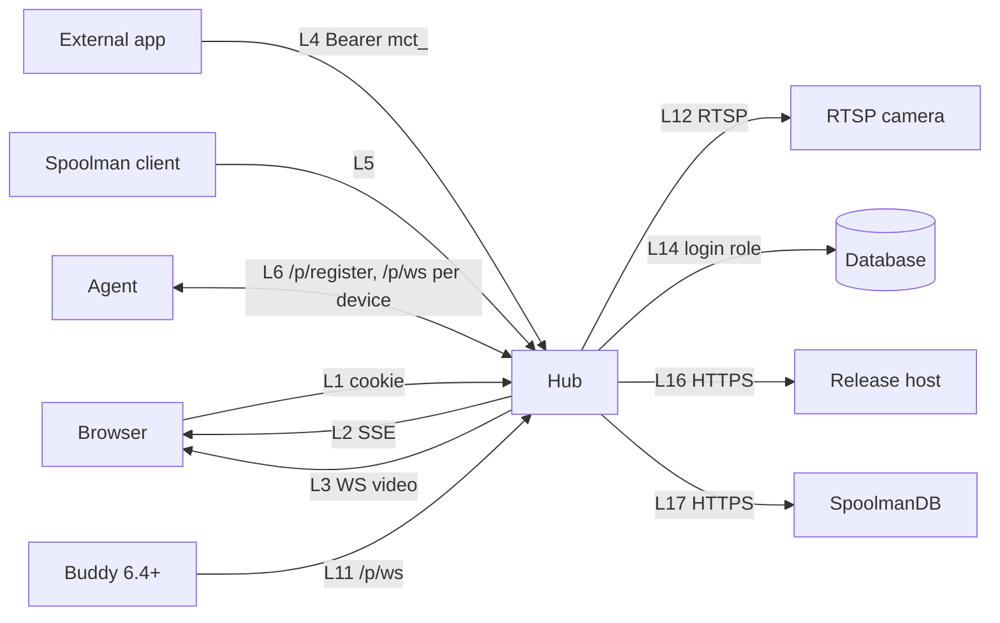

# Links

Every link between two processes: what carries it, which way it goes, how the caller proves who it
is, and which reference it follows. Flows over these links are in [flows.md](flows.md); endpoints in
[api.md](api.md); the agent's messages in [wire.md](wire.md).

## The links

| # | From → to | Transport | Paths | Authentication | Reference | Source |
|---|---|---|---|---|---|---|
| L1 | Browser → hub | HTTP/1.1 | pages, `/api/v1/*` | session cookie (HttpOnly) set at sign-in (a further Origin check: [OQ-30](risks-and-open.md#oq-30-origin-check-on-state-changing-requests)) | ours | plan §2.6, §2.9 |
| L2 | Hub → browser | SSE over HTTP | `/api/v1/events` | session cookie, or an API token in its own space | ours (event envelope) | plan §2.4 |
| L3 | Hub → browser | WebSocket, binary fMP4 fragments, MSE player | `/api/v1/cameras/{id}/ws` | session cookie; `device.view` on the camera checked before the upgrade | go2rtc v1.9.15 `internal/mp4/ws.go`, `www/video-rtc.js` | cameras.md |
| L4 | External app → hub | HTTP | `/api/v1/*` | `Authorization: Bearer mct_…`: an API token, stored hashed, with scopes, expiry, last use and the person's generation | ours | plan §2.6, §2.8 |
| L5 | Spoolman client → hub | HTTP + WebSocket | `/spoolman/api/v1/*` | open: [OQ-7](risks-and-open.md#oq-7-how-spoolman-clients-authenticate) | Spoolman `eccb05e` with base path `/spoolman` | plan §2.8 |
| L6 | Each device on an agent → hub, as a Prusa Connect printer | HTTP to register; then one WebSocket per device, JSON text frames up (telemetry, events), `J`/`G`/`F` frames down; ping and pong | `/p/register`, `/p/ws` | `Code` header while registering; then `Fingerprint` and `Token` headers on the upgrade, no subprotocol ([wire.md](wire.md#the-websocket)) | Prusa-Connect-SDK-Printer `websockets` @ `c0d7d233` (client, ported), PrusaLink `websockets` @ `171148ce` (its use); server answers read in `reference/prusa-connect` `internal/connector/xbuddy` ([decision](decisions/20261120-agent-link-is-prusa-connect-protocol.md)) | owner ruling 2026-11-19 |
| L7 | (not used) | folded into L6: commands travel on the device's WebSocket | | | | |
| L8 | (not used) | folded into L6: a device registers over `/p/register`; a person enters its code in Space | | | | |
| L9 | (not used) | our file and update routes are gone; files come with the drivers as the SDK fetches them, the agent's update is [OQ-46](risks-and-open.md#oq-46-how-the-agents-own-update-reaches-it) | | | | |
| L11 | Prusa printer, Buddy 6.4+ → hub | HTTP + WebSocket | `/p/register`, `/p/auth`, `/p/ws` | `Code` header while registering; then `Fingerprint` and `Token` headers on the upgrade, `Sec-WebSocket-Protocol: prusa-connect` (`reference/buddy-6.4.0` `src/connect/connect.cpp:151-189`); the only Buddy dialect ([decision](decisions/20261119-buddy-websocket-dialect-only.md)) | Buddy 6.4+; server side read in `reference/prusa-connect` `internal/connector/xbuddy` | plan §2.2 |
| L12 | Hub → network camera | RTSP over TCP | the camera's stream URL | the camera's user and password, kept by the hub | retina `2b6b7fe` (0.4.22) | cameras.md |
| L13 | Agent → device | USB HID, USB printer class, serial, CUPS | per port | none (local) | the port's one reference (device-contract.md) | `CLAUDE.md` |
| L14 | Hub → database | PostgreSQL wire, TLS off on `127.0.0.1` or a Unix socket | `DATABASE_URL` | the hub's login role, neither superuser nor table owner ([database.md](database.md#roles-and-pools)) | sqlx 0.9 | plan §2.6, §2.7 |
| L15 | Hub → dump tools | child process, stdin/stdout | `pg_dump -Fc`, `pg_restore`, `psql` | `PGPASSWORD` in the child's environment, never on the command line | PostgreSQL client of the server's major version | [decision](decisions/20261119-pg-client-no-docker-rights.md) |
| L16 | Hub → release host | HTTPS GET | the release list, `SHA256SUMS`, `SHA256SUMS.sig`, the build | none; the build is taken only when the Ed25519 signature over `<tag>\n<SHA256SUMS>` holds and the file's sum is listed | ours (`crates/update`) | storage-ops.md |
| L17 | Hub → SpoolmanDB | HTTPS GET | the public catalogue | none | SpoolmanDB | hub-modules.md A3 |
| L18 | Hub → event bus → subscribers | in-process broadcast | none | in-process | ours | plan §2.4 |
| L19 | Hub page → hub | same origin | `/laser-design/*` (LaserFoundry web fork, gzip in the binary) calling `/api/v1` | session cookie | LaserFoundry v0.5.0 fork | hub-side.md HS13 |

Not in v2 (parked by the plan, §3): the SimplyPrint/Moonraker route for Klipper, out-of-process drivers
over Prusa's plugin wire. The MK3 is the `prusa` kind on the agent, ported from PrusaLink's `websockets`
branch; it reaches the hub over L6 like every device on an agent, which is `/p/ws` as PrusaLink speaks it
([OQ-45](risks-and-open.md#oq-45-how-the-mk3-port-reaches-the-hub), decided). Open: how USB
camera frames reach the hub ([OQ-9](risks-and-open.md#oq-9-how-usb-camera-video-reaches-the-hub)),
door access hardware ([OQ-10](risks-and-open.md#oq-10-door-access-link)).

## Who talks to whom

## Rules on every link

- What the request log redacts is [OQ-31](risks-and-open.md#oq-31-log-redaction-and-urls-a-device-hands-the-hub).
- A secret is stored hashed where the other side only presents it (sessions, API tokens, device
  tokens, invites). Secrets the hub must present itself (a camera's password)
  are stored as the owner decided for cameras (plain, cameras.md, 2026-11-16).
- Every request that changes data runs in one transaction with `SET LOCAL app.space_id` for the
  caller's space ([authz.md](authz.md#tenancy)).
- Whether the hub fetches a URL a camera or a printer hands it: [OQ-31](risks-and-open.md#oq-31-log-redaction-and-urls-a-device-hands-the-hub).
