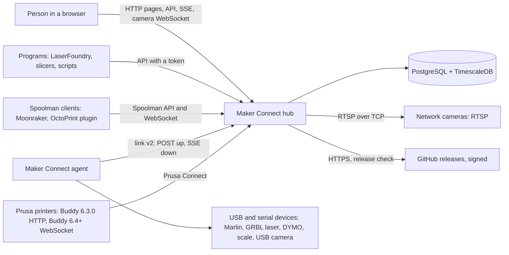

# Overview

## What Maker Connect is

Maker Connect is a "Prusa Connect for all maker machines": 3D printers, lasers, label printers, scales
and cameras of a makerspace (later CNC, cutting plotters, paper printers), with files, jobs, queues, a
print farm, materials and stock. It is self-hosted (a Pi, an old laptop, a NAS) and shaped for a
multi-tenant hosting later: organisations hold spaces from day one. AGPL-3.0, all Rust.

Two programs:

- **The hub** (`maker-connect-hub`): the server. It keeps the database, serves the web UI and the
  public API, hosts the devices that talk to it directly (Prusa printers over Prusa Connect, network
  cameras over RTSP) and the agents' links.
- **The agent** (`maker-connect-agent`): a program next to machines on USB or serial. It hosts one
  session per device, each driven by a port that follows one reference to the letter, and links to
  the hub.

The hub core v2 is built around **one device contract** (every machine is a device with an identity,
declared capabilities and states, a state tree changed by patches, and commands that are durable
records), **one event envelope** (stored, resumable over SSE), **actions within a Space** filtered in
SQL, and **one store**: PostgreSQL with TimescaleDB (plan §1).

The building blocks inside hub and agent, and the transport of every arrow, are the
[system architecture](architecture.md); the diagram below is only the context.

## Glossary

| Term | Meaning |
|---|---|
| Organisation | A tenant. Holds one or more spaces; its members count in all its spaces. |
| Space | A makerspace (or a home). Every tenant row belongs to one space (`space_id`); permissions are set in its Space page. |
| Member | A person with a role in a space or an organisation: owner, admin, member, guest. |
| Device | A machine or camera the hub knows: one identity, one kind, one current state tree. |
| Kind | `marlin`, `prusa` (Buddy), `grbl`, `labelmanager`, `labelwriter`, `scale`, `camera`: which state set and verb set apply. |
| Capability | A verb with typed arguments (kind, unit, bounds) that a device declares. |
| Epoch | A counter that changes when a device's enabled capability set changes. |
| State set | The states of a kind, which verbs each state accepts. |
| State tree | A device's current values (JSON object), changed only by patches. |
| Patch | `{path, value}`; `null` removes the path. |
| Command | A request for one verb on one device, a durable record from request to outcome. |
| Fault | A coded refusal or failure, `domain/REASON` (registry). |
| Event | A stored fact with a global `seq`, published on the bus and over SSE. |
| Action | A named right (`device.move`, `mc.laser.start`, …). Each verb names the action it needs. |
| Preset | A named set of actions (View, Use, Operate, Manage; the roles). |
| Grant | An action set given to a person or group on a device or device group, with an expiry. |
| Driver | Code that speaks a device's protocol inside the hub (Prusa). |
| Port | Code in the engine that speaks a device's protocol inside the agent, a port of one reference. |
| Host | What runs device sessions: the hub (in-process drivers) or an agent (ports). |
| Reference | The one proven, working program a port or driver follows to the letter. |
| Module | A part of the hub with its own migrations, routes, registry entries and Cargo feature. |
| Access | Physical: doors and badges. Not machine permissions. |
| Permissions | Who may use which machine: grants of actions. |

## Rules every part obeys

1. **One reference to the letter** (`CLAUDE.md`). Everything that talks to a machine or another
   program does exactly what one proven reference does: bytes, order, timing, quirks. A capability verb
   maps to the reference's own call; a verb the reference has no call for is not declared (plan §2.1).
   Our own limits live in host-side validation and the UI, never on the wire to the device.
2. **The hub makes no G-code** for agent devices; the port does, from its reference
   (agent-engine.md D9).
3. **A laser never starts unattended.** `mc.laser.start` is accepted only from a person's own session,
   never from the queue or a token ([decision](decisions/20261118-damaging-actions-by-grant.md),
   plan §2.1). A laser job is sent and loaded, then the person frames, sets the origin, frames again,
   and presses Start burn.
4. **Access is not permissions.** Door access (doors, badges) is its own module with its own tables
   and actions; it never grants machine actions, and machine grants never open doors (plan §2.6).
5. **Permissions only in Space.** No button or route outside the Space page grants an action, the
   owner's own included.
6. **Server to browser is SSE**; browser to server is HTTP. Camera video is the one WebSocket, as the
   browser-side reference (go2rtc) does it (cameras.md).
7. **One subject per page or tab** in the UI.
8. **No compatibility with old builds**: nobody uses the hub; old code is deleted, not wrapped (plan §1).
   No v1 is kept anywhere: not the agent link v1 (`/api/agent/v1`), not the Apps API v1
   (`/api/apps/v1`), not v1 machines or old pages; no fallback and no transition for old agents
   (owner, 2026-11-19: "geen oude v1 meer. er is toch niets en niemand actief").
9. **Firmware versions are labels**, never compared; behaviour follows declared capabilities.
