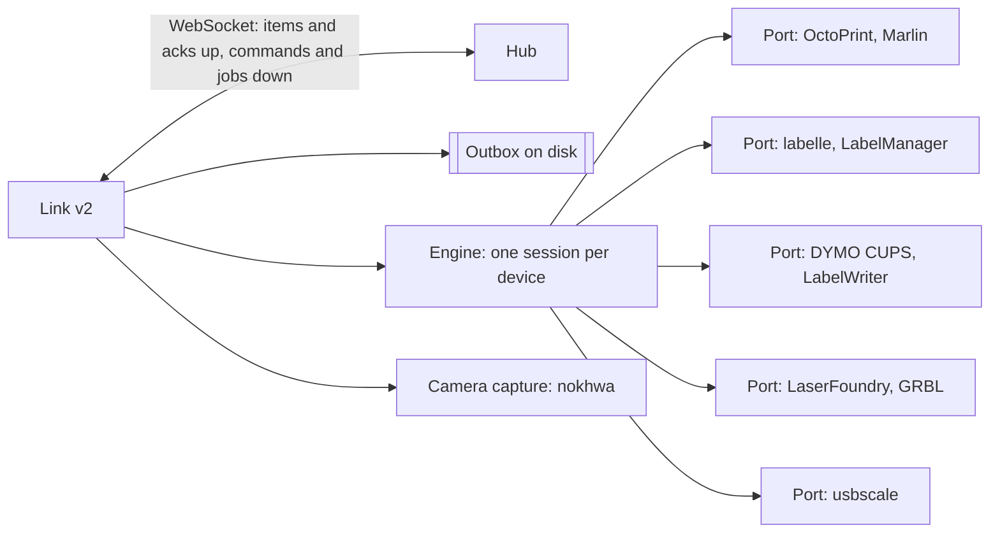

# Processes

Every process of a running Maker Connect, the children it starts and the tasks inside it. Each part
names the block of [architecture.md](architecture.md) it belongs to.

## Deployment

The deployment view is in [architecture.md](architecture.md#deployment).

## Processes

| Process | Binary | Host | Listens | Started by | Notes |
|---|---|---|---|---|---|
| Hub | `maker-connect-hub` | hub host, native | one HTTP listener, `--listen` (default `0.0.0.0:8460`) | system unit `maker-connect-hub.service`, `User=maker-connect`, not in `docker` ([architecture.md](architecture.md#deployment)) | Talks to Postgres only through `DATABASE_URL` ([decision](decisions/20261119-database-url-only.md)). |
| Hub on trial | the new `maker-connect-hub` | hub host | the same listener, taken over | the running hub during a self-update | Runs as the old build's child until it confirms itself; see [storage-ops.md](storage-ops.md). |
| Database | `postgres` in `timescale/timescaledb:2.32.0-pg17` | hub host | `127.0.0.1:5432` or a Unix socket, never the LAN | Docker, `--restart unless-stopped`, confined by AppArmor `docker-default` | Limits on the 1 GB Pi: 384 MiB, `shared_buffers=64MB`, `work_mem=4MB`, `max_connections=20` (plan §2.7). arm64/amd64 hosts may use TimescaleDB's apt packages instead. |
| Dump and restore tools | `pg_dump`, `pg_restore`, `psql` | hub host, on the hub's `PATH` | none | the hub, as children | The server's major version; on Debian 11 armhf built from PostgreSQL's source; the hub has no Docker rights ([decision](decisions/20261119-pg-client-no-docker-rights.md)). |
| Agent | `maker-connect-agent` | next to the machines (Linux, macOS, Windows) | none (outbound only) | a service per agent host | One session per device; see below. |
| Agent on trial | the new `maker-connect-agent` | agent host | none | the running agent, `--version` trial | Confirmed once the hub answered it (`crates/update`). |
| Browser | any | anywhere on the LAN | none | a person | Pages, `/api/v1`, `/api/v1/events` (SSE), the camera player (MSE over WebSocket). |
| Prusa printer | Buddy firmware | the printer | none | the printer's Connect settings pointing at the hub | 6.4+ over `/p/ws`; 6.3.0 over HTTP shelved (plan §2.2). |
| Network camera | the camera | LAN | RTSP | the camera | Reached by the hub over RTSP/TCP; hub's LAN only (cameras.md). |
| Spoolman clients | Moonraker `[spoolman]`, OctoPrint's Spoolman plugin, Mainsail, Fluidd, KlipperScreen | their own hosts | none | their operators | Pointed at `http://hub/spoolman` (plan §2.8). |
| External apps | LaserFoundry desktop, scripts | anywhere | none | a person | `/api/v1` with an API token. |

## Inside the hub

The hub is one tokio process. Its parts:

| Part | Kind | What it does | Module | Block |
|---|---|---|---|---|
| HTTP server (axum) | listener | Pages, `/api/v1`, `/spoolman/api/v1`, `/api/agent/v2`, `/p/*`, files, camera WebSockets | core | API, Web UI pages, Device host |
| Route guard | middleware | Every route names its action; an unknown route is refused (plan §2.6) | core | Route guard and authz |
| Store handle | shared value | Two pools (app, admin), the event bus, small in-memory maps with their own locks | core | Store |
| Event bus | in-process broadcast | Carries facts and state patches to SSE subscribers, the history subscriber and Spoolman's WebSockets (plan §2.4) | core | Event bus and SSE |
| Event writer | in the request's transaction | Takes `pg_advisory_xact_lock` of the event key, draws `seq`, writes the fact to the `event` hypertable; it publishes nothing ([decision](decisions/20261119-event-order.md)) | core | Event bus and SSE |
| Event relay | task | Woken by `NOTIFY` from each writing transaction, reads the committed facts with `seq` above the last it published, in order, and publishes them on the bus: the only publisher of facts (admin pool, allowlist #4). State patches reach the bus from the Device host directly, each after the transaction that stored it and raised `state_rev` committed | core | Event bus and SSE |
| History subscriber | task | Takes state patches off the bus, writes `sample` rows and `gap` rows (plan §2.7) | history | History subscriber |
| Command sweep | at start | Every open command record becomes `outcome unknown`; nothing is re-sent (plan §2.5) | commands | Command records |
| Device host | in-process | Hosts driver sessions (Prusa `prusa-buddy`, both dialects) and accepts agent sessions through one `Host` boundary (plan §2.3) | devices, prusa | Device host |
| Camera sessions | task per RTSP camera | retina's RTSP session, frames broadcast to viewers, GOP kept since the last key frame (cameras.md) | cameras | Camera sessions |
| Queue dispatcher | task | Starts the next queued job on a free device. The queue never starts a laser; a laser job waits for a person's Start (plan §2.1) | queue | Modules |
| Farm dispatcher | task | Picks parts for farm devices after Set Ready | farm | Modules |
| Virtual devices | task per device | Simulated devices through the same ports | virtual | Device host |
| SpoolmanDB fetch | task, hourly | Fetches the public filament catalogue | spoolman | Modules |
| Dumps | task, hourly check | A nightly dump when the last is a day old; prunes to `--keep-dumps` ([decision](decisions/20261119-database-dumps.md)) | core | Dumps and self-update |
| Update supervisor | task | Checks signed releases, takes a dump, starts the new build on trial, goes back if needed | core | Dumps and self-update |

In memory on purpose (plan §2.7): PPE confirmations, "framed since last origin", "origin set since
start", sign-in failure counters, the per-subscriber action cache keyed by `authz_epoch`, camera GOPs.
Everything else that must survive a restart is in the database.

## Inside the agent

| Part | Kind | What it does | Block |
|---|---|---|---|
| Link v2 | thread | One WebSocket to the hub: upstream items with a sequence the hub acknowledges; commands, jobs, answers and updates on the same socket; ping and pong (plan §2.3, [wire.md](wire.md)) | Link v2 with outbox |
| Outbox | on disk | Unacknowledged upstream items, kept across reconnects and restarts | Link v2 with outbox |
| Engine | library | One session per device, in order (agent-engine.md O1, O2) | Engine |
| Ports | thread per device | Each the port of one reference (OctoPrint, labelle, DYMO CUPS, LaserFoundry, usbscale) | Ports |
| Camera capture | thread per USB camera | nokhwa 0.10.11, MJPEG passed through (cameras.md) | Camera capture |
| Downloads | thread | A job's file fetched whole before the job is handed on, at most 512 MB (agent-engine.md O6) | Link v2 with outbox |
| Self-update | in the link | Signed releases from the hub's own download route, `--version` trial | Link v2 with outbox |

