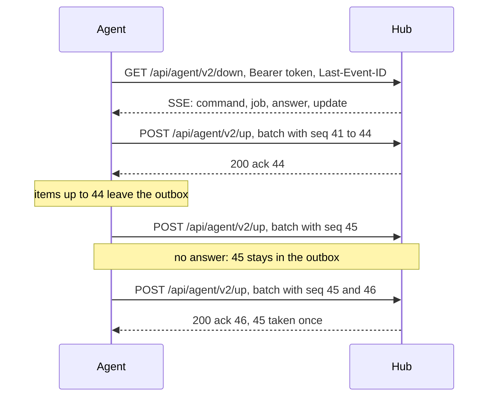

# Agent link v2: the wire

Ours, not in the public spec (plan §2.3, §2.8). Replaces `/api/agent/v1` and the 2-second report
loop. The content of each message is the plan's; the JSON names below are this design's and become
the generated schema (`schemars` from `crates/protocol`) in step 4
([OQ-18](risks-and-open.md#oq-18-agent-link-details)).

## Shape

- **Identity:** one agent token for the link (`agents`); the agent's devices are paired one by one
  under it, each with its own registration and code ([decision](decisions/20261119-agent-link-identity-and-delivery.md)).
- **Stream:** the agent makes a random `stream` uuid together with its outbox and sends it in every
  up body and in the down query. A new stream (a reinstalled agent, a lost outbox) resets the hub's
  cursor for that agent and settles the old stream's open command records as `outcome unknown`.
  The hub takes a new stream only while no down connection of the current stream is open; otherwise
  `409 agent/STREAM_IN_USE`, and the agent retries after the keepalive interval
  ([OQ-18](risks-and-open.md#oq-18-agent-link-details)). So two hosts with one token cannot reset each
  other, and a clone of an agent is refused rather than let in. A reconnect **on the same stream**
  while the old connection is still open (a network drop the hub has not noticed) replaces the old
  connection without a reset: no record is settled by it
  ([decision](decisions/20261119-agent-link-identity-and-delivery.md)).
- **Upstream:** POST batches. Each item has an agent-wide `seq`; the hub keeps the highest applied
  seq per agent and stream (`agents.up_seq`), answers with it, and takes each seq once. Items are
  applied idempotently by their own key (the command id, the job id, the capability epoch, the state
  rev); the cursor advances after the items' space transactions have committed. Unacknowledged
  items stay in the on-disk outbox across restarts.
- **Downstream:** one SSE stream per agent, so a command arrives at once; `Last-Event-ID` resumes it.
  On a (re)connect on the same stream the hub re-sends the open command records it sent on this
  stream. The agent keeps an on-disk set of taken command ids with their results until acknowledged
  and never runs a taken id twice.
- **A late result** (after the hub settled the record `unknown`) is stored on the record as
  `late_outcome`, `late_reason`, `late_at`: shown, never acted on; the outcome stays `unknown`.
- The agent token may only report and fetch for its own devices.

## Registration

| Message | Direction | Fields |
|---|---|---|
| `RegisterRequest` | agent → hub, `POST /api/agent/v2/register`; without a token the first time, with the agent token for every further device | `kind` string, `identity` Identity, `fingerprint` string, `agent` AgentInfo |
| `RegisterAnswer` | 201 | `registration_id` uuid, `code` string (the pairing code), `secret` string (once), `expires_at` time |
| `CollectAnswer` | `GET /api/agent/v2/register/{id}` with the secret | 202 while waiting; 200 once approved, once: `{token, device}` for the agent's first registration (the agent token, shown once), `{device}` for every further device; 410 expired |

## Upstream items (`POST /api/agent/v2/up`)

Body: `{"agent": AgentInfo, "stream": uuid, "items": [Item…]}`. Answer: `{"ack": integer}` (the highest
seq applied on this stream).

| Item `type` | Fields | When |
|---|---|---|
| `hello` | `seq`, `device` uuid, `identity` Identity, `capabilities` CapabilitySet, `state_set` StateSet | a session opens, or its set changes (new epoch) |
| `patch` | `seq`, `device`, `time`, `rev` integer (the device's state rev after these patches), `patches` [Patch] | the state tree changed |
| `result` | `seq`, `device`, `command` uuid (the hub's record id), `outcome` (`ok`, `refused`, `failed`), `fault` string or null, `reason` string or null, `output` string or null | a command settled at the device |
| `job_end` | `seq`, `device`, `job` uuid, `outcome` (`done`, `stopped`, `failed`), `reason` string or null, `lines` integer or null | a job ended |
| `offline` | `seq`, `device`, `why` string | the port says the device went away |
| `camera_frame` | open ([OQ-9](risks-and-open.md#oq-9-how-usb-camera-video-reaches-the-hub)) | — |

## Downstream events (`GET /api/agent/v2/down?stream=<uuid>`, SSE)

| Event | Fields | Meaning |
|---|---|---|
| `command` | `id` uuid (record id), `device`, `verb`, `args` object | run this verb; answer with a `result` |
| `job` | `id` uuid, `device`, `file` {`id`, `name`, `size`}, `from_line` integer or null | fetch the file whole (`GET /api/agent/v2/files/{id}`, at most 512 MB), then hand the job to the port; a laser job is loaded, not started |
| `answer` | `device`, `dialog` string, `button` string | a person's answer to a device's question |
| `update` | `tag` string | a signed agent release to take (`GET /api/agent/v2/update/{tag}/{file}`) |

## Shared types

| Type | Fields |
|---|---|
| AgentInfo | `version` string, `os` string, `arch` string |
| Identity | `vendor`, `model`, `firmware_label`, `serial`, `unit_uid`: strings or null |
| CapabilitySet | `epoch` integer, `verbs` [Verb] |
| Verb | `name` string (registry), `args` [Arg] |
| Arg | `name`, `kind` (string, number, integer, boolean, opaque), `unit` or null, `bounds` or null, `required` boolean |
| StateSet | `states` [{`name`, `accepts` [verb names]}], `transitions` [{`from`, `to`, `verb`}] |
| Patch | `path` string (JSON pointer), `value` any JSON, `null` removes |

The agent's own values (report pace, retry, download progress, the update trial) are ours, as
approved for the agent (agent-engine.md O4-O7); what goes to a device is the port's alone.
